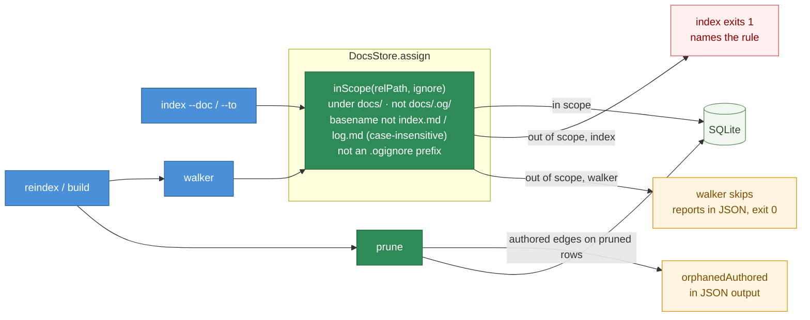

# DESIGN-20261117-7931: OKF-Compatible Knowledge Base — Evaluate: Decision 4, OG scope guard

_Produced by the 🏗 Evaluate phase. This is the judgment artifact. Options come from `01 Research - OG Scope Guard.md`._

**Step 1b outcome (all decisions):** Assumption #18 proposed. The DB migrates inside OG on open via `PRAGMA user_version`. A deterministic `cli.mjs migrate` rewrites frontmatter and detects pending work by OG-era keys. `reindex-graph` runs it before `build`. Reads accept both key names until a project is migrated. Greenfield starts at v1; an already migrated project is a no-op. The Product folder from launch Q10c is written to an OG config file. Assumption #19: bundle options 1, 3 and 5 depend on a VitePress rewrites spike; Option 6 does not need rewrites.

Options:

- **A** — Minimal guard at the `index` command, manual migration.
- **B** — One scope predicate at the single write path, built-in rules, guarded prune, cleanup command.
- **C** — gitignore-style `.ogignore`.
- **D** — Allow-list by tier root, as a config list in constants.

## Requirements × Options Matrix

✅ satisfies · ⚠️ partially (see note) · ❌ does not satisfy

| Criterion                                            | A guard in `index()`   | B predicate at `assign`                                  | C gitignore `.ogignore`                 | D tier allow-list           |
| ---------------------------------------------------- | ---------------------- | -------------------------------------------------------- | --------------------------------------- | --------------------------- |
| EC2 never `index.md`, no override                    | ✅                     | ✅                                                       | ⚠️ only if hardcoded (collapses to B)   | ✅                          |
| EC3 never outside `docs/`, every caller              | ❌ `assign` stays open | ✅                                                       | ✅                                      | ✅                          |
| Untiered docs under `docs/` stay                     | ✅                     | ✅                                                       | ✅                                      | ⚠️ needs an extra-path list |
| EC7 no silent loss in consuming projects             | ❌ runbook only        | ✅ prune reports orphaned authored edges, plus `migrate` | ❌                                      | ⚠️                          |
| EC9 loud on `index`, tested                          | ✅                     | ✅                                                       | ✅                                      | ✅                          |
| Report-only on build (developer)                     | ✅                     | ✅                                                       | ✅                                      | ✅                          |
| `.ogignore` stays project-owned (no merge conflicts) | ✅                     | ✅                                                       | ❌ canonical defaults in a project file | ✅                          |

## Tradeoffs

| Dimension              | A                  | B                           | C                                  | D                |
| ---------------------- | ------------------ | --------------------------- | ---------------------------------- | ---------------- |
| Operational Excellence | ⚠️ manual runbook  | ✅ one rule                 | ⚠️ pattern edge cases              | ⚠️ scope shrinks |
| Security               | ⚠️ open write path | ✅ single check at the sink | ✅                                 | ✅               |
| Reliability            | ❌ silent prune    | ✅                          | ⚠️                                 | ⚠️               |
| Performance Efficiency | ✅                 | ✅                          | ✅                                 | ✅               |
| Cost Optimization      | ✅                 | ✅                          | ⚠️                                 | ✅               |
| Sustainability         | ✅                 | ✅                          | ✅                                 | ✅               |
| Integration Complexity | ✅                 | ⚠️ edge-type ripple         | ❌ patch merge into a project file | ⚠️               |
| Vendor Lock-in         | ✅                 | ✅                          | ✅                                 | ✅               |

## Recommendation

**Recommended option: Option B — One scope predicate at the single write path**

### Predicate rules

- `inScope(relPath, ignore)` lives in `utils.mjs`. `DocsStore.assign` and the walker both call it.
- The rules are built in and not configurable:
  - the path is under `docs/`;
  - the path is not under `docs/.og/`;
  - the basename is not `index.md` and not `log.md`. Both are OKF-reserved. The compare is case-insensitive;
  - the path does not match an `.ogignore` prefix.
- `.ogignore` stays prefix-only and project-owned.
- `.og/` and the reserved names are hardcoded. So EC2 and EC3 are platform guarantees, not project settings.

### Failure modes

- `index --doc` or `--to` on an out-of-scope path exits non-zero. The message names the rule that failed.
- `reindex` and `build` filter with the same predicate. They report scope violations in their JSON output and exit 0 (developer decision). A CI docs build is never blocked by a scope violation.

### Prune safety

- Authored (`derived=0`) edges that touch a pruned row are listed as `orphanedAuthored` in the JSON output.
- Prune never removes them silently. So EC7 holds even if a consuming project rebuilds before it migrates.

### `AppReadme` and `impl-to-readme` retirement

- Retire the `AppReadme` tier and `APP_README_PATTERN`.
- Retire the `impl-to-readme` edge type. The 2 existing edges into `docs/README.md` are re-typed `references`.
- `/dev document` records app README updates in its report only. It no longer calls `index` for them.
- Graph Explorer `edgeGroup()` and the OG docs drop to five graduation types.

### Cleanup via `migrate`

Cleanup runs inside Decision 2's `migrate` command. It does three things:

1. Moves each index page's `id` to its new overview page (Decision 3). The graduation edges keep their target.
2. Strips `id:` from `index.md` files.
3. Strips OG-shaped `id:` values (`^[0-9a-f]{8}(-\d+)?$`) from tracked `.md` files outside `docs/`. It strips only when no row owns the id and `id` is the only frontmatter key. Otherwise it reports the file and leaves it alone.

### Why, and why not the others

- B is the only option that guards every caller (EC3). It also keeps EC7 when a consuming project rebuilds before migrating.
- A leaves `assign` open, so any programmatic caller can still leak. Its migration is a manual runbook.
- C's project override weakens EC2. Its default lines need a patch merge into a project-owned file.
- D shrinks scope beyond what EC3 asks. Untiered docs under `docs/` need an extra-path list.

### Falsifiability

If a consuming project needs another reserved basename, this becomes a one-line built-in change in canonical. The predicate design still holds.

**Open questions to resolve before implementation:**

| #    | Question                                                                           | Owner                             | Impact if unresolved                                   |
| ---- | ---------------------------------------------------------------------------------- | --------------------------------- | ------------------------------------------------------ |
| OQ-1 | Retarget or drop list for `references` edges whose source index page is not moved. | dev, during the `migrate` dry-run | Edges show up as `orphanedAuthored`; no silent loss    |
| OQ-2 | Case-insensitive basename compare behaves the same on Linux CI.                    | dev                               | A `Index.md` could slip into the graph on one platform |

Research open questions deferred to Evaluate, now settled:

| Research OQ                                                   | Outcome                                                                                      |
| ------------------------------------------------------------- | -------------------------------------------------------------------------------------------- |
| 7 — real destinations of the 4 graduation edges               | No retarget needed. `migrate` moves the index page's `id` to its overview page (Decision 3). |
| 8 — retarget the ~10 `references` edges one by one or in bulk | Decided per edge in the `migrate` dry-run (OQ-1).                                            |
| 9 — retire or keep `impl-to-readme`                           | Retire. The 2 edges become `references`.                                                     |
| 10 — auto-remove stray `id:` by shape                         | Yes, only when no row owns it and `id` is the only key. Otherwise report.                    |
| 11 — `log.md` now or later                                    | Now. It is a built-in reserved basename.                                                     |
| 12 — case-insensitive basename check                          | Yes. Linux CI behaviour is OQ-2.                                                             |

## WAF (Option B)

| Pillar                 | Rating | Headline                                                                                                     |
| ---------------------- | ------ | ------------------------------------------------------------------------------------------------------------ |
| Operational Excellence | 🟢     | One rule in one place. Violations are visible in JSON output.                                                |
| Security               | 🟢     | Path allow-by-root check at the sink (OWASP path traversal pattern). OG can no longer write outside `docs/`. |
| Reliability            | 🟢     | No silent loss of authored edges. `index` fails loudly.                                                      |
| Performance Efficiency | 🟢     | Cheap string checks.                                                                                         |
| Cost Optimization      | 🟢     | Small code change.                                                                                           |
| Sustainability         | 🟢     | Removes a dead tier and pattern.                                                                             |

- **P1:** none.
- **P2:** none.
- **P3:** consider running `og check` in CI.

## Cross-decision consistency

All four decisions agree:

- Decision 3 keeps `index.md` in source as navigation. Decision 4 keeps it out of the graph, and OG never writes it.
- Decision 1's `type` fallback is Decision 3's bundle tier, which is the OG tier.
- Decision 2's `migrate` command carries Decision 1's rewrite, Decision 3's index-page id move and Decision 4's stray-id cleanup in one idempotent pass.
- Decision 2's `og.config.json` supplies Decision 3's Product bundle root and the Product tier for Decisions 1 and 4.
- One fix sits outside the four decisions and is already in Frame scope: the Product folder is set at launch.
