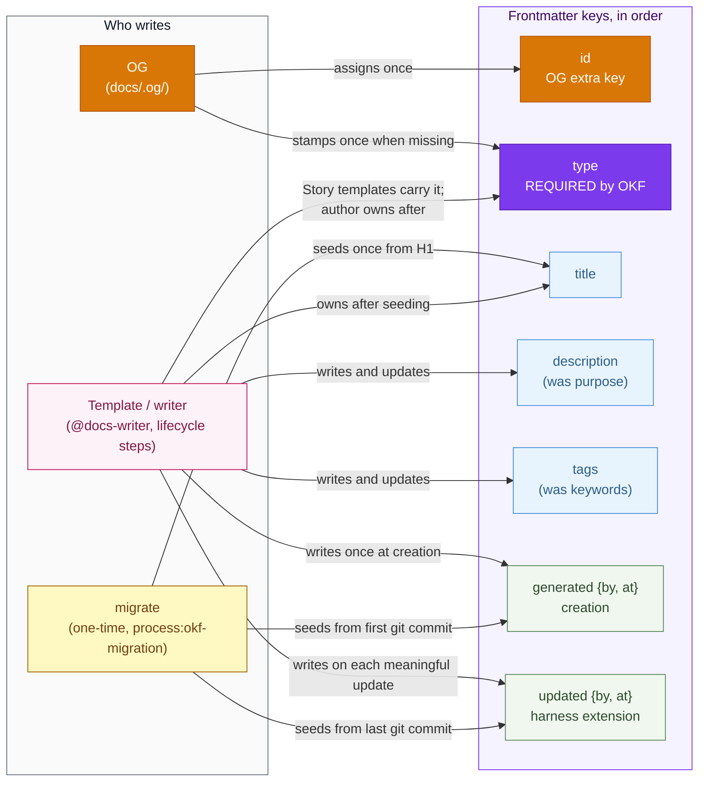

# DESIGN-20261117-7931: OKF-Compatible Knowledge Base — Evaluate: Decision 1, Target frontmatter format

_Produced by the 🏗 Evaluate phase. This is the judgment artifact. Options A, B, C, D and B+ are defined in `01 Research - Target Frontmatter Format.md`._

**Recommendation: Option B+ (v0.2-native with `updated`).** It is the developer's direction, and it is the only option that keeps fidelity to the pinned OKF v0.2 and still gives a clear freshness signal.

**Step 1b outcome (all decisions):** Assumptions #18 proposed: the DB migrates inside OG on open via `PRAGMA user_version`; a deterministic `cli.mjs migrate` rewrites frontmatter and detects pending work by OG-era keys; `reindex-graph` runs it before `build`; OG reads both old and new keys until a project is migrated; greenfield starts at v1; an already-migrated project is a no-op; launch writes the Q10c Product folder to an OG config file. Assumptions #19: bundle options 1, 3 and 5 depend on a VitePress rewrites spike; Option 6 needs no rewrites.

## Recommended key set and who writes each key



OG never stamps time. OG writes only `id` and, once, a missing `type`.

## Requirements × Options Matrix

✅ satisfies · ⚠️ partially (see note) · ❌ does not satisfy

| Criterion                                      | A: list + `timestamp`     | B: `generated`                          | C: both                        | D: no time key        | B+: `generated` + `updated`                |
| ---------------------------------------------- | ------------------------- | --------------------------------------- | ------------------------------ | --------------------- | ------------------------------------------ |
| EC1 OKF v0.2 conformance (`type` required)     | ✅                        | ✅                                      | ✅                             | ✅                    | ✅                                         |
| Fidelity to pinned v0.2 (no superseded keys)   | ❌ `timestamp` superseded | ✅                                      | ⚠️ carries a legacy mirror     | ✅                    | ✅ `updated` is a legal extra key          |
| Developer direction (OKF names + a time key)   | ⚠️ uses a v0.1 key        | ⚠️ no freshness key                     | ⚠️                             | ❌ drops the time key | ✅ chosen by the developer                 |
| Freshness signal in the bundle (no git needed) | ✅                        | ⚠️ `at` is ambiguous: created or latest | ⚠️                             | ❌                    | ✅ separate created and updated            |
| EC5 writers can follow it simply               | ✅                        | ⚠️                                      | ❌ two copies of one fact      | ✅                    | ⚠️ two mapping keys                        |
| EC6 OG stays the only query layer              | ✅                        | ✅                                      | ✅                             | ✅                    | ✅                                         |
| Parser cost (OG has no YAML library)           | ✅ flat keys              | ⚠️ flow mapping                         | ⚠️                             | ✅                    | ⚠️ two flow mappings                       |
| Diff churn                                     | ✅ writer-owned           | ✅                                      | ⚠️                             | ✅                    | ✅ writer-owned; OG never stamps time      |
| Privacy on the public site                     | ✅                        | ⚠️ `by` actor                           | ⚠️                             | ✅                    | ⚠️ mitigated: process/producer actors only |
| EC10 reversible                                | ✅                        | ✅                                      | ⚠️ mirror may never be dropped | ✅                    | ✅                                         |

## Tradeoffs

| Dimension              | A                                | B                          | C                   | D                         | B+                             |
| ---------------------- | -------------------------------- | -------------------------- | ------------------- | ------------------------- | ------------------------------ |
| Operational Excellence | ✅ simple                        | ✅                         | ❌ two values drift | ✅                        | ✅ clear meanings              |
| Security               | ✅                               | ⚠️ actor values are public | ⚠️                  | ✅                        | ✅ with the actor rule         |
| Reliability            | ⚠️ relies on the legacy fallback | ✅                         | ⚠️ drift            | ⚠️ freshness only via git | ✅                             |
| Performance Efficiency | ✅                               | ✅                         | ✅                  | ✅                        | ✅                             |
| Cost Optimization      | ✅                               | ✅                         | ⚠️                  | ✅                        | ✅                             |
| Sustainability         | ✅                               | ✅                         | ✅                  | ✅                        | ✅                             |
| Integration Complexity | ✅                               | ⚠️ parser upgrade          | ⚠️                  | ✅                        | ⚠️ parser upgrade              |
| Vendor Lock-in         | ⚠️ tied to a v0.1 key            | ✅ spec-native             | ✅                  | ✅                        | ✅ spec-native + one extension |

## Recommendation

**Recommended option: Option B+ — v0.2-native with `updated` (developer direction)**

Final format. `id` stays first, so `writeAdditiveId` needs no change (F2).

```yaml
---
id: f84dc7bb # OG extra key, assigned once
type: Container # REQUIRED (OKF)
title: Discuss Container # stamped once from H1 by migration; writer-owned after
description: One-line summary # was purpose; required by the harness
tags: [discuss, giscus, hld] # was keywords; required by the harness
generated: { by: artisyn-harness/4.1, at: 2026-11-02T09:00:00Z } # creation, written once
updated: { by: artisyn-harness/4.1, at: 2026-11-17T10:00:00Z } # last meaningful update (harness extension)
---
```

### Rules

| Key or topic          | Rule                                                                                                                                                                                                                                                                                                                                         |
| --------------------- | -------------------------------------------------------------------------------------------------------------------------------------------------------------------------------------------------------------------------------------------------------------------------------------------------------------------------------------------- |
| `type`                | Descriptive per-kind values from a canonical path map in OG. The bundle's tier is the fallback (`HLD`, `LLD`, `Engineering Guide`, `Product`, `Story`). Story templates carry `type`. OG stamps `type` once when it is missing; the author owns it after. Solution fixes the exact map.                                                      |
| `type` initial set    | `Container`, `Architecture Overview`, `Non-Functional Requirements`, `Component Design`, `Guide`, `Product Concept`, `Design Frame`, `Design Research`, `Design Evaluation`, `Design Report`, `Solution Architecture`, `Solution Design`, `Solution Stack`, `Solution Efforts`, `Dev Intent`, `Implementation Plan`, `Implementation Report` |
| `title`               | The migration stamps it once from the H1. Writers own it after. This fixes filename-title collisions (F8). When it equals the H1, VitePress shows no visible change (F7).                                                                                                                                                                    |
| `description`, `tags` | Required by the harness (stricter than OKF). Same rule as today's Principles.                                                                                                                                                                                                                                                                |
| `tags` syntax         | Inline flow list. OG's parser becomes a hand-written YAML subset with zero dependencies. It reads flow lists (including Prettier-wrapped multi-line lists), block lists, and one-level flow or block mappings. This also fixes the live defect: 50 of 184 docs read empty keywords today.                                                    |
| `generated`           | Written once at creation by the template or writer.                                                                                                                                                                                                                                                                                          |
| `updated`             | Written by the writer on each meaningful update. OG never stamps time.                                                                                                                                                                                                                                                                       |
| `by` actors           | Process/producer actors only: `artisyn-harness/<major.minor>`, `process:<lifecycle>`, `process:okf-migration`. Never `human:<id>`, because the site is public.                                                                                                                                                                               |
| Migration seed        | `generated.at` from each file's first git commit date. `updated.at` from its last. `by: process:okf-migration`.                                                                                                                                                                                                                              |
| Legacy template keys  | The skill strips template meta (`name`, template `description`, `type: reference`) when it copies a template. Templates are harness config and stay as they are. The migration drops `name` and the template `description` from the 10 affected Story docs and reports them as missing `description` for re-authoring.                       |
| VitePress keys        | `layout` and `hero` live only on `docs/index.md`, which sits outside every bundle (Decision 3).                                                                                                                                                                                                                                              |

### Research questions settled here

| #          | Outcome                                                                                                                                          |
| ---------- | ------------------------------------------------------------------------------------------------------------------------------------------------ |
| FQ-4       | Confirmed: the writer writes `updated`; `generated` is written once; the migration seeds both from git; OG never stamps time.                    |
| FQ-5       | Confirmed: process/producer actors only.                                                                                                         |
| FQ-6, FQ-7 | Confirmed: descriptive per-kind values with a tier fallback; Story templates carry `type`; OG stamps once when missing, then the author owns it. |
| FQ-8       | The path map lives in canonical OG. Solution fixes its content.                                                                                  |
| FQ-9       | Stamped once from the H1 by the migration, then writer-owned.                                                                                    |
| FQ-10      | Inline flow list, read by a hand-written YAML-subset parser that also accepts block lists.                                                       |
| FQ-12      | The skill strips template meta on copy.                                                                                                          |
| FQ-13      | Dropped by the migration and reported for re-authoring.                                                                                          |
| FQ-14      | `id` first.                                                                                                                                      |
| FQ-15      | Confirmed: `description` and `tags` are required by the harness.                                                                                 |
| FQ-16      | VitePress keys stay on `docs/index.md`, outside every bundle.                                                                                    |
| FQ-17      | Carried by Decision 2: the DB adds `created_at` and `modified_at` from `generated.at` and `updated.at`.                                          |

### Why B+, and why not the others

Only B+ meets the developer's direction and pinned-v0.2 fidelity together, and it gives a usable freshness signal.

| Option | Disqualifier                                                               |
| ------ | -------------------------------------------------------------------------- |
| A      | Writes the superseded `timestamp` key next to an `okf_version: "0.2"` pin. |
| B      | `generated.at` is ambiguous: creation or latest edit.                      |
| C      | Stores the same fact twice; the mirror can drift and may never be dropped. |
| D      | Drops the time key the developer asked for.                                |

**Falsifiability:**

- If OKF later standardises a "last modified" key, `updated` maps to it.
- If Prettier expands a flow mapping into a block mapping, the parser's block-mapping support reads it.

**Open questions to resolve before implementation:**

| #    | Question                                                 | Owner                          | Impact if unresolved                         |
| ---- | -------------------------------------------------------- | ------------------------------ | -------------------------------------------- |
| OQ-1 | Exact `type` path map                                    | Solution, `@product-architect` | Blocks the OG `type` stamp and the migration |
| OQ-2 | Parser test corpus: every current doc                    | dev                            | Blocks the migration from rewriting files    |
| OQ-3 | Which skills copy templates, and where stripping happens | dev                            | Story docs keep inheriting template meta     |

## WAF assessment (B+)

| Pillar                 | Rating | Headline                                                                                      |
| ---------------------- | ------ | --------------------------------------------------------------------------------------------- |
| Operational Excellence | 🟢     | Clear key meanings. Writers own `updated`. The deterministic migration seeds values from git. |
| Security               | 🟢     | No personal identities in public frontmatter. `by` is limited to process/producer actors.     |
| Reliability            | 🟡     | The hand-written YAML-subset parser is new code on a critical path.                           |
| Performance Efficiency | 🟢     | Frontmatter-only parsing. No runtime cost.                                                    |
| Cost Optimization      | 🟢     | No dependencies, no new services.                                                             |
| Sustainability         | 🟢     | No time churn on reindex.                                                                     |

| Priority | Action                                                                                                                |
| -------- | --------------------------------------------------------------------------------------------------------------------- |
| P1       | None.                                                                                                                 |
| P2       | Validate the parser against the full doc corpus with a golden round-trip test before the migration rewrites any file. |
| P3       | Map `updated` to an OKF key if OKF standardises one.                                                                  |

## Cross-decision consistency

All four decisions agree.

| Check                                                                                                                                                      | Status |
| ---------------------------------------------------------------------------------------------------------------------------------------------------------- | ------ |
| Decision 3 keeps `index.md` in source as navigation. Decision 4 keeps it out of the graph, and OG never writes it.                                         | ✅     |
| Decision 1's `type` fallback = Decision 3's bundle tier = OG tier.                                                                                         | ✅     |
| Decision 2's `migrate` command carries Decision 1's rewrite, Decision 3's index-page `id` move and Decision 4's stray-`id` cleanup in one idempotent pass. | ✅     |
| Decision 2's `og.config.json` supplies Decision 3's Product bundle root and the Product tier for Decisions 1 and 4.                                        | ✅     |
| One fix outside the four decisions, already in Frame scope: the Product folder is set at launch.                                                           | ✅     |
