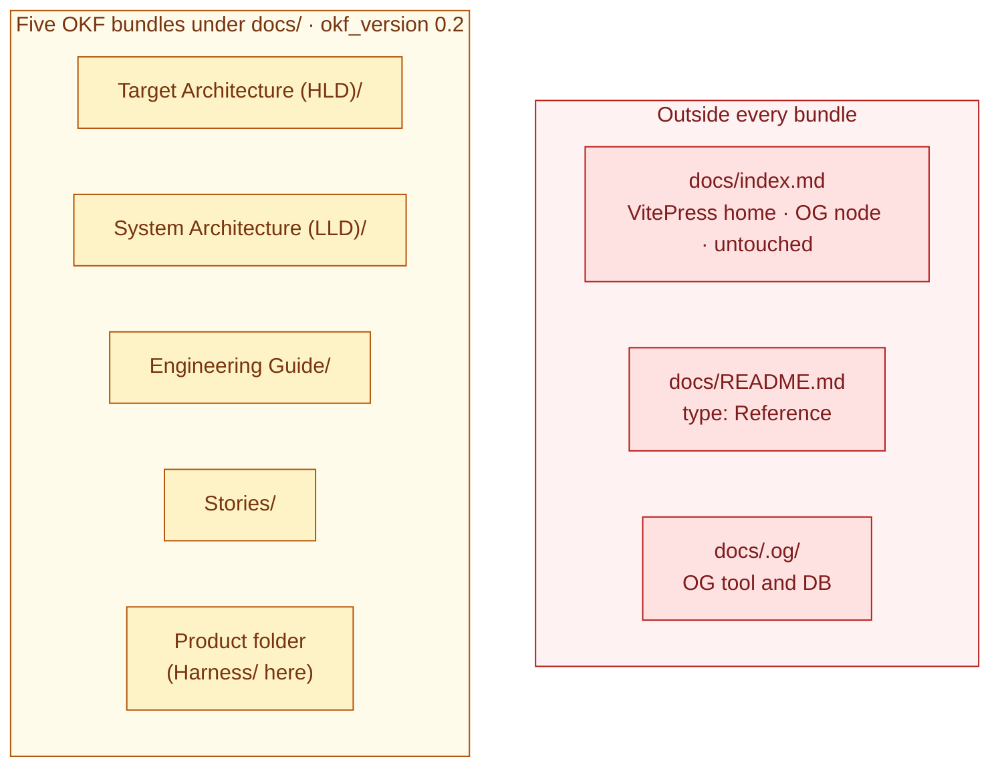
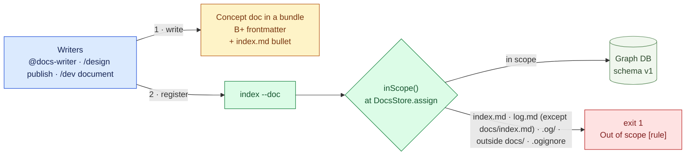
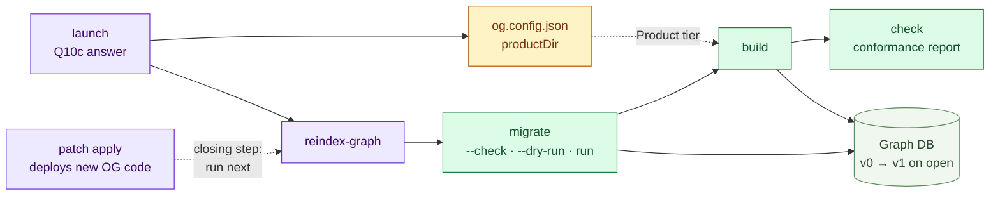
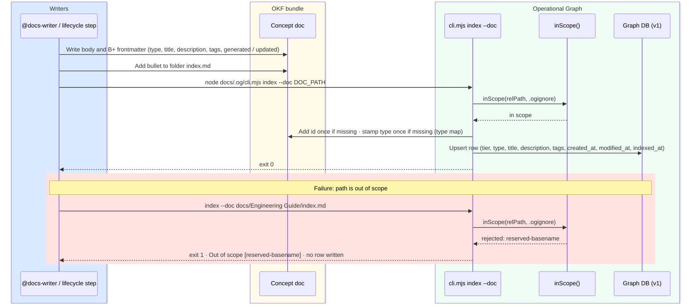
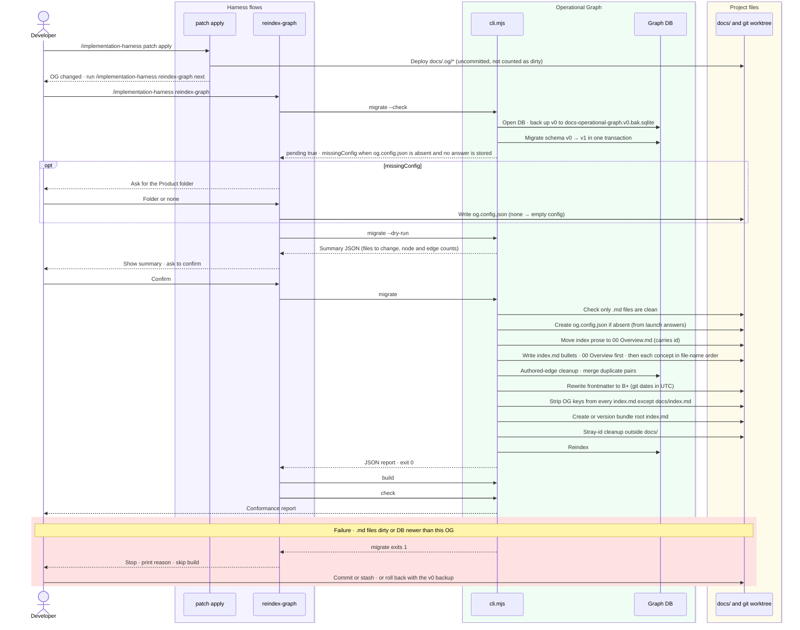
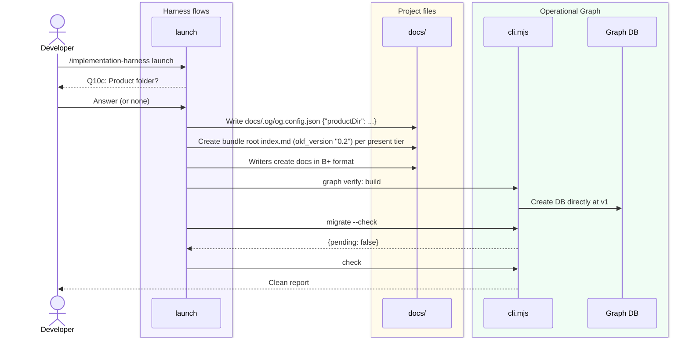

# DESIGN-20261117-7931 — OKF-Compatible Knowledge Base: Solution Architecture

The harness docs become an Open Knowledge Format (OKF) 0.2 knowledge base: five tier bundles under `docs/`, one frontmatter contract (B+), and the Operational Graph (OG) as the only query source. All decisions here are settled. Rationale lives in `design/02 Evaluate - *.md`. This is a Product-track change: the canonical package at `skills/implementation-harness/` changes first, and this repo receives it as the dogfood consumer.

Abstraction level: harness components (package internals and the flows that call them). No new container is added.

---

## Components and responsibilities

Each touched component keeps one responsibility after the change.

| Component              | Canonical source                                                                                                                                              | Responsibility after the change                                                                                                                                                                                                                                                                                                                                                                                                                                                                      |
| ---------------------- | ------------------------------------------------------------------------------------------------------------------------------------------------------------- | ---------------------------------------------------------------------------------------------------------------------------------------------------------------------------------------------------------------------------------------------------------------------------------------------------------------------------------------------------------------------------------------------------------------------------------------------------------------------------------------------------- |
| Operational Graph (OG) | `skills/implementation-harness/canonical/docs/.og/` (`cli.mjs`, `docs.mjs`, `edges.mjs`, `utils.mjs`, `constants.mjs`, `schema.mjs`, `cli.test.mjs`, seed DB) | Owns the graph DB at schema v1. Backs up a v0 DB before migrating it on open. Enforces `inScope()` at its single write path (`DocsStore.assign`) and in the reindex walker. Parses and writes the B+ frontmatter. Runs `migrate` and `check`. Reads and validates the Product prefix from `og.config.json`. OG commands other than `migrate` never write an `index.md` or `log.md` under `docs/`, except the docs-root `docs/index.md`.                                                              |
| Launch                 | `skills/implementation-harness/references/launch/` (`02-launch-questions.md`, `01c-launch-docs.md`, `01d-launch-graph-verify.md`)                             | Writes `docs/.og/og.config.json` from the Q10c answer. Creates four or five bundle root `index.md` files with `okf_version: "0.2"` (Product only when Q10c names a folder). Creates the DB at v1. Runs `migrate --check` and `check` during graph verify. Into a project with older `docs/`, shows `migrate --dry-run`, asks the developer to confirm, then runs `migrate --allow-dirty`.                                                                                                            |
| reindex-graph          | `skills/implementation-harness/references/reindex-graph.md`                                                                                                   | Runs `migrate --check`. When it reports `missingConfig`, asks the developer for the Product folder and writes `og.config.json` before the dry-run. When pending, shows the `--dry-run` summary and asks the developer to confirm, then runs `migrate`, then `build`. If the developer declines, skips `migrate`, still runs `build` and `check`, and reports "migration pending". Stops and skips `build` when `migrate` exits 1. Prints the `check` report. Uses `list --missing description,tags`. |
| Patch apply            | `skills/implementation-harness/references/patch/05-patch-apply.md`                                                                                            | Deploys the new OG files. Its closing verify step tells the developer to run `/implementation-harness reindex-graph` when OG files changed. It never runs migration itself.                                                                                                                                                                                                                                                                                                                          |
| Docs flow (writers)    | canonical `skills/design`, `skills/dev` templates and references; `01 Principles.md`, `07 Terminology.md`, `Lifecycles/05 Documents Flow.md`; `@docs-writer`  | Writers produce B+ frontmatter. Templates carry `type`. Skills strip template meta when copying. Writers keep `index.md` bullets current. `@docs-writer` creates a bundle root `index.md` when it writes the first doc into a bundle that has none. `/dev document` no longer authors `impl-to-readme`.                                                                                                                                                                                              |
| This repo (dogfood)    | `docs/`, `docs/.og/`, `apps/web-docs/`, `apps/web-explorer/`, `scripts/ci/check-tier-sync.mjs`                                                                | Receives the patch and runs the migration. Index pages are restructured. VitePress nav and `docs/README.md` links point at the new `00 Overview` pages. `docs/index.md` stays unchanged. Graph Explorer drops `AppReadme` from `TIER_COLORS`/`TIER_RING` and `impl-to-readme` from its edge-type comment. Web Explorer gains a "Dogfood" page (Efforts item 9).                                                                                                                                      |

---

## Boundary and component view

Writers author files. OG is the only component that writes graph state. OG commands other than `migrate` never write an `index.md` or `log.md` under `docs/`, except the docs-root `docs/index.md`.

### Where things live

Five bundles hold the concept docs. Three items under `docs/` sit outside every bundle.

### Write path

A writer writes the doc, then registers it with OG. The scope guard decides whether it reaches the DB.

### Upgrade and launch path

Patch apply and launch both lead to `reindex-graph`. It runs `migrate`, `build` and `check` in that order.

Bundles are the OG tier roots. A missing tier root is an absent bundle. Skills query only OG; no skill reads a bundle file as a query source.

---

## Flows

### (a) A writer publishes a doc

The writer owns the frontmatter. OG assigns `id` once and indexes only in-scope paths.

OG never stamps time. `generated` is written once at creation. `updated` changes on each meaningful update.

### (b) Upgrade of an older-harness project

Migration runs from `reindex-graph`, never from `patch apply`. The v0 DB backup and git are the rollback.

If the developer declines after the dry-run, `reindex-graph` skips `migrate`, still runs `build` and `check`, and reports "migration pending". The read-compat window keeps the graph data intact. A second `migrate` run changes nothing. OG released with this change refuses a DB newer than it supports. Today's OG has no such check, so a rollback restores the v0 DB together with the old OG code.

### (c) Greenfield launch

A new project starts in the target state. `migrate --check` reports not pending.

Launch into a project whose `docs/` predates the harness works differently. It shows `migrate --dry-run`, asks the developer to confirm, then runs `migrate --allow-dirty`, because launch's own files are uncommitted. Files with no git history get the current time for `generated.at` and `updated.at`.

---

## Decision register

Every settled decision, its owner and how it is verified. Detail sits in the linked design files.

### D1 — Target frontmatter format (B+)

| Decision                | Outcome                                                                                                                                                                                                                                                                                                               | Scope / owner                           | Consequence                                                                | Verification                                                                                 |
| ----------------------- | --------------------------------------------------------------------------------------------------------------------------------------------------------------------------------------------------------------------------------------------------------------------------------------------------------------------- | --------------------------------------- | -------------------------------------------------------------------------- | -------------------------------------------------------------------------------------------- |
| Key set and order       | `id`, `type`, `title`, `description`, `tags`, `generated`, `updated`, in that order                                                                                                                                                                                                                                   | All in-scope docs; OG parser/writer     | `purpose` and `keywords` leave the contract                                | `check` reports zero missing `type`/`description`/`tags` after re-authoring                  |
| Field ownership         | `id`: OG, once. `type`: template, or OG once from the type map, then the author. `title`: migration once from H1, then the writer. `description`, `tags`: writer (required). `generated`: writer at creation, once. `updated`: writer per meaningful update                                                           | Writers, templates, OG                  | OG never stamps time; `description` and `tags` are stricter than OKF       | `cli.test.mjs`; new design story `00 Frame.md` has `type: Design Frame` and `generated`      |
| Who stamps `type`       | Only `index --doc` and `migrate` stamp `type`. `reindex`/`build` stamp `id` as today and never write `type` or any other key. They report docs missing `type` under `check`'s `missingFields`                                                                                                                         | OG `cli.mjs`                            | Bulk runs never rewrite doc content beyond `id`                            | `cli.test.mjs`: `reindex` leaves a doc without `type` unchanged and `check` lists it         |
| `by` actors             | `artisyn-harness/<major.minor>`, `process:<lifecycle>`, `process:okf-migration`. Never `human:<id>`                                                                                                                                                                                                                   | Writers, migration                      | No personal identifiers on the public site                                 | Golden round-trip test; review of migrated docs                                              |
| Time format             | ISO 8601 with explicit UTC offset (`Z`)                                                                                                                                                                                                                                                                               | Writers, migration                      | Times compare without time-zone ambiguity                                  | Parser tests                                                                                 |
| Value syntax            | `tags`: inline flow list. `generated`/`updated`: one-line flow mapping `{ by, at }`. Parser also accepts Prettier-wrapped flow lists, block lists and one-level block mappings. Parser and `check` accept single and double quotes and both `*` and `-` bullets                                                       | OG YAML-subset parser in `utils.mjs`    | No new dependency; Prettier reformatting causes no repeated diffs          | Golden round-trip test over every current doc; tags no longer empty for the 50 affected docs |
| Unparseable frontmatter | Frontmatter outside the accepted subset: `index --doc` exits 1 and names the file and line. `reindex`/`build` index the parseable keys, list the doc under `frontmatterErrors` (path, line, reason) and exit 0. `check` lists it. `migrate` leaves the file and reports it under `needsWriter`                        | OG parser, `cli.mjs`                    | A single bad doc fails loudly on write and never blocks a bulk run         | Parser unit cases                                                                            |
| Migration seeds         | `generated.at` = first git commit date; `updated.at` = last git commit date; both `by: process:okf-migration`. `git log --follow --format=%aI` values are converted to UTC `Z`. Files with no git history (untracked, `--allow-dirty`, shallow clone) get the current time. `title` from H1; `type` from the type map | OG `migrate`                            | Dates reflect history, not migration time, wherever history exists         | `migrate` JSON; spot check of seeded dates; fixture without git history                      |
| Legacy keys             | Rename `purpose`→`description`, `keywords`→`tags`. Drop `name`, template-copied `description` and `type: reference` from the 10 affected Story docs                                                                                                                                                                   | OG `migrate`                            | Those 10 docs show under `check` as missing `description` for re-authoring | `migrate` JSON lists items needing a writer                                                  |
| Template meta stripping | Skills strip template meta when copying. Template files keep their own meta                                                                                                                                                                                                                                           | Canonical `skills/design`, `skills/dev` | New story docs never inherit template meta                                 | New story doc inspection                                                                     |
| Canonical type map      | Path patterns per bundle in OG constants; first match wins. Fallback per bundle: HLD `HLD`, LLD `LLD`, Engineering Guide `Guide`, Stories `Story Note`. Product: `Product Concept` for any path. `00 Overview.md` from migration takes the bundle's mapped type. Untiered docs: `Reference`                           | OG `constants.mjs`                      | Every in-scope doc gets a `type`                                           | `check` zero missing `type`                                                                  |
| VitePress keys          | `layout`, `hero`, `features` appear only on `docs/index.md`                                                                                                                                                                                                                                                           | `apps/web-docs`                         | `docs/index.md` stays outside every bundle                                 | `yarn nx run web-docs:build`                                                                 |

### D2 — Graph schema and migration

| Decision                    | Outcome                                                                                                                                                                                                                                                                                                                                                                                                                                                                                                              | Scope / owner                                                 | Consequence                                                                                                | Verification                                                                     |
| --------------------------- | -------------------------------------------------------------------------------------------------------------------------------------------------------------------------------------------------------------------------------------------------------------------------------------------------------------------------------------------------------------------------------------------------------------------------------------------------------------------------------------------------------------------- | ------------------------------------------------------------- | ---------------------------------------------------------------------------------------------------------- | -------------------------------------------------------------------------------- |
| Schema v1                   | `docs` columns: `id`, `tier`, `type`, `path`, `title`, `description`, `tags`, `created_at`, `modified_at`, `indexed_at`; `edges` unchanged; `PRAGMA user_version = 1`                                                                                                                                                                                                                                                                                                                                                | OG `schema.mjs`                                               | Storage carries OKF names; Graph Explorer still reads `id, tier, path, title`                              | v0 fixture migrates; greenfield fixture creates v1                               |
| Migration on open           | Before migrating, OG copies the v0 DB to `docs/.og/docs-operational-graph.v0.bak.sqlite`. `openStore` then migrates v0→v1 in one transaction; rows and edges preserved. v1 → no-op. Newer than supported → exit 1                                                                                                                                                                                                                                                                                                    | OG                                                            | Rollback works also where the DB is not tracked in git                                                     | Three-state fixtures; backup file present after migration                        |
| Older OG and a v1 DB        | Only OG released with this change refuses a DB newer than it supports. Today's OG has no `user_version` check. On a v1 DB it fails with raw SQL errors on writes and `list --missing`, and `search` loses data                                                                                                                                                                                                                                                                                                       | OG, developer                                                 | Rolling back OG code always restores the v0 DB (backup or git) together with the old code                  | Rollback rehearsal on a fixture                                                  |
| `migrate` command           | `migrate --dir <root> [--check] [--dry-run] [--allow-dirty]`. Steps in order: create `og.config.json` if absent; move index prose to `00 Overview.md` and write the navigation bullets; authored-edge cleanup; rewrite frontmatter to B+; strip OG keys from `index.md` other than `docs/index.md`; create or version bundle root `index.md`; stray-id cleanup; reindex; JSON report. Idempotent                                                                                                                     | OG `cli.mjs`                                                  | One command takes a project to the target state                                                            | Second run reports no changes; authored edges after = before − merged duplicates |
| Clean-worktree scope        | `migrate` checks only `.md` files: those under `docs/` (excluding `docs/.og/`) and the out-of-scope files it will touch in stray-id cleanup. Changes under `docs/.og/` (new OG code, the DB, `og.config.json`) never count as dirty                                                                                                                                                                                                                                                                                  | OG `migrate`                                                  | A fresh patch apply never blocks the migration                                                             | Fixture with uncommitted `docs/.og/*` runs; fixture with a dirty `.md` refuses   |
| `--check` contract          | Exit 0, JSON `{pending, counts}`. Pending when an in-scope doc has `purpose:`/`keywords:` or lacks `type`, an `index.md` other than `docs/index.md` carries OG frontmatter, index prose is not moved, a folder is in `overviewConflicts`, or a present bundle root lacks `index.md` or `okf_version: "0.2"`. `docs/index.md` is never reported                                                                                                                                                                       | OG                                                            | Flows decide on JSON, not on exit code                                                                     | Fixtures for pending and not pending                                             |
| Read-only modes             | `--check` and `--dry-run` write no doc files. Both may run the on-open schema migration, with the v0 backup                                                                                                                                                                                                                                                                                                                                                                                                          | OG                                                            | Previewing a migration never changes docs                                                                  | Fixture: no `.md` changes after `--check` and `--dry-run`                        |
| `migrate` exit codes        | Exit 0 on success, including report-only items. Exit 1 only when it refuses to run: dirty `.md` files without `--allow-dirty`, a DB newer than this OG, or a failed on-open schema migration. `--check` always exits 0                                                                                                                                                                                                                                                                                               | OG `cli.mjs`                                                  | Report-only items never fail a flow                                                                        | `cli.test.mjs` exit-code cases                                                   |
| Failed on-open migration    | A failed v0→v1 schema migration rolls back; the DB stays v0. OG exits 1 and names the failing statement                                                                                                                                                                                                                                                                                                                                                                                                              | OG `openStore`                                                | A DB is never left half-migrated                                                                           | Fixture with a forced statement failure                                          |
| Report shapes               | `needsWriter` entries share one shape `{ path, reason, line? }`. Other report keys: `overviewConflicts`, `mergedEdges`, `missingConfig`, `invalidConfig`, `orphanedAuthored`                                                                                                                                                                                                                                                                                                                                         | OG `migrate`                                                  | Flows and writers read one report format                                                                   | `migrate` JSON in fixtures                                                       |
| Overview collision          | A folder whose `00 Overview.md` already exists is listed in `overviewConflicts`. It skips the prose move and the frontmatter strip, so its `index.md` stays unchanged. `--check` stays pending until a writer resolves it                                                                                                                                                                                                                                                                                            | OG `migrate`, writer                                          | Authored edges on that index page stay attached. Nothing is orphaned until a writer resolves the collision | Collision fixture: edges unchanged, `--check` pending                            |
| Trigger                     | `reindex-graph` runs `migrate --check`. It acts on `missingConfig` first: it asks for the Product folder and writes `og.config.json`, so the first real `migrate` always runs with the Product tier known. When pending, it then shows `--dry-run`, asks the developer to confirm, then runs `migrate`, then `build`. On decline it skips `migrate`, runs `build` and `check`, and reports "migration pending". Greenfield launch runs `migrate --check` in graph verify. Patch apply only points to `reindex-graph` | Canonical `reindex-graph.md`, launch, patch                   | Patch apply never runs new recipes mid-apply; no file changes without consent                              | Dogfood run in this repo                                                         |
| `og.config.json` on upgrade | `migrate` creates `docs/.og/og.config.json` when absent, from the Q10c answer in `.harness/state/launch/answers.json`. When the answers record Q10b as Project-scoped, it infers no Product folder and writes `{}` without asking. A "none" answer is written as `{}`. `missingConfig: true` is reported only when the file is absent and no answer exists; `reindex-graph` then asks before the dry-run                                                                                                             | OG `migrate`, `reindex-graph`                                 | Older projects gain a Product tier without re-running launch. An empty config stops later prompts          | Fixtures: stored answer, Project-scoped answer, "none" answer, no answer         |
| `og.config.json` validation | `productDir` must be under `docs/`, must not be `docs/.og` and must not equal or overlap another tier root. Tier prefixes match with a trailing `/`, so `docs/Harness` does not match `docs/HarnessX`. An invalid config is ignored and reported as `invalidConfig` with the reason; the Product tier is absent; exit 0. `index --doc` on a Product path then exits 1 naming `invalidConfig`                                                                                                                         | OG                                                            | A bad config never misfiles docs into the wrong tier                                                       | `cli.test.mjs` config cases                                                      |
| Tier names                  | Tier names stay a static list in OG constants: `HLD`, `LLD`, `EngineeringGuide`, `Product`, `Story`. Only the path prefixes come from config                                                                                                                                                                                                                                                                                                                                                                         | OG `constants.mjs`                                            | `scripts/ci/check-tier-sync.mjs` keeps reading the static names                                            | `check-tier-sync.mjs` passes                                                     |
| Read-compat window          | Until migrated, `build`/`reindex` read `description ?? purpose` and `tags ?? keywords`. The window is removed at the major release after this one                                                                                                                                                                                                                                                                                                                                                                    | OG                                                            | A CI docs build between OG upgrade and migration loses no data                                             | Build on an unmigrated fixture                                                   |
| CLI contract renames        | `list --missing description,tags`; `search` haystack and `keyword-match` use `tags`                                                                                                                                                                                                                                                                                                                                                                                                                                  | OG, `reindex-graph.md` Steps 2–2b, Principles, `@docs-writer` | Callers use the new names                                                                                  | `cli.test.mjs`                                                                   |
| Compatibility rule          | "Schema changes are versioned with `PRAGMA user_version` and migrated in place by OG on open. Authored edges are always preserved."                                                                                                                                                                                                                                                                                                                                                                                  | `02 Storage and Build Model.md`                               | Replaces the previous rule                                                                                 | Publish review                                                                   |
| Seed DB                     | Canonical `docs-operational-graph.sqlite` regenerated at v1                                                                                                                                                                                                                                                                                                                                                                                                                                                          | Canonical OG                                                  | New installs start at v1                                                                                   | `user_version` of seed = 1                                                       |

### D3 — OKF bundle layout (five tier bundles)

| Decision                          | Outcome                                                                                                                                                                                                                                                                                                                                                                                                                                                                                                                                                                                     | Scope / owner                                                                                    | Consequence                                                                                                                                                                                                     | Verification                                                                                             |
| --------------------------------- | ------------------------------------------------------------------------------------------------------------------------------------------------------------------------------------------------------------------------------------------------------------------------------------------------------------------------------------------------------------------------------------------------------------------------------------------------------------------------------------------------------------------------------------------------------------------------------------------- | ------------------------------------------------------------------------------------------------ | --------------------------------------------------------------------------------------------------------------------------------------------------------------------------------------------------------------- | -------------------------------------------------------------------------------------------------------- |
| Bundles                           | Five bundles = OG tier roots: HLD, LLD, Engineering Guide, Stories, Product folder from `og.config.json`. A missing root is an absent bundle                                                                                                                                                                                                                                                                                                                                                                                                                                                | OG, launch                                                                                       | Bundle set follows tiers; no second layout to maintain                                                                                                                                                          | `check` lists bundle roots                                                                               |
| Bundle root `index.md`            | Frontmatter only `okf_version: "0.2"`; body is `# Section` headings with `* [Title](relative-url) - description` bullets. LLD and Stories gain one                                                                                                                                                                                                                                                                                                                                                                                                                                          | Launch (greenfield), `migrate` (creates or versions), `@docs-writer` (first doc in a new bundle) | Format pinned on every present bundle root                                                                                                                                                                      | `check`: every present bundle root has `okf_version: "0.2"`                                              |
| New bundle roots after launch     | When `@docs-writer` writes the first doc into a bundle with no root `index.md`, it creates one: frontmatter `okf_version: "0.2"` only, bullets body. `check` reports any present bundle root without it under `unversionedBundles`                                                                                                                                                                                                                                                                                                                                                          | `@docs-writer`, OG `check`                                                                       | A bundle added later is versioned like the others                                                                                                                                                               | `check` `unversionedBundles` empty                                                                       |
| Section `index.md`                | No frontmatter; headings and link bullets only                                                                                                                                                                                                                                                                                                                                                                                                                                                                                                                                              | Writers                                                                                          | `index.md` is navigation, never a graph node                                                                                                                                                                    | `check`; scope guard tests                                                                               |
| `migrate` and `index.md`          | `migrate` is the one OG command allowed to write an `index.md` other than `docs/index.md`. It moves prose to `00 Overview.md`, writes the navigation bullets, strips OG frontmatter, and creates or versions bundle root `index.md`. OG commands other than `migrate` never write an `index.md` or `log.md` under `docs/`, except the docs-root `docs/index.md`                                                                                                                                                                                                                             | OG                                                                                               | Navigation stays a writer concern after migration                                                                                                                                                               | `cli.test.mjs`: `index`, `reindex`, `build` leave `index.md` other than `docs/index.md` untouched        |
| Navigation bullets from `migrate` | When `migrate` moves a content-bearing `index.md`'s prose, it also writes the navigation. The remaining `index.md` gets the `00 Overview` bullet first, then one `* [title](relative-url) - description` bullet per concept doc in the folder, from each doc's frontmatter, in file-name order. Docs already linked are not duplicated                                                                                                                                                                                                                                                      | OG `migrate`                                                                                     | Migrated folders are fully listed from the start. Writers keep the bullets current afterwards                                                                                                                   | After `migrate`, `check` reports zero `unlistedConcepts` for migrated folders                            |
| Content-bearing index pages       | An `index.md` is content-bearing when its body has anything other than headings, blank lines and link-only bullets (`* [Title](url)`, optionally followed by ` - text`). Migration moves that content to `00 Overview.md` in the same folder; the overview takes over the old `id` and its authored edges. `index.md` keeps its headings and link bullets, gains a first bullet linking `00 Overview.md`, and gains the concept bullets above                                                                                                                                               | OG `migrate`                                                                                     | In this repo: `Engineering Guide/`, `Harness/`, `Harness/00 The Story/`, `01 Explore`, `02 Quick Start`, `05 Principles`, `06 Roadmap`, `07 Operational Graph`, `08 Security Scan`, `09 Distribution`, HLD root | The 4 graduation edges resolve to the new `00 Overview.md` pages                                         |
| OG key strip from `index.md`      | The strip applies to every `index.md` under `docs/`, except the docs-root `docs/index.md`. When the parser rejects its frontmatter, the fallback is a line-level removal of the top-level `id`, `purpose` and `keywords` keys, including the continuation lines of a wrapped flow list. No full YAML parse                                                                                                                                                                                                                                                                                  | OG `migrate`                                                                                     | Every `index.md` other than `docs/index.md` reaches no OG frontmatter. `--check` converges                                                                                                                      | Fixture with unparseable `index.md` other than `docs/index.md` frontmatter; second `--check` not pending |
| `docs/index.md`                   | `docs/index.md` sits outside every bundle. It is the VitePress home and the one `index.md` that is an ordinary in-scope doc for OG. `migrate` leaves it byte-for-byte unchanged: no key strip, no rename, no `type` stamp, no link retarget. `--check` and `check` do not report it. It stays a graph node with its `id`. In this repo its 2 authored `references` edges, from `docs/Stories/archive/[ADLC-000] Giscus Comments for VitePress/impl/1-plan.md` and `docs/Target Architecture (HLD)/v1/Containers/Web Docs.md`, stay attached. Its hero and features links are not retargeted | OG, `apps/web-docs`                                                                              | The home keeps its rich frontmatter. Its folder links stay valid: they render the bullet `index.md`, whose first bullet links `00 Overview`                                                                     | `git diff` shows no change to `docs/index.md`; both edges present after migration                        |
| `index.md` upkeep                 | Writers keep bullets current on add, rename or remove                                                                                                                                                                                                                                                                                                                                                                                                                                                                                                                                       | `@docs-writer`, publish/document steps                                                           | Navigation stays a writer concern                                                                                                                                                                               | `check`: unlisted concepts, entries to missing files                                                     |
| `unlistedConcepts`                | Checked only in folders that have an `index.md`. A concept is unlisted when its own folder's `index.md` exists and does not link it. Folders without `index.md` are fine; Story folders need none                                                                                                                                                                                                                                                                                                                                                                                           | OG `check`                                                                                       | `index.md` stays optional, as in OKF                                                                                                                                                                            | `check` fixtures with and without a folder `index.md`                                                    |
| `check` command                   | `check --dir <root>`: JSON, exit 0. Keys: `missingFields`, `brokenIndexEntries`, `unlistedConcepts`, `unversionedBundles`, `frontmatterErrors`, `counts`                                                                                                                                                                                                                                                                                                                                                                                                                                    | OG                                                                                               | Conformance is visible on every reindex                                                                                                                                                                         | Printed by `reindex-graph` after `build`                                                                 |
| Index bullet text                 | Each `index.md` bullet takes the target doc's `title` and `description`                                                                                                                                                                                                                                                                                                                                                                                                                                                                                                                     | Writers                                                                                          | Navigation text matches the doc's own frontmatter                                                                                                                                                               | `check`; writer review                                                                                   |
| Product bundle at launch          | Launch creates the Product bundle root `index.md` only when Q10c names a Product folder                                                                                                                                                                                                                                                                                                                                                                                                                                                                                                     | Launch                                                                                           | Projects without a Product folder have four bundles                                                                                                                                                             | Greenfield fixtures with and without a Product folder                                                    |
| Outside items                     | `docs/index.md` (VitePress home, graph node, untouched), `docs/README.md` (graph node, `type: Reference`), `docs/.og/`                                                                                                                                                                                                                                                                                                                                                                                                                                                                      | OG scope, VitePress                                                                              | Site home keeps its VitePress keys and content                                                                                                                                                                  | `yarn nx run web-docs:build`                                                                             |
| README routers                    | Stay concepts: `Version Router`, `Component Registry`                                                                                                                                                                                                                                                                                                                                                                                                                                                                                                                                       | Type map                                                                                         | Existing routing docs keep their edges                                                                                                                                                                          | `check`                                                                                                  |
| Links and IDs                     | File-relative links only. Story concept IDs change when folders move to `approved/`/`declined/`/`archive/`; OG `id` stays stable                                                                                                                                                                                                                                                                                                                                                                                                                                                            | Writers, OG                                                                                      | Graph identity survives folder moves                                                                                                                                                                            | Reindex after a move keeps edges                                                                         |
| Archive exception                 | Migration may make frontmatter-only edits to approved and archived Story files                                                                                                                                                                                                                                                                                                                                                                                                                                                                                                              | `05 Documents Flow.md`                                                                           | Archive bodies stay frozen                                                                                                                                                                                      | `migrate` diff touches frontmatter only there                                                            |
| `log.md`                          | Not adopted                                                                                                                                                                                                                                                                                                                                                                                                                                                                                                                                                                                 | —                                                                                                | Scope guard excludes it                                                                                                                                                                                         | Scope guard tests                                                                                        |
| VitePress nav                     | Nav entries that pointed at content-bearing index routes point at `00 Overview` pages; sidebar already skips `index.md`                                                                                                                                                                                                                                                                                                                                                                                                                                                                     | `apps/web-docs`                                                                                  | No VitePress rewrites                                                                                                                                                                                           | Home and section pages render; nav links resolve                                                         |

### D4 — OG scope guard

| Decision             | Outcome                                                                                                                                                                                                                                                                                                                                     | Scope / owner                                                                                                             | Consequence                                                                                                             | Verification                                                                                                                                         |
| -------------------- | ------------------------------------------------------------------------------------------------------------------------------------------------------------------------------------------------------------------------------------------------------------------------------------------------------------------------------------------- | ------------------------------------------------------------------------------------------------------------------------- | ----------------------------------------------------------------------------------------------------------------------- | ---------------------------------------------------------------------------------------------------------------------------------------------------- |
| Predicate            | `inScope(relPath, ignore)` in `utils.mjs`, called by `DocsStore.assign` and the reindex walker. Built-in rules: under `docs/`; not under `docs/.og/`; basename not `index.md`/`log.md` (case-insensitive) anywhere under `docs/`, except the docs-root `docs/index.md` (`reserved-basename`, config-independent); not an `.ogignore` prefix | OG                                                                                                                        | One rule set for every write path; `.ogignore` stays prefix-only and project-owned. `docs/index.md` is in scope         | Programmatic `DocsStore.assign` rejects out-of-scope paths and accepts `docs/index.md`                                                               |
| Rule ids and message | Rule ids: `outside-docs`, `og-internal`, `reserved-basename`, `ogignore`. Error message: `Out of scope [<rule>]: <path>`                                                                                                                                                                                                                    | OG `utils.mjs`, `cli.mjs`                                                                                                 | Callers and tests match on a stable rule id                                                                             | `cli.test.mjs` asserts the message per rule                                                                                                          |
| Failure modes        | `index --doc`/`--to` on an out-of-scope path exits non-zero with that message. The walker skips out-of-scope files silently. `reindex`/`build` exit 0                                                                                                                                                                                       | OG                                                                                                                        | Single-doc writes fail loudly; bulk runs never block                                                                    | `cli.test.mjs`: `index.md` and `log.md` in a bundle and in a non-bundle folder under `docs/`, `docs/.og/x.md`, `apps/x/README.md`, `.ogignore`d path |
| `scopeViolations`    | Lists only out-of-scope files that still carry OG `id:` frontmatter, and rows pruned because their path is now out of scope                                                                                                                                                                                                                 | OG `reindex`/`build` JSON                                                                                                 | The report shows only items that need action                                                                            | Fixture with a stray `id:` and a newly ignored path                                                                                                  |
| Prune safety         | Prune keeps the row of an out-of-scope `index.md` while that file still carries the row's `id:`, and lists it in `scopeViolations`. Once the `id:` is gone, authored (`derived=0`) edges touching the pruned row are listed in `orphanedAuthored`, then deleted with the row                                                                | OG                                                                                                                        | Authored edges survive builds before migration, a declined migration and collision folders. Any loss is always reported | Fixtures: unmigrated build, decline, collision keep the row; `orphanedAuthored` lists edges after the strip                                          |
| Retirements          | `AppReadme` tier, `APP_README_PATTERN`, `TIER_COLORS.AppReadme` and the `impl-to-readme` edge type are removed. The 2 existing edges become `references`. Graduation edge types drop to five                                                                                                                                                | OG; Graph Explorer `TIER_COLORS`/`TIER_RING` and edge-type comment (`edgeGroup()` has no `impl-to-readme` group); OG docs | `/dev document` records app README updates in its report only                                                           | Authored edges after = before − merged duplicates                                                                                                    |
| Edge re-typing merge | When a `references` edge already joins the same pair, the re-typed `impl-to-readme` edge merges into it (UNIQUE `from_id, to_id, edge_type`). `migrate` JSON reports `mergedEdges`                                                                                                                                                          | OG `migrate`                                                                                                              | No unique-constraint failure during migration                                                                           | Authored edges after = before − `mergedEdges`                                                                                                        |
| Stray-id cleanup     | Only `migrate` does it, and only on git-tracked `.md` files outside `docs/` whose only frontmatter key is an OG-shaped `id` (`^[0-9a-f]{8}(-\d+)?$`) with no owning row. Anything else is reported. This is the one bounded exception to OG writing only under `docs/`                                                                      | OG `migrate`                                                                                                              | This repo: `apps/web-explorer/README.md` (`id: ffe6a029`)                                                               | `migrate` JSON                                                                                                                                       |

### Cross-cutting decisions

| Decision                            | Outcome                                                                                                                                                                                                                                                                                                               | Scope / owner                    | Consequence                                                                                                       | Verification                                                                                                                                                                                         |
| ----------------------------------- | --------------------------------------------------------------------------------------------------------------------------------------------------------------------------------------------------------------------------------------------------------------------------------------------------------------------- | -------------------------------- | ----------------------------------------------------------------------------------------------------------------- | ---------------------------------------------------------------------------------------------------------------------------------------------------------------------------------------------------- |
| Product folder at launch            | Launch writes `docs/.og/og.config.json` (`{"productDir": ...}`) from Q10c. A "none" answer is written as `{}`. OG builds `TIER_PATH_PREFIXES` from it; absent file or key → no Product tier                                                                                                                           | Launch, OG; project-owned file   | Patches never overwrite it. This repo gets `{"productDir": "docs/Harness"}` during its migration                  | Greenfield fixture; this repo's Product tier resolves to `docs/Harness/`                                                                                                                             |
| Launch into existing docs           | Launch into a project whose `docs/` predates the harness shows `migrate --dry-run`, asks the developer to confirm, then runs `migrate --allow-dirty`. Launch's own files are uncommitted                                                                                                                              | Launch                           | Brownfield projects reach the target state at launch                                                              | Brownfield launch fixture; `check` after launch                                                                                                                                                      |
| Delivery order                      | Canonical change first → `/implementation-harness patch prepare` → `/implementation-harness patch apply` to this repo → `/implementation-harness reindex-graph` runs the migration here                                                                                                                               | Developer; Release               | This repo never diverges from canonical                                                                           | This repo's `docs/.og/` byte-identical to canonical except project-owned and generated files: `og.config.json`, `docs-operational-graph.sqlite`, `docs-operational-graph.v0.bak.sqlite`, `graph.mmd` |
| v0 DB backup file                   | `docs-operational-graph.v0.bak.sqlite` is git-ignored through a canonical `docs/.og/.gitignore` line that ships with the change. It may be deleted once the migrated project is committed                                                                                                                             | Canonical OG; developer          | `check` never requires the backup                                                                                 | `git status` clean after migration; `check` passes without the file                                                                                                                                  |
| Web Explorer "Dogfood" page         | This repo adds a "Dogfood" page to Web Explorer (Efforts item 9). It is developer-requested, outside the Frame's ECs, and does not block items 1–8                                                                                                                                                                    | This repo (`apps/web-explorer/`) | No effect on the harness package                                                                                  | Page renders in the Web Explorer build                                                                                                                                                               |
| Release                             | A breaking release: CLI renames (`list --missing description,tags`), removed edge type `impl-to-readme`, and a v1 DB that today's OG cannot use (it has no `user_version` check and fails with raw SQL errors). Major version bump via `yarn harness:version` (Efforts item 7). Commits use `feat!`/`BREAKING CHANGE` | Release                          | Consumers see the upgrade as breaking. The read-compat window is removed at the following major                   | Stamped major version in the patch bundle                                                                                                                                                            |
| `AppReadme` retirement in this repo | Retiring `AppReadme` also updates this repo's `scripts/ci/check-tier-sync.mjs` and the Graph Explorer `cytoscapeStyle.ts`, in the same change as the patch apply (Efforts item 8)                                                                                                                                     | This repo                        | Tier sync CI and Graph Explorer styling match the OG tiers                                                        | `check-tier-sync.mjs` passes; `yarn nx run web-docs:build`                                                                                                                                           |
| Inbound links to moved index routes | Index routes stay valid as bullet pages whose first bullet links `00 Overview`. This repo retargets every link in `docs/README.md` that targets a content-moved folder's index to that folder's `00 Overview` page (Efforts item 8). `docs/index.md` links are not retargeted                                         | This repo                        | Home links stay valid through the bullet page's first bullet                                                      | Site build; links resolve to `00 Overview` pages                                                                                                                                                     |
| Confirm before migrate              | `reindex-graph` shows the `migrate --dry-run` summary and asks the developer to confirm before `migrate`. Launch does the same for existing docs. If the developer declines, `reindex-graph` skips `migrate`, still runs `build` and `check`, and reports "migration pending"                                         | `reindex-graph.md`, launch       | No doc rewrite happens without consent. The read-compat window keeps graph data intact while migration is pending | Dogfood run shows the summary and prompt; decline fixture runs `build` and `check` and reports "migration pending"                                                                                   |
| Stop on refusal                     | `reindex-graph` stops when `migrate` exits 1, prints the reason (dirty `.md` files, newer DB, failed schema migration) and skips `build`                                                                                                                                                                              | `reindex-graph.md`               | A refused migration never leaves a half-built graph                                                               | Dirty-worktree fixture: `build` not run                                                                                                                                                              |
| Rollback                            | Canonical changes revert by commit. This repo's migration rolls back with `git restore` or the v0 DB backup. Rolling back OG code also restores the v0 DB                                                                                                                                                             | Developer                        | The clean `.md` precondition and the backup keep rollback to one step                                             | Dirty-worktree refusal test; restore from backup on a fixture                                                                                                                                        |
| WAF D1 Reliability P2               | Golden round-trip test over every current doc in this repo before `migrate` rewrites files. It compares parsed values (parse → write → parse equal), not bytes. Fixtures include CRLF line endings and a UTF-8 BOM                                                                                                    | Canonical OG (`cli.test.mjs`)    | Parser defects surface before any file changes                                                                    | Test passes on this repo's full doc set and the CRLF/BOM fixtures                                                                                                                                    |
| WAF D2 Reliability P2               | `migrate --dry-run` summary and a clean `.md` precondition                                                                                                                                                                                                                                                            | Canonical OG; `reindex-graph`    | The developer sees the change set first and can always roll back                                                  | Dry-run JSON matches the real run; dirty-worktree refusal                                                                                                                                            |
| WAF D3 OpEx P2                      | `check` conformance report printed by every `reindex-graph`                                                                                                                                                                                                                                                           | `reindex-graph.md`               | Drift in `index.md` and frontmatter is visible on every run                                                       | `reindex-graph` output includes the `check` report                                                                                                                                                   |

---

## WAF

The solution review found four Reliability P1 items. All four are resolved by settled decisions in the register.

| Reliability P1 area                        | Resolved by                                                                                |
| ------------------------------------------ | ------------------------------------------------------------------------------------------ |
| Migration safety and rollback              | D2 "Clean-worktree scope" and "Migration on open" (v0 DB backup); cross-cutting "Rollback" |
| Convergence of the `index.md` strip        | D3 "OG key strip from `index.md`" (line-level removal)                                     |
| Bulk runs writing doc content              | D1 "Who stamps `type`"                                                                     |
| `index.md` ownership and conformance rules | D3 "`migrate` and `index.md`", "Content-bearing index pages" and "`unlistedConcepts`"      |

One P3 follow-up stays open beyond this release. `docs/index.md` keeps `purpose` and `keywords`. After the read-compat window ends at the following major, OG no longer reads its description unless a writer renames those two keys.

These obligations are satisfied in the solution.

| Pillar / decision           | Obligation                                                                  | Satisfied by                                        |
| --------------------------- | --------------------------------------------------------------------------- | --------------------------------------------------- |
| Reliability — D1            | Golden round-trip test before `migrate` rewrites files                      | WBS item 2 (OG frontmatter), `cli.test.mjs`         |
| Reliability — D2            | `--dry-run` summary and clean `.md` precondition                            | WBS item 4 (`migrate`); flow (b) in `reindex-graph` |
| Operational Excellence — D3 | `check` report on every `reindex-graph`                                     | WBS item 4 (`check`), item 5 (`reindex-graph` flow) |
| Reliability                 | `reindex-graph` shows the dry-run summary and asks to confirm               | Cross-cutting "Confirm before migrate"; WBS item 5  |
| Reliability                 | `reindex-graph` stops on `migrate` exit 1, prints the reason, skips `build` | Cross-cutting "Stop on refusal"; WBS item 5         |
| Reliability                 | Golden test compares parsed values; CRLF and UTF-8 BOM fixtures             | Cross-cutting "WAF D1 Reliability P2"; WBS item 2   |
| Operational Excellence      | Quote and bullet tolerance so Prettier causes no repeated diffs             | D1 "Value syntax"; WBS item 2                       |

---

## Integration with the existing system

The change extends existing harness parts. It adds no container.

| Existing part           | How the solution plugs in                                                                                                                                                                     |
| ----------------------- | --------------------------------------------------------------------------------------------------------------------------------------------------------------------------------------------- |
| OG module (`docs/.og/`) | Same CLI and DB file. New commands `migrate` and `check`. Schema versioned in place, with a v0 backup. Edges table unchanged.                                                                 |
| Launch                  | Q10c answer is persisted to `og.config.json`. Docs step creates bundle root `index.md` files. Graph verify runs `migrate --check` and `check`. Existing docs are migrated after confirmation. |
| Patch                   | `patch prepare` bundles the canonical changes with a major version stamp. `patch apply` deploys OG and points to `reindex-graph`.                                                             |
| Lifecycles              | `/design publish`, `/dev document` and `@docs-writer` write B+ frontmatter and keep `index.md` bullets. Templates carry `type`.                                                               |
| VitePress site          | No rewrites. Nav targets and `docs/README.md` links move to `00 Overview` pages. `docs/index.md` is unchanged. Graph Explorer drops `AppReadme` and `impl-to-readme`.                         |

## Downstream docs to update at Publish

| Doc                                                                                             | Change                                                                 |
| ----------------------------------------------------------------------------------------------- | ---------------------------------------------------------------------- |
| `docs/Harness/07 Operational Graph/01 Ops Model.md`                                             | Scope guard, `migrate`, `check`, retired tier and edge type            |
| `docs/Harness/07 Operational Graph/02 Storage and Build Model.md`                               | Schema v1, v0 backup, new compatibility rule, read-compat window       |
| `docs/Harness/07 Operational Graph/03 Visualization Model.md`                                   | Tiers and edge groups without `AppReadme` and `impl-to-readme`         |
| `docs/Harness/07 Operational Graph/04 Graph Explorer.md`                                        | Same, where it lists edge groups or tiers                              |
| `docs/Harness/03 Lifecycles/05 Documents Flow.md`                                               | App README row, archive frontmatter exception, `index.md` rule         |
| `docs/Harness/09 Distribution/02 Update.md`                                                     | Patch apply → `reindex-graph` step, where it describes the update flow |
| `docs/Engineering Guide/Documentation/01 Principles.md` and `07 Terminology.md` (via canonical) | B+ frontmatter contract replaces `purpose`/`keywords`                  |
| New: `docs/Harness/07 Operational Graph/05 Knowledge Base Format.md`                            | OKF bundles and the frontmatter contract                               |

---

## Detail files

- [Design - Target Frontmatter Format](Design%20-%20Target%20Frontmatter%20Format.md) — D1 key contract, type map, parser rules
- [Design - Graph Schema and Migration](Design%20-%20Graph%20Schema%20and%20Migration.md) — D2 schema v1, `migrate`, read-compat window
- [Design - OKF Bundle Layout](Design%20-%20OKF%20Bundle%20Layout.md) — D3 bundles, `index.md` rules, `check`
- [Design - OG Scope Guard](Design%20-%20OG%20Scope%20Guard.md) — D4 predicate, failure modes, retirements
- [Stack](Stack.md) — technologies and version constraints
- [Efforts](Efforts.md) — WBS, sequencing, rollback

## Considered Options

A full options analysis is in `design/02 Evaluate - Target Frontmatter Format.md`, `design/02 Evaluate - Graph Schema and Migration.md`, `design/02 Evaluate - OKF Bundle Layout.md` and `design/02 Evaluate - OG Scope Guard.md`. In summary: for the frontmatter, the team compared the developer's list with a legacy `timestamp`, v0.2-native `generated`, both, and no time key, and chose `generated` plus an `updated` extension. For storage, keeping OG key names or mapping at an export boundary was set aside once the source had to carry OKF names. For layout, a single `docs/` bundle, area bundles without Stories, a generated export and a hybrid overlay were compared with five tier bundles. For the guard, a command-level check, a gitignore-style ignore file and a tier allow-list were compared with one predicate at the single write path.
