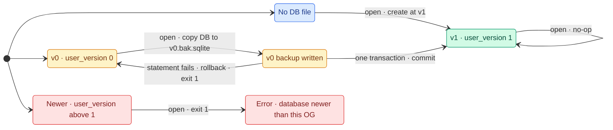
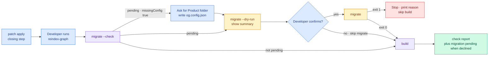

# DESIGN-20261117-7931 — Design: Graph schema and migration

OG versions its SQLite schema with `PRAGMA user_version` and migrates it in place on open; a separate `migrate` command rewrites doc frontmatter to the B+ format and the docs to the OKF layout. Component boundaries and delivery order are in [Architecture.md](Architecture.md).

Scope: canonical OG (`skills/implementation-harness/canonical/docs/.og/` — `schema.mjs`, `cli.mjs`, `docs.mjs`, `constants.mjs`, `cli.test.mjs`, seed DB), the `reindex-graph` and patch-apply references, and the launch handling of `og.config.json` and existing docs.

This is a breaking harness release. The CLI renames, the removed `impl-to-readme` edge type and a v1 DB that older OG cannot use all break consumers. `yarn harness:version` bumps the major version; commits use `feat!` or a `BREAKING CHANGE` footer.

## Schema v1

Schema v1 renames the frontmatter-backed columns to their OKF names and adds `type`, `created_at` and `modified_at`. The `edges` table does not change.

```sql
-- PRAGMA user_version = 1
CREATE TABLE IF NOT EXISTS docs (
  id          TEXT PRIMARY KEY,
  tier        TEXT,
  type        TEXT,
  path        TEXT UNIQUE NOT NULL,
  title       TEXT,
  description TEXT,
  tags        TEXT,
  created_at  TEXT,   -- from frontmatter generated.at
  modified_at TEXT,   -- from frontmatter updated.at
  indexed_at  TEXT    -- OG index time (was updated_at)
);
CREATE TABLE IF NOT EXISTS edges (
  from_id   TEXT NOT NULL,
  to_id     TEXT NOT NULL,
  edge_type TEXT NOT NULL,
  derived   INTEGER NOT NULL,
  UNIQUE(from_id, to_id, edge_type)
);
```

| v0 column    | v1 column     | Source                    | Change                                   |
| ------------ | ------------- | ------------------------- | ---------------------------------------- |
| `id`         | `id`          | frontmatter `id`          | unchanged                                |
| `tier`       | `tier`        | path prefix               | unchanged                                |
| —            | `type`        | frontmatter `type`        | `ADD COLUMN`                             |
| `path`       | `path`        | file path                 | unchanged                                |
| `title`      | `title`       | frontmatter `title`       | unchanged                                |
| `purpose`    | `description` | frontmatter `description` | `RENAME COLUMN purpose TO description`   |
| `keywords`   | `tags`        | frontmatter `tags`        | `RENAME COLUMN keywords TO tags`         |
| —            | `created_at`  | `generated.at`            | `ADD COLUMN`                             |
| —            | `modified_at` | `updated.at`              | `ADD COLUMN`                             |
| `updated_at` | `indexed_at`  | OG index time             | `RENAME COLUMN updated_at TO indexed_at` |

The Graph Explorer reads `id, tier, path, title`. These columns keep their names, so its query does not change.

Only `index --doc` and `migrate` stamp `type` into a file. `reindex` and `build` keep stamping `id` as today and never write `type` or any other key. Docs missing `type` appear in `check`'s `missingFields`.

## On-open migration

`openStore` reads `PRAGMA user_version` and acts on it before any command runs, including `migrate --check` and `migrate --dry-run`.



Before the v0 → v1 change, OG copies the DB to `docs/.og/docs-operational-graph.v0.bak.sqlite`. The backup also covers projects that do not track the DB in git. It is git-ignored through a line in the canonical `docs/.og/.gitignore`, which ships with this change. The developer may delete it once the migrated project is committed; `check` never requires it. OG then runs these statements in one transaction:

1. `BEGIN`
2. `ALTER TABLE docs RENAME COLUMN purpose TO description`
3. `ALTER TABLE docs RENAME COLUMN keywords TO tags`
4. `ALTER TABLE docs RENAME COLUMN updated_at TO indexed_at`
5. `ALTER TABLE docs ADD COLUMN type TEXT`
6. `ALTER TABLE docs ADD COLUMN created_at TEXT`
7. `ALTER TABLE docs ADD COLUMN modified_at TEXT`
8. `PRAGMA user_version = 1`
9. `COMMIT`

All rows and all edges survive. If any statement fails, OG rolls back the transaction, so the DB stays at v0. OG then exits 1 and names the failing statement. Node 24 `node:sqlite` bundles SQLite 3.53, which supports `RENAME COLUMN` (needs ≥ 3.25).

OG released with this change refuses a DB newer than it supports. Today's OG has no `user_version` check. On a v1 DB it fails with raw SQL errors on writes and on `list --missing`, and `search` loses data. Rolling back OG code therefore also restores the v0 DB.

## `migrate` command

`node docs/.og/cli.mjs migrate --dir ROOT [--check] [--dry-run] [--allow-dirty]` brings a project's docs to the B+ frontmatter and OKF layout in one idempotent pass. It is the one OG command allowed to write an `index.md` inside a bundle. OG commands other than `migrate` never write an `index.md` or `log.md` under `docs/`, except the docs-root `docs/index.md`.

`migrate` and `migrate --check` skip `docs/index.md` entirely. It is the VitePress home, outside every bundle, and an ordinary in-scope doc for OG. `migrate` leaves it byte-for-byte unchanged: no key strip, no rename, no `type` stamp, no link retarget. It stays a graph node with its `id`, and its 2 authored `references` edges stay attached.

| Flag            | Effect                                                                                         |
| --------------- | ---------------------------------------------------------------------------------------------- |
| (none)          | Runs all steps and writes files. Refuses dirty `.md` files.                                    |
| `--check`       | Writes no doc files. Prints `{pending, counts, missingConfig, invalidConfig}`. Always exits 0. |
| `--dry-run`     | Writes no doc files. Runs all steps in memory and prints the same JSON as a real run.          |
| `--allow-dirty` | Skips the clean-worktree precondition.                                                         |

`--check` and `--dry-run` may still run the on-open schema migration, with its backup.

The clean-worktree check covers only `.md` files: those under `docs/` except `docs/.og/`, plus the out-of-scope files the stray-`id` cleanup will touch. Changes under `docs/.og/` (new OG code, the DB, `og.config.json`) never count as dirty.

Migration is **pending** when any of these holds:

- An in-scope doc has `purpose:` or `keywords:`, or lacks `type`.
- An `index.md` inside a bundle carries OG keys (`id`, `purpose`, `keywords`).
- A content-bearing `index.md` inside a bundle has not had its prose moved to `00 Overview.md`.
- A present bundle root lacks `index.md`, or its `index.md` lacks `okf_version: "0.2"`.
- A folder is listed in `overviewConflicts`. It stays pending until a writer resolves the collision.

An `index.md` is content-bearing when its body has anything other than headings, blank lines and link-only bullets (`* [Title](url)`, optionally followed by ` - text`).

Steps run in this order:

| #   | Step                          | What it does                                                                                                                                                                                                                                                                       |
| --- | ----------------------------- | ---------------------------------------------------------------------------------------------------------------------------------------------------------------------------------------------------------------------------------------------------------------------------------- |
| 1   | Config                        | Creates `docs/.og/og.config.json` when absent, from the Q10c answer, or `{}` when Q10b records Project-scoped. See [`og.config.json`](#og-config-json).                                                                                                                            |
| 2   | Prose move and navigation     | Moves the prose of each content-bearing in-bundle `index.md` to `00 Overview.md` in the same folder, carrying its `id`. Then writes the navigation in the remaining `index.md`: the `00 Overview` bullet first, then one bullet per concept doc in the folder, in file-name order. |
| 3   | Authored-edge cleanup         | Re-types every `impl-to-readme` edge to `references`. If a `references` edge already joins the same pair, the two merge into one. Merges are counted in `mergedEdges`.                                                                                                             |
| 4   | Frontmatter rewrite           | Rewrites every in-scope doc except `docs/index.md` to B+: renames keys, stamps `type`, `title`, `generated`, `updated` with `by: process:okf-migration`.                                                                                                                           |
| 5   | Strip OG keys from `index.md` | Removes the top-level `id`, `purpose` and `keywords` keys from every `index.md` inside a bundle. `docs/index.md` is not touched.                                                                                                                                                   |
| 6   | Bundle roots                  | Creates each missing bundle root `index.md`, or adds `okf_version: "0.2"` to an existing one.                                                                                                                                                                                      |
| 7   | Stray-`id` cleanup            | Removes an unowned OG-shaped `id:` from git-tracked `.md` files outside `docs/` when `id` is the only frontmatter key; otherwise reports it.                                                                                                                                       |
| 8   | Reindex                       | Rebuilds the graph from the rewritten files.                                                                                                                                                                                                                                       |
| 9   | Report                        | Prints the JSON result.                                                                                                                                                                                                                                                            |

Step details:

- Step 4 seeds `generated.at` from the file's first git commit and `updated.at` from its last, using `git log --follow --format=%aI`. Both are converted to UTC with a `Z` suffix. Files with no git history (untracked, `--allow-dirty` runs, shallow clones) get the current time.
- Step 2 writes each bullet as `* [title](relative-url) - description`, from the doc's frontmatter. It does not duplicate a bullet for a doc already linked. After `migrate`, `check` reports zero `unlistedConcepts` for migrated folders. Writers keep the bullets current afterwards.
- Step 5 falls back to a line-level removal when the parser rejects an in-bundle `index.md`'s frontmatter. It removes the OG key lines, including continuation lines of a wrapped flow list, with no full YAML parse. `--check` then converges on that file.
- Step 7 is the one bounded exception to the scope guard (EC3). Only `migrate` performs it, and only on files that match all its conditions.
- Folders in `overviewConflicts` skip steps 2 and 5. Their `index.md` stays unchanged and keeps its row and authored edges. The row is pruned only after a writer resolves the collision; any edges left then appear in that reindex's `orphanedAuthored`.

Example `migrate` output (values illustrative):

```json
{
  "pending": false,
  "counts": {
    "before": { "nodes": 212, "edges": { "authored": 64, "derived": 140 } },
    "after": { "nodes": 223, "edges": { "authored": 64, "derived": 140 } }
  },
  "filesChanged": 231,
  "mergedEdges": 0,
  "missingConfig": false,
  "invalidConfig": null,
  "needsWriter": [
    { "path": "docs/Stories/.../design/00 Frame.md", "reason": "missing description" },
    { "path": "docs/Stories/.../design/00 Frame.md", "reason": "missing tags" },
    { "path": "docs/Engineering Guide/.../Example.md", "reason": "unsupported YAML", "line": 4 }
  ],
  "overviewConflicts": [],
  "orphanedAuthored": []
}
```

Report fields that are not counts:

```json
"overviewConflicts": [
  { "folder": "FOLDER", "existing": "FOLDER/00 Overview.md" }
],
"invalidConfig": { "reason": "productDir overlaps docs/Engineering Guide" }
```

Example `--check` output:

```json
{
  "pending": true,
  "counts": { "nodes": 212, "edges": { "authored": 64, "derived": 140 } },
  "missingConfig": false,
  "invalidConfig": null
}
```

| Exit code | When                                                                                                                                                                                                     |
| --------- | -------------------------------------------------------------------------------------------------------------------------------------------------------------------------------------------------------- |
| 0         | Success, including runs that only report items (`needsWriter`, `overviewConflicts`, `orphanedAuthored`, `missingConfig`, `invalidConfig`, files skipped for unsupported YAML). `--check` always exits 0. |
| 1         | `migrate` refuses to run: dirty `.md` files without `--allow-dirty`, or a DB newer than this OG. Also a failed on-open schema migration.                                                                 |

`needsWriter` lists docs a writer must fix. Every entry has one shape: `{ "path", "reason", "line"? }`. A doc with several problems gets one entry per reason. `line` is the 1-based line number of the offending frontmatter line, present only for `unsupported YAML`.

| `reason`              | Meaning                                                                                                                                                                                                         |
| --------------------- | --------------------------------------------------------------------------------------------------------------------------------------------------------------------------------------------------------------- |
| `missing description` | Doc has no `description`, for example the 10 Story docs whose template `description` was dropped. `check` lists it until a writer re-authors it.                                                                |
| `missing tags`        | Doc has no `tags`.                                                                                                                                                                                              |
| `unsupported YAML`    | Frontmatter uses a YAML form outside the accepted subset. `migrate` does not rewrite the file. The subset is defined in [Design - Target Frontmatter Format.md](Design%20-%20Target%20Frontmatter%20Format.md). |

A second run finds nothing new to do, changes no file and reports `filesChanged: 0`.

## Project states

Each project falls into one of four states, and the same commands handle all of them.

| State                           | Signal                                              | What happens                                                                                                                                 |
| ------------------------------- | --------------------------------------------------- | -------------------------------------------------------------------------------------------------------------------------------------------- |
| Greenfield launch               | No DB file; launch writes docs in B+ format         | DB created at v1. `migrate --check` reports not pending.                                                                                     |
| Launch into pre-harness `docs/` | No DB file; `docs/` already has docs                | Launch shows `migrate --dry-run`, gets the developer's confirmation, then runs `migrate --allow-dirty` (launch's own files are uncommitted). |
| Older harness                   | `user_version = 0`; docs carry `purpose`/`keywords` | DB migrates on first open, with backup. `reindex-graph` runs `migrate`.                                                                      |
| Already migrated                | `user_version = 1`; `migrate --check` not pending   | Both are no-ops.                                                                                                                             |

## Trigger

`reindex-graph` is the single point that runs `migrate` after an upgrade. Patch apply never runs new recipes mid-apply; its closing verify step tells the developer to run `/implementation-harness reindex-graph` when OG files changed.



- When `migrate --check` reports `missingConfig: true`, `reindex-graph` asks the developer for the Product folder and writes `og.config.json` before the dry-run. The first real `migrate` therefore always runs with the Product tier known.
- `reindex-graph` shows the `--dry-run` summary and asks the developer to confirm before `migrate`. Launch does the same.
- When the developer declines, `reindex-graph` skips `migrate` but still runs `build` and `check`. The read-compat window keeps the data intact. The report says "migration pending".
- When `migrate` exits 1, `reindex-graph` stops, prints the reason (dirty `.md` files, newer DB, failed schema migration) and skips `build`.

## Read-compat window

Until a project is migrated, `build` and `reindex` read `description ?? purpose` and `tags ?? keywords` from frontmatter. A CI docs build that runs between the OG upgrade and the migration loses no data. This release is itself a major; the window is removed at the following major release.

`docs/index.md` keeps `purpose` and `keywords`, because `migrate` skips it. After the window ends, OG no longer reads its description unless a writer renames those two keys.

## CLI contract renames

| Surface                                  | v0                           | v1                           |
| ---------------------------------------- | ---------------------------- | ---------------------------- |
| `cli.mjs list`                           | `--missing purpose,keywords` | `--missing description,tags` |
| `cli.mjs search`                         | haystack uses `keywords`     | haystack uses `tags`         |
| keyword match                            | matches `keywords`           | matches `tags`               |
| `reindex-graph.md`                       | Steps 2–2b use old names     | Steps 2–2b use new names     |
| Documentation Principles, `@docs-writer` | `purpose`, `keywords`        | `description`, `tags`        |

## `og.config.json`

`docs/.og/og.config.json` names the Product folder, so OG code stays byte-identical across projects. A project's `docs/.og/` matches canonical except for its project-owned and generated files: `og.config.json`, `docs-operational-graph.sqlite`, `docs-operational-graph.v0.bak.sqlite` and `graph.mmd`.

```json
{ "productDir": "docs/Harness" }
```

| Event                    | Behaviour                                                                                                                                                                         |
| ------------------------ | --------------------------------------------------------------------------------------------------------------------------------------------------------------------------------- |
| Launch                   | Writes the file from the Q10c answer.                                                                                                                                             |
| Upgrade (`migrate`)      | Creates the file when absent, from the Q10c answer in `.harness/state/launch/answers.json`. When Q10b records Project-scoped (no Product context), it writes `{}` without asking. |
| Developer answers "none" | `reindex-graph` writes `{}`, so later runs stop asking.                                                                                                                           |
| No answer, file absent   | `missingConfig: true`. `reindex-graph` asks before the dry-run (see [Trigger](#trigger)).                                                                                         |
| Patch                    | Never overwrites it. The file is project-owned.                                                                                                                                   |
| `{}`, or absent key      | No Product tier. `missingConfig` is reported only when the file itself is absent.                                                                                                 |

Validation: `productDir` must sit under `docs/`, must not be `docs/.og`, and must not equal or overlap another tier root. On an invalid config OG ignores the file, reports `invalidConfig` with the reason, leaves the Product tier absent and exits 0. `index --doc` on a path under the configured Product folder then exits 1 and names `invalidConfig`.

Tier names stay a static list in constants: `HLD`, `LLD`, `EngineeringGuide`, `Product`, `Story`. Only the path prefixes come from config. `scripts/ci/check-tier-sync.mjs` keeps reading the static names. OG builds `TIER_PATH_PREFIXES` with a trailing `/`, so `docs/Harness` does not match `docs/HarnessX`.

This repo gets `{"productDir": "docs/Harness"}` during its migration.

## Seed DB

The canonical seed `docs-operational-graph.sqlite` is regenerated at v1. A greenfield launch therefore starts at v1 with no schema migration.

## Failure and rollback

| Failure                                     | Behaviour                                                                                                                                         |
| ------------------------------------------- | ------------------------------------------------------------------------------------------------------------------------------------------------- |
| v0 → v1 statement fails                     | Transaction rolls back; DB stays v0; OG exits 1 and names the failing statement. The v0 backup stays in `docs/.og/`.                              |
| DB `user_version` > 1                       | OG exits 1 with "database newer than this OG". Nothing is written.                                                                                |
| Dirty `.md` files on `migrate`              | Refuses and exits 1, unless `--allow-dirty`.                                                                                                      |
| `00 Overview.md` already exists in a folder | Folder skips the prose move and the OG-key strip; its `index.md` stays unchanged; listed in `overviewConflicts`; `--check` stays pending; exit 0. |
| Frontmatter outside the YAML subset         | File is not rewritten; listed in `needsWriter` with `reason: "unsupported YAML"`; exit 0.                                                         |
| Missing or invalid `og.config.json`         | Reported as `missingConfig` or `invalidConfig`; Product tier absent; exit 0.                                                                      |
| Authored edge touches a pruned row          | Listed in `orphanedAuthored`; never removed silently.                                                                                             |
| Frontmatter rewrite goes wrong              | `git restore` returns the `.md` files; the clean-worktree precondition keeps the diff isolated.                                                   |
| OG code rolled back after migration         | Older OG cannot use a v1 DB. Restore `docs-operational-graph.v0.bak.sqlite` or the committed v0 DB together with the old code.                    |

The compatibility rule in `docs/Harness/07 Operational Graph/02 Storage and Build Model.md` becomes: "Schema changes are versioned with `PRAGMA user_version` and migrated in place by OG on open. Authored edges are always preserved."

## Verification

`cli.test.mjs` covers each DB state, the precondition scope and the command's idempotency.

| Test               | Setup                                                           | Expected                                                                                             |
| ------------------ | --------------------------------------------------------------- | ---------------------------------------------------------------------------------------------------- |
| v0 fixture         | v0 DB and docs with `purpose`/`keywords`                        | Backup written; DB opens at v1; columns renamed and added; `migrate` rewrites docs to B+.            |
| Greenfield fixture | No DB, B+ docs                                                  | DB created at v1; `migrate --check` reports not pending.                                             |
| Second-run no-op   | Run `migrate` twice                                             | Second run: `filesChanged: 0`, no git diff.                                                          |
| Newer-DB error     | DB with `user_version = 2`                                      | Exit 1, "database newer than this OG", DB untouched.                                                 |
| Edges preserved    | v0 fixture with authored and derived edges                      | Authored after = authored before − `mergedEdges`; `orphanedAuthored` empty.                          |
| Edge merge         | `impl-to-readme` and `references` edges on the same pair        | One `references` edge remains; `mergedEdges: 1`.                                                     |
| Dirty-check scope  | Uncommitted changes only under `docs/.og/`                      | `migrate` runs; a dirty `.md` under `docs/` makes it exit 1.                                         |
| Overview collision | Content-bearing `index.md` next to an existing `00 Overview.md` | Folder in `overviewConflicts`; `index.md` unchanged; `--check` pending; exit 0.                      |
| Config             | Absent answer; overlapping `productDir`                         | `missingConfig: true`; `invalidConfig` with reason; exit 0; `index --doc` on a Product path exits 1. |

In this repo, the `migrate` JSON shows authored edges after = before − `mergedEdges`, the 4 graduation edges resolve to the new `00 Overview.md` pages, `orphanedAuthored` is empty, and `docs/index.md` is byte-for-byte unchanged with its 2 authored `references` edges attached.
