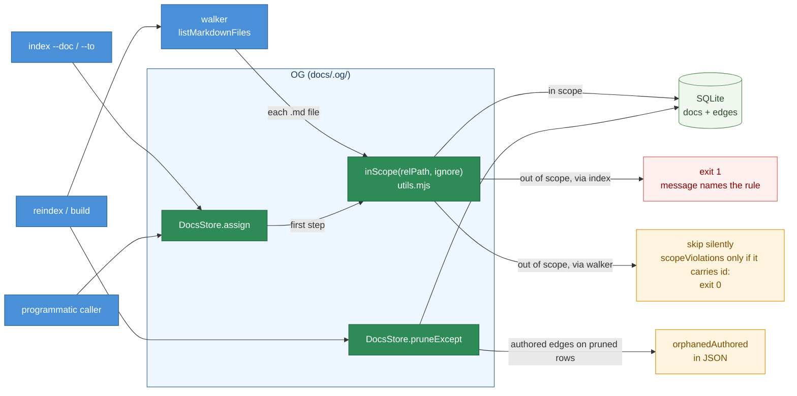
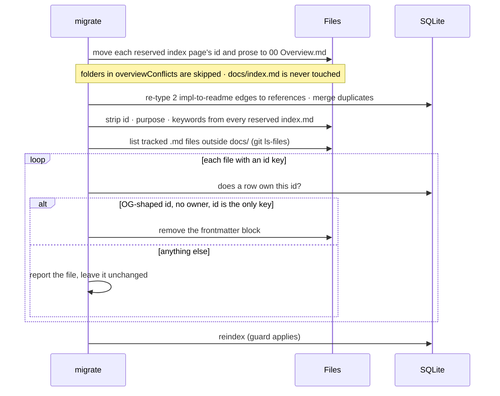

# DESIGN-20261117-7931 — Design: OG scope guard

_One predicate, `inScope(relPath, ignore)`, decides which files the Operational Graph (OG) may index or write. It runs at every write path. Container placement and delivery order are in [Architecture.md](Architecture.md)._

Scope: canonical OG under `skills/implementation-harness/canonical/docs/.og/` (`utils.mjs`, `docs.mjs`, `cli.mjs`, `constants.mjs`, `cli.test.mjs`). This repo receives the same files through `patch apply`.

---

## Where the guard runs

`DocsStore.assign` is the single write path, and the reindex walker feeds it. Both call `inScope`. A caller cannot write a row or a frontmatter `id` without passing it.



| Component                                 | Responsibility                                  | Contract                                                       |
| ----------------------------------------- | ----------------------------------------------- | -------------------------------------------------------------- |
| `inScope` (`utils.mjs`)                   | Applies the built-in rules and `.ogignore`      | Pure function; no file or DB access                            |
| `DocsStore.assign` (`docs.mjs`)           | Assigns `id`, upserts the row                   | Calls `inScope` before reading the file; throws on a violation |
| Walker (`listMarkdownFiles`, `utils.mjs`) | Lists candidate docs under `docs/`              | Returns in-scope files only; skips out-of-scope files silently |
| `DocsStore.pruneExcept` (`docs.mjs`)      | Removes rows whose file is gone or out of scope | Reports authored edges on removed rows                         |

Which frontmatter keys each caller writes:

| Caller             | Writes                                                                                                               |
| ------------------ | -------------------------------------------------------------------------------------------------------------------- |
| `index --doc`      | `id` when missing, and `type` when missing (from the canonical type map)                                             |
| `reindex`, `build` | `id` when missing, as today. Never `type` or any other key. Docs missing `type` appear in `check`'s `missingFields`. |
| `migrate`          | `type` and the other B+ keys (see [Architecture.md](Architecture.md))                                                |

OG commands other than `migrate` never write an `index.md` or `log.md` under `docs/`, except the docs-root `docs/index.md`. The guard enforces this for `index`, `reindex` and `build`.

---

## The `inScope` contract

`inScope(relPath, ignore)` returns `{ ok: true }` or `{ ok: false, rule, message }`. It does not read `og.config.json` or bundle roots.

| Input     | Meaning                                                                           |
| --------- | --------------------------------------------------------------------------------- |
| `relPath` | Path relative to the project root, POSIX separators (`toPosixRelative`)           |
| `ignore`  | Prefix list from `readIgnoreList(docsRoot)`; `[]` when `docs/.ogignore` is absent |

Rules run in this order. The first failing rule wins. The rules are built in and have no override.

| #   | Rule                                                                                                    | Example path                                                                        | Result       | Message                                                                                                      |
| --- | ------------------------------------------------------------------------------------------------------- | ----------------------------------------------------------------------------------- | ------------ | ------------------------------------------------------------------------------------------------------------ |
| 1   | `outside-docs` — path is under `docs/`                                                                  | `apps/web-explorer/README.md`                                                       | out of scope | `Out of scope [outside-docs]: apps/web-explorer/README.md is not under docs/`                                |
| 2   | `og-internal` — path is not under `docs/.og/`                                                           | `docs/.og/notes.md`                                                                 | out of scope | `Out of scope [og-internal]: docs/.og/notes.md is inside the OG tool folder`                                 |
| 3   | `reserved-basename` — not an `index.md` or `log.md` under `docs/`, except the docs-root `docs/index.md` | `docs/Harness/index.md` (rejected even with an invalid or missing `og.config.json`) | out of scope | `Out of scope [reserved-basename]: docs/Harness/index.md is an OKF-reserved file (index.md, log.md)`         |
| 3   | `reserved-basename`                                                                                     | `docs/Engineering Guide/log.md`                                                     | out of scope | `Out of scope [reserved-basename]: docs/Engineering Guide/log.md is an OKF-reserved file (index.md, log.md)` |
| 4   | `ogignore` — path matches no `.ogignore` prefix                                                         | `docs/vendor/api.md` with `docs/vendor/` listed                                     | out of scope | `Out of scope [ogignore]: docs/vendor/api.md matches .ogignore prefix docs/vendor`                           |
| —   | all rules pass                                                                                          | `docs/Harness/07 Operational Graph/01 Ops Model.md`                                 | in scope     | —                                                                                                            |
| —   | rule 3 exception (docs root)                                                                            | `docs/index.md`                                                                     | in scope     | —                                                                                                            |

- Rule 3 applies at any depth under `docs/`. The one exception is the docs-root `docs/index.md`.
- `docs/index.md` is the VitePress home and an ordinary in-scope doc: a graph node with its `id`, and its authored `references` edges stay attached.
- The basename compare lowercases the string first. `Index.md`, `INDEX.MD` and `LOG.md` all fail rule 3. The docs-root exception is an exact match on `docs/index.md`. The check is on the string, not the file system, so it gives the same result on macOS and Linux CI.
- A path that leaves the project (`../x.md`) fails rule 1.
- `.ogignore` semantics do not change. It is prefix-only and project-owned: a prefix matches the exact path or anything under `prefix/`. `#` comments and blank lines are skipped, as today.

---

## Failure modes per caller

`index` fails loudly. `reindex` and `build` report and carry on.

| Caller                          | Out-of-scope input                                                           | Behaviour                                                                                                                              |
| ------------------------------- | ---------------------------------------------------------------------------- | -------------------------------------------------------------------------------------------------------------------------------------- |
| `cli.mjs index --doc <p>`       | `<p>` fails a rule                                                           | Nothing written. Exit 1. stderr carries the rule message.                                                                              |
| `cli.mjs index … --to <p>`      | `<p>` fails a rule                                                           | Checked before the `--to` lookup and before `assign` on `--doc`. Nothing written. Exit 1 with the rule message.                        |
| Programmatic `DocsStore.assign` | path fails a rule                                                            | Throws `Error` with the rule message. No row, no frontmatter write.                                                                    |
| `cli.mjs index --doc <p>`       | `<p>` is under the configured Product folder and `og.config.json` is invalid | Nothing written. Exit 1. The message names `invalidConfig` and its reason. (`reindex`/`build` only report `invalidConfig` and exit 0.) |
| `cli.mjs reindex`, `build`      | walker finds a failing file                                                  | File skipped silently. Exit 0. A CI docs build is never blocked.                                                                       |

`scopeViolations` lists only real violations, each as `{ path, rule }`:

| Violation                                                            | Example                                                                                       |
| -------------------------------------------------------------------- | --------------------------------------------------------------------------------------------- |
| An out-of-scope `.md` file that still carries OG frontmatter (`id:`) | `docs/Harness/index.md` with `id: 9b41c7e0` before `migrate`                                  |
| A DB row whose path is now out of scope; the row is pruned           | A row for `docs/Harness/index.md`, indexed by an older OG, whose file no longer carries `id:` |

A reserved `index.md` without `id:`, or an `.ogignore`d file, is not a violation and is not listed.

---

## Prune safety

Prune keeps no row whose file is missing or out of scope. One exception: a reserved `index.md` that still carries its row's `id:` keeps the row (see Overview collision below). Before prune removes a row, it lists every authored (`derived=0`) edge touching that row in `orphanedAuthored`. The edges are then removed with the row, as today. Nothing is removed without a line in the output.

`reindex` and `build` JSON output:

```json
{
  "skipped": [],
  "pruned": ["9b41c7e0"],
  "scopeViolations": [{ "path": "docs/Harness/index.md", "rule": "reserved-basename" }],
  "orphanedAuthored": [
    {
      "edge": "story-to-product",
      "fromId": "5d2e8a13",
      "fromPath": "docs/Stories/product-design/[DESIGN-…]/design/Report.md",
      "toId": "9b41c7e0",
      "toPath": "docs/Harness/index.md",
      "prunedId": "9b41c7e0"
    }
  ]
}
```

`prunedId` names the pruned end of the edge. `orphanedAuthored` is empty after a clean `migrate`, because `migrate` moves each index page's `id` to its `00 Overview.md` before the guard prunes `index.md`.

### Overview collision

When a folder already has a `00 Overview.md`, `migrate` cannot move its `index.md` row. It lists the folder in `overviewConflicts`, and leaves that `index.md` unchanged: no prose move, no frontmatter strip.

- The `index.md` still carries its `id:`. Prune keeps its row while it does, and lists the file in `scopeViolations`. Its authored edges stay attached. Nothing is orphaned.
- `migrate --check` stays pending until a writer resolves the collision.
- After the writer resolves it, the next reindex prunes the `index.md` row. Any edge still on it then appears in `orphanedAuthored` of that reindex. The writer retargets it with `index --edge … --to NEW_TARGET` or retracts it with `unedge`.

---

## Retirements

The `AppReadme` tier and the `impl-to-readme` edge type are removed. OG no longer indexes anything outside `docs/`.

| Removed                                                                            | Location                                                     | Replacement                                                                                                                                                                                                                            |
| ---------------------------------------------------------------------------------- | ------------------------------------------------------------ | -------------------------------------------------------------------------------------------------------------------------------------------------------------------------------------------------------------------------------------- |
| `AppReadme` branch in `tierOf`                                                     | `docs.mjs`                                                   | None; tiers come from `TIER_PATH_PREFIXES` only                                                                                                                                                                                        |
| `APP_README_PATTERN`                                                               | `constants.mjs`                                              | None                                                                                                                                                                                                                                   |
| `TIER_COLORS.AppReadme`                                                            | `constants.mjs`                                              | None                                                                                                                                                                                                                                   |
| `'impl-to-readme'` in `EDGE_TYPES`                                                 | `constants.mjs`                                              | None                                                                                                                                                                                                                                   |
| 2 existing `impl-to-readme` edges (into `docs/README.md`)                          | SQLite `edges`                                               | Re-typed `references` by `migrate` (authored-edge cleanup step). When a `references` edge already joins the same pair, the two merge into one (UNIQUE `from_id, to_id, edge_type`). `migrate` JSON reports the count as `mergedEdges`. |
| `APP_README_PATTERN` import, `AppReadme` add                                       | `scripts/ci/check-tier-sync.mjs`                             | Static tier names from constants only                                                                                                                                                                                                  |
| `AppReadme` entries in `TIER_COLORS` and `TIER_RING`, and the `AppReadme` comments | Graph Explorer `cytoscapeStyle.ts`, `script.ts`, `docUrl.ts` | None. `edgeGroup()` has no `impl-to-readme` group and does not change.                                                                                                                                                                 |

Five graduation edge types remain:

| Edge type                   | Written by        |
| --------------------------- | ----------------- |
| `story-to-product`          | `/design publish` |
| `story-to-hld`              | `/design publish` |
| `impl-to-hld`               | `/dev document`   |
| `impl-to-lld`               | `/dev document`   |
| `impl-to-engineering-guide` | `/dev document`   |

`references` (scan) and the three derived types are unchanged.

### `/dev document` change

`/dev document` still updates an app README through `@docs-writer`. It no longer calls `index` for it. It records the README update in the story's `2-report.md` only. Step 4 of `skills/dev/references/06-document.md` lists the three `impl-to-*` graduation types and drops `impl-to-readme`.

---

## Cleanup performed by `migrate`

`migrate` brings an existing project in line with the guard. It runs these steps inside its one idempotent pass (full step order is in [Architecture.md](Architecture.md)). `migrate` is the one OG command allowed to write an `index.md` under `docs/` (never the docs-root `docs/index.md`). It leaves `docs/index.md` byte-for-byte unchanged: no key strip, no rename, no `type` stamp, no link retarget. `migrate --check` and `check` do not report it.



| Cleanup                                   | Condition                                                                                                                                                             | Action                                                                                                                                                                                                                                                                                                |
| ----------------------------------------- | --------------------------------------------------------------------------------------------------------------------------------------------------------------------- | ----------------------------------------------------------------------------------------------------------------------------------------------------------------------------------------------------------------------------------------------------------------------------------------------------- |
| Reserved `index.md` frontmatter           | An `index.md` under `docs/`, other than `docs/index.md`, carries OG keys (`id`, `purpose`, `keywords`), except folders in `overviewConflicts`. Never `docs/index.md`. | Remove those keys. When the parser rejects the frontmatter, the fallback removes those top-level key lines, including the continuation lines of a wrapped flow list, with no full YAML parse. Other keys stay. A block left empty is removed. Bundle root `okf_version` is a separate `migrate` step. |
| Stray OG `id` outside `docs/`             | Git-tracked `.md` file outside `docs/`; `id` matches `^[0-9a-f]{8}(-\d+)?$`; no `docs` row owns it; `id` is the only frontmatter key                                  | Remove the frontmatter block.                                                                                                                                                                                                                                                                         |
| Stray `id` that fails any condition above | —                                                                                                                                                                     | Report in the `migrate` JSON. Leave the file unchanged.                                                                                                                                                                                                                                               |

Stray-id cleanup is the one bounded exception to EC3 (OG never writes outside `docs/`). Only `migrate` performs it, and only on git-tracked `.md` files whose only frontmatter key is an OG-shaped `id` with no owning row. `index`, `reindex` and `build` never write outside `docs/`.

In this repo, `apps/web-explorer/README.md` carries `id: ffe6a029` as its only key and no row owns it. `migrate` removes its frontmatter block.

EC7 check: authored edges after `migrate` = authored edges before − `mergedEdges`.

---

## Tests

All cases live in canonical `docs/.og/cli.test.mjs`.

| Case                          | Input                                                                                                                                | Expected                                                                                                      |
| ----------------------------- | ------------------------------------------------------------------------------------------------------------------------------------ | ------------------------------------------------------------------------------------------------------------- |
| Rule 1 via `index`            | `index --doc apps/x/README.md`                                                                                                       | Exit 1; message contains `[outside-docs]`; file unchanged                                                     |
| Rule 2 via `index`            | `index --doc docs/.og/x.md`                                                                                                          | Exit 1; `[og-internal]`                                                                                       |
| Rule 3 via `index`            | `index --doc` on `docs/Engineering Guide/index.md`, `docs/Engineering Guide/a/log.md`, `docs/Engineering Guide/a/Index.md`           | Exit 1; `[reserved-basename]`                                                                                 |
| Home page accepted            | `index --doc docs/index.md`                                                                                                          | Exit 0; row created; `id` assigned                                                                            |
| `index.md` outside tier roots | `index --doc docs/misc/index.md` (no tier root covers `docs/misc`)                                                                   | Exit 1; `[reserved-basename]`                                                                                 |
| Invalid config still rejects  | `og.config.json` invalid or missing; `index --doc docs/Harness/index.md`                                                             | Exit 1; `[reserved-basename]`                                                                                 |
| Rule 4 via `index`            | `.ogignore` lists `docs/vendor/`; `index --doc docs/vendor/a.md`                                                                     | Exit 1; `[ogignore]`                                                                                          |
| `--to` guard                  | `index --doc IN_SCOPE_DOC --edge references --to "docs/Engineering Guide/index.md"`                                                  | Exit 1; `[reserved-basename]`; no edge, no `id` on `--doc`                                                    |
| Programmatic `assign`         | `DocsStore.assign` on each rule's example path                                                                                       | Throws the rule message; no row; no frontmatter write                                                         |
| Walker skip                   | Fixture `docs/` with one plain file per rule, `docs/index.md` and one valid doc                                                      | `reindex` exit 0; the valid doc and `docs/index.md` indexed; `scopeViolations` empty                          |
| Violation with `id:`          | Fixture `docs/Engineering Guide/a/index.md` carrying `id:`                                                                           | `reindex` exit 0; file not indexed; `scopeViolations` lists `{ path, rule: "reserved-basename" }`             |
| `overviewConflicts`           | `docs/Engineering Guide/a/index.md` with `id:` and an authored edge; `00 Overview.md` already exists in that folder                  | `migrate` lists the folder in `overviewConflicts`; `index.md` unchanged; row and edge kept; `--check` pending |
| Collision resolved            | The case above, then a writer strips `id:` from that `index.md`                                                                      | Next `reindex` prunes the row and lists the edge in `orphanedAuthored`                                        |
| Re-type merge                 | `impl-to-readme` and `references` edges on the same pair                                                                             | `migrate` leaves one `references` edge; `mergedEdges` is 1                                                    |
| Reserved `index.md` key strip | `docs/Engineering Guide/index.md` with `id`, `purpose`, `keywords`                                                                   | Keys removed; second run changes nothing                                                                      |
| Line-level fallback           | Reserved `index.md` whose frontmatter the parser rejects, with `id` and a wrapped `keywords` flow list                               | `id` and every `keywords` line removed; other lines unchanged                                                 |
| Home page untouched           | `docs/index.md` with `layout`, `hero`, `features`, `id`, `purpose`, `keywords`                                                       | `migrate` leaves it byte-for-byte unchanged; `--check` and `check` do not report it                           |
| `reindex` writes `id` only    | In-scope doc with no `id` and no `type`                                                                                              | `reindex` adds `id`; no `type` written; `check` lists it in `missingFields`                                   |
| Invalid config                | `og.config.json` with `productDir: "docs/Stories/Product"` (overlaps the Stories tier root); `index --doc docs/Stories/Product/a.md` | Exit 1 naming `invalidConfig`; `reindex` reports `invalidConfig` and exits 0                                  |
| `orphanedAuthored`            | Indexed doc with an authored edge, then file made out of scope (renamed to `index.md` without `id:`)                                 | `reindex` prunes the row; `orphanedAuthored` lists the edge with both ids and paths                           |
| Retired edge type             | `index --doc IN_SCOPE_DOC --edge impl-to-readme --to IN_SCOPE_DOC`                                                                   | Exit 1 as an unknown edge type; `EDGE_TYPES` has five entries                                                 |

---

## Downstream docs

Updated at Publish: `docs/Harness/07 Operational Graph/01 Ops Model.md`, `02 Storage and Build Model.md`, `03 Visualization Model.md` (tiers, edge types, scope rule); `docs/Harness/03 Lifecycles/05 Documents Flow.md` (App README row records in the report only).
