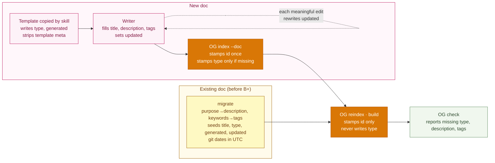

# DESIGN-20261117-7931 — Design: Target frontmatter format

_Settled design for decision D1 (format B+). The decision register and component scope are in [Architecture.md](./Architecture.md)._

Every in-scope doc carries one fixed frontmatter block: `id`, `type`, `title`, `description`, `tags`, `generated`, `updated`, in that order. OKF requires `type`. The harness also requires `description` and `tags`. OG reads every key. `index --doc`, `reindex` and `build` write `id`. Only `index --doc` and `migrate` also stamp `type` when it is missing. `reindex` and `build` never write `type` or any other key. Among OG commands, only `migrate` writes times, once, when it seeds old docs.

## One doc's frontmatter over its life



## Frontmatter contract

The key order is fixed, with `id` first as today.

```yaml
---
id: f84dc7bb
type: Container
title: Discuss Container
description: One-line summary of what the doc is for
tags: [discuss, giscus, hld]
generated: { by: artisyn-harness/4.1, at: 2026-11-02T09:00:00Z }
updated: { by: artisyn-harness/4.1, at: 2026-11-17T10:00:00Z }
---
```

| Key           | Required by | Value format                                             | Notes                                         |
| ------------- | ----------- | -------------------------------------------------------- | --------------------------------------------- |
| `id`          | OG          | 8 hex chars, optional `-N` suffix                        | OG extra key; assigned once, never reassigned |
| `type`        | OKF         | Plain string from the type map below                     | OKF's only required key                       |
| `title`       | —           | Plain string                                             | Display name                                  |
| `description` | Harness     | One line; quoted when it holds a YAML-reserved character | Was `purpose`                                 |
| `tags`        | Harness     | Flow list `[a, b]`                                       | Was `keywords`                                |
| `generated`   | —           | Flow mapping `{ by: <actor>, at: <time> }`               | Creation; written once                        |
| `updated`     | —           | Flow mapping `{ by: <actor>, at: <time> }`               | Last meaningful update; harness extension key |

Times are ISO 8601 with an explicit UTC offset (`Z`).

## Ownership

Each key has one owner after it is first written.

| Key           | Who writes it                                                        | When                                                 | May OG change it                                                                  |
| ------------- | -------------------------------------------------------------------- | ---------------------------------------------------- | --------------------------------------------------------------------------------- |
| `id`          | OG                                                                   | First `index --doc`, `reindex` or `build` of the doc | No; additive once, never reassigned                                               |
| `type`        | Story template; `index --doc` or `migrate` when missing; then author | At creation; stamped once if absent                  | Only `index --doc` and `migrate`, once, when missing; `reindex` and `build` never |
| `title`       | `migrate` once from the H1; then writer                              | Migration; then on any edit                          | No (`migrate` seeds it once)                                                      |
| `description` | Writer                                                               | Every write or update of the doc                     | No (`migrate` renames `purpose`)                                                  |
| `tags`        | Writer                                                               | Every write or update of the doc                     | No (`migrate` renames `keywords`)                                                 |
| `generated`   | Template / writer                                                    | At creation, once                                    | No (`migrate` seeds it once)                                                      |
| `updated`     | Writer                                                               | On each meaningful update                            | No (`migrate` seeds it once)                                                      |

### The `by` actor rule

`by` names a tool or a process, never a person. The docs site is public.

| Actor                           | Used by                                          |
| ------------------------------- | ------------------------------------------------ |
| `artisyn-harness/<major.minor>` | Agent writers (e.g. `artisyn-harness/4.1`)       |
| `process:<lifecycle>`           | A lifecycle step (e.g. `process:design-publish`) |
| `process:okf-migration`         | `migrate`                                        |
| `human:<id>`                    | Never used                                       |

## Canonical type map

OG holds this map in its constants. Within a bundle, the first matching pattern wins. Patterns are relative to the bundle root. When nothing matches, `type` is the bundle's own fallback: HLD `HLD`, LLD `LLD`, Engineering Guide `Guide`, Stories `Story Note`. Product maps every path to `Product Concept` and needs no separate fallback.

| Bundle            | Path pattern                      | `type`                        |
| ----------------- | --------------------------------- | ----------------------------- |
| HLD               | `**/Containers/*.md`              | `Container`                   |
| HLD               | `**/Non-Functional Concerns/*.md` | `Non-Functional Requirements` |
| HLD               | `**/System Overview.md`           | `System Overview`             |
| HLD               | `**/System Sizing.md`             | `System Sizing`               |
| HLD               | `README.md`                       | `Version Router`              |
| HLD               | fallback                          | `HLD`                         |
| LLD               | `README.md`                       | `Component Registry`          |
| LLD               | `*/*.md`                          | `Component Design`            |
| LLD               | fallback                          | `LLD`                         |
| Engineering Guide | any                               | `Guide`                       |
| Product           | any                               | `Product Concept`             |
| Stories           | `**/design/00 Frame.md`           | `Design Frame`                |
| Stories           | `**/design/01 Research*.md`       | `Design Research`             |
| Stories           | `**/design/02 Evaluate*.md`       | `Design Evaluation`           |
| Stories           | `**/design/Report.md`             | `Design Report`               |
| Stories           | `**/solution/Architecture.md`     | `Solution Architecture`       |
| Stories           | `**/solution/Design*.md`          | `Solution Design`             |
| Stories           | `**/solution/Stack.md`            | `Solution Stack`              |
| Stories           | `**/solution/Efforts.md`          | `Solution Efforts`            |
| Stories           | `**/impl/0-intent.md`             | `Dev Intent`                  |
| Stories           | `**/impl/1-plan.md`               | `Implementation Plan`         |
| Stories           | `**/impl/2-report.md`             | `Implementation Report`       |
| Stories           | fallback                          | `Story Note`                  |

Two special cases:

- A `00 Overview.md` page created by `migrate` takes its bundle's mapped type (e.g. `Product Concept`, `Guide`, `HLD`).
- An untiered doc under `docs/` outside every bundle (e.g. `docs/README.md`) gets `Reference`.

## YAML subset

OG parses frontmatter with a hand-written YAML subset in `utils.mjs`. It adds no dependency. The writer always emits the canonical form; the parser also accepts the other forms below.

The parser accepts single and double quotes. The writer's output is Prettier-stable: running Prettier over it changes nothing, so reformatting causes no repeated diffs.

| Form                              | Accepted | Example                                                                     |
| --------------------------------- | -------- | --------------------------------------------------------------------------- |
| Plain scalar                      | Yes      | `title: Discuss Container`                                                  |
| Single- or double-quoted scalar   | Yes      | `description: 'Ops: graph model'` / `description: "Ops: graph model"`       |
| Inline flow list (canonical)      | Yes      | `tags: [discuss, giscus, hld]`                                              |
| Prettier-wrapped flow list        | Yes      | `tags:`<br/>`  [discuss, giscus,`<br/>`   hld]`                             |
| Block list                        | Yes      | `tags:`<br/>`  - discuss`<br/>`  - giscus`                                  |
| One-line flow mapping (canonical) | Yes      | `updated: { by: process:okf-migration, at: 2026-11-17T10:00:00Z }`          |
| One-level block mapping           | Yes      | `updated:`<br/>`  by: artisyn-harness/4.1`<br/>`  at: 2026-11-17T10:00:00Z` |
| Nesting deeper than one level     | No       | `updated:`<br/>`  by:`<br/>`    name: x`                                    |
| Anchors and aliases               | No       | `generated: &g { … }` / `updated: *g`                                       |
| Multi-document                    | No       | a second `---` block inside the frontmatter                                 |

### When a doc uses a rejected form

A rejected form never removes a doc from the graph. Dropping it would prune its row and orphan its authored edges.

| Command             | Behaviour                                                                                   | Exit                             |
| ------------------- | ------------------------------------------------------------------------------------------- | -------------------------------- |
| `index --doc`       | Stops and names the file and the line                                                       | Non-zero                         |
| `reindex` / `build` | Indexes the keys it could parse; lists the doc under `frontmatterErrors` in its JSON output | 0                                |
| `check`             | Lists every `frontmatterErrors` entry                                                       | 0                                |
| `migrate`           | Does not rewrite the file; lists it under `needsWriter`                                     | 0 (reported under `needsWriter`) |

`reindex` and `build` follow the same report-only rule as scope violations. One `frontmatterErrors` entry:

```json
{
  "frontmatterErrors": [
    {
      "path": "docs/Engineering Guide/01 Conventions.md",
      "line": 6,
      "reason": "anchors and aliases are not supported"
    }
  ]
}
```

## Legacy keys

`migrate` rewrites every in-scope doc to B+ in one pass.

| Found in a doc                                                                                  | `migrate` does                                                                                                                                                                                           |
| ----------------------------------------------------------------------------------------------- | -------------------------------------------------------------------------------------------------------------------------------------------------------------------------------------------------------- |
| `purpose`                                                                                       | Renames it to `description`                                                                                                                                                                              |
| `keywords`                                                                                      | Renames it to `tags`                                                                                                                                                                                     |
| No `title`                                                                                      | Seeds it from the H1                                                                                                                                                                                     |
| No `type`                                                                                       | Seeds it from the type map                                                                                                                                                                               |
| No `generated` / `updated`                                                                      | Seeds `at` from the file's first / last git commit date, converted to UTC `Z`; `by: process:okf-migration`. A file with no git history (untracked, `--allow-dirty`, shallow clone) gets the current time |
| Template meta (`name`, template `description`, `type: reference`) in the 10 affected Story docs | Drops it; `check` then lists the doc as missing `description` for a writer to re-author                                                                                                                  |

Skills strip template meta when they copy a template. Template files are harness config and keep their own meta.

VitePress keys (`layout`, `hero`, `features`) appear only on `docs/index.md`. That file is outside every bundle, so the contract does not apply to it.

`migrate` strips OG keys from `index.md` files with a line-level removal, not a YAML parse. This applies only to `index.md`. It removes the top-level `id`, `purpose` and `keywords` lines, plus the continuation lines of a wrapped flow list. All other lines stay. So `docs/index.md` keeps its VitePress `layout`/`hero`/`features` keys and loses `id`/`purpose`/`keywords`, even when the parser rejects its YAML, and `migrate --check` converges.

## Read-compat window

Until a project is migrated, `build` and `reindex` read `description ?? purpose` and `tags ?? keywords`. A CI docs build that runs between an OG upgrade and `migrate` therefore loses no data. The following major harness release (after this breaking release) removes the window.

## Validation

`node docs/.og/cli.mjs check --dir <root>` reports every in-scope doc missing `type`, `description` or `tags` under `missingFields`. It prints JSON and exits 0. Docs missing `type` are fixed by `index --doc`, `migrate` or the author; `reindex` and `build` do not fill it. `reindex-graph` prints the report after `build`.

## Verification

| Test                    | Proves                                                                                                                                           |
| ----------------------- | ------------------------------------------------------------------------------------------------------------------------------------------------ |
| Golden round-trip       | For every current doc in this repo, parse → write → parse gives equal parsed values (values, not bytes); runs before `migrate` rewrites any file |
| Round-trip fixtures     | CRLF line endings and a UTF-8 BOM parse to the same values as LF without BOM                                                                     |
| Parser unit cases       | Each accepted form in the subset table, including single and double quotes, parses to the same value; each rejected form is refused              |
| Prettier stability      | Prettier over writer output changes nothing                                                                                                      |
| `type` stamping         | `index --doc` and `migrate` stamp a missing `type`; `reindex` and `build` leave it missing and `check` lists it under `missingFields`            |
| Git date seeds          | Seeded `at` values end in `Z`; a file with no git history gets the current time                                                                  |
| Tags after migration    | `tags` is non-empty for the 50 docs whose `keywords` parsed empty before                                                                         |
| `check` after migration | Zero docs missing `type`                                                                                                                         |
| New design story        | `00 Frame.md` is created with `type: Design Frame` and `generated`                                                                               |
