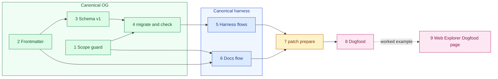
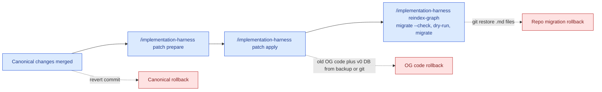

# DESIGN-20261117-7931 — Efforts

Delivery is canonical first: OG and harness changes land in the package, then reach this repo by patch.

Components and flows are in [Architecture.md](Architecture.md).

## Work breakdown

| #   | Summary                                                                                                                                                                                                                                                                                                                                                                                                                                                                                                                                                                                                                                                                                                                                           | Type  | Layer                    | Depends on                                                 |
| --- | ------------------------------------------------------------------------------------------------------------------------------------------------------------------------------------------------------------------------------------------------------------------------------------------------------------------------------------------------------------------------------------------------------------------------------------------------------------------------------------------------------------------------------------------------------------------------------------------------------------------------------------------------------------------------------------------------------------------------------------------------- | ----- | ------------------------ | ---------------------------------------------------------- |
| 1   | OG scope guard: `inScope()` at `assign` and walker, loud `index`, report-only build, `orphanedAuthored`, retire `AppReadme`/`impl-to-readme`, tests                                                                                                                                                                                                                                                                                                                                                                                                                                                                                                                                                                                               | feat! | Canonical OG             | —                                                          |
| 2   | OG frontmatter: YAML-subset parser and B+ writer, read-compat window, canonical type map, golden round-trip test                                                                                                                                                                                                                                                                                                                                                                                                                                                                                                                                                                                                                                  | feat! | Canonical OG             | —                                                          |
| 3   | OG schema v1: `user_version` migration on open with a v0 backup (`docs/.og/docs-operational-graph.v0.bak.sqlite`), new columns, `og.config.json` Product prefix (static tier names, prefixes from config), CLI contract renames (`list --missing description,tags`), seed DB regenerated                                                                                                                                                                                                                                                                                                                                                                                                                                                          | feat! | Canonical OG             | 2                                                          |
| 4   | OG `migrate` and `check` commands: index-page moves (writes navigation bullets, overview first, then one per concept doc, when moving index prose), bundle root `index.md` creation and versioning, `og.config.json` creation when absent, line-level OG-key strip from `index.md`, edge cleanup with merge of duplicate edges (`mergedEdges`), frontmatter rewrite with git-date seeding, stray-id cleanup, dry-run, clean-worktree guard over `.md` files only, canonical `docs/.og/.gitignore` line for the v0 backup, counts JSON, three-state fixtures                                                                                                                                                                                       | feat! | Canonical OG             | 1, 2, 3                                                    |
| 5   | Harness flows: launch writes `og.config.json` and bundle root `index.md` files; launch into a project with existing `docs/` (brownfield) shows `migrate --dry-run`, gets confirmation and runs `migrate --allow-dirty`; `reindex-graph` runs `migrate --check`; when `missingConfig` is reported it asks for the Product folder and writes `og.config.json` before the dry-run (a "none" answer writes `{}`, so later runs do not ask); when the launch answers record Q10b as Project-scoped, `migrate` writes `{}` without asking; it then shows the dry-run summary and asks the developer to confirm before `migrate`, stops and skips `build` when `migrate` exits 1, and prints `check`; patch apply closing step points to `reindex-graph` | feat  | Canonical harness        | 4                                                          |
| 6   | Docs flow: `@docs-writer`, Principles, Terminology, Documents Flow, design/dev templates (`type`, `generated`, `updated`), template-meta stripping, `index.md` upkeep rule, `@docs-writer` creates a missing bundle root `index.md` when it writes the first doc into that bundle, `/dev document` without `impl-to-readme`                                                                                                                                                                                                                                                                                                                                                                                                                       | feat  | Canonical harness        | 1, 2                                                       |
| 7   | Release: breaking (major) version via `yarn harness:version`, with `feat!`/`BREAKING CHANGE` commits; `patch prepare` bundle from the canonical changes                                                                                                                                                                                                                                                                                                                                                                                                                                                                                                                                                                                           | chore | Release                  | 1–6                                                        |
| 8   | Dogfood: `patch apply` to this repo, `og.config.json`, `reindex-graph` migration, review moved overview pages and missing descriptions, VitePress nav, retarget every link in `docs/README.md` that targets a content-moved folder's index (e.g. Harness, 00 The Story, 08 Security Scan, HLD root, Engineering Guide — full list in `Design - OKF Bundle Layout.md`) to the `00 Overview` pages (`docs/index.md` stays untouched), Graph Explorer `AppReadme`/`impl-to-readme` removal (including `cytoscapeStyle.ts` `AppReadme` colour and ring position), `scripts/ci/check-tier-sync.mjs` drops the retired `APP_README_PATTERN` import (same change as patch apply, so CI stays green), counts diff, site build                             | chore | This repo                | 7                                                          |
| 9   | Web Explorer page: Dogfood — this repo runs on its own harness. Explains the idiom ('eating your own dog food'), that this repo is the canonical source of the harness and also its first consumer, and the delivery loop canonical → `patch prepare` → `patch apply` → `reindex-graph`; uses item 8's migration as the worked example.                                                                                                                                                                                                                                                                                                                                                                                                           | feat  | This repo (Web Explorer) | — (can ship any time; the worked example is final after 8) |

Item 9 was added at the developer's request during Solution; it is outside the Frame's ECs and does not block items 1–8.

## Done when

| #   | Done when                                                                                                                                                                                                                                                                                                                                                                                                                                                                                                                                                                                                                  | EC                    |
| --- | -------------------------------------------------------------------------------------------------------------------------------------------------------------------------------------------------------------------------------------------------------------------------------------------------------------------------------------------------------------------------------------------------------------------------------------------------------------------------------------------------------------------------------------------------------------------------------------------------------------------------- | --------------------- |
| 1   | `cli.test.mjs`: `index --doc` on `index.md`, `log.md`, `docs/.og/x.md`, `apps/x/README.md` and an `.ogignore`d path exits non-zero and names the rule; the walker skips them; `DocsStore.assign` rejects them.                                                                                                                                                                                                                                                                                                                                                                                                             | EC2, EC3, EC9         |
| 2   | Golden round-trip test (parse → write → parse equal, with CRLF and UTF-8 BOM fixtures) passes over every current doc; `tags` is no longer empty for the 50 affected docs.                                                                                                                                                                                                                                                                                                                                                                                                                                                  | Parser                |
| 3   | v0 fixture migrates to v1 on open and leaves the v0 backup file; greenfield fixture creates v1; a newer DB makes OG exit non-zero; seed DB is at v1.                                                                                                                                                                                                                                                                                                                                                                                                                                                                       | EC10                  |
| 4   | `migrate` JSON shows authored edges after = before − `mergedEdges` and `orphanedAuthored` empty; a second run reports no changes; `--dry-run` writes no doc files.                                                                                                                                                                                                                                                                                                                                                                                                                                                         | EC7, EC10             |
| 5   | Greenfield launch: `check` reports zero missing `type`, four or five bundle roots (Product only when Q10c names a folder) carry `okf_version: "0.2"`, `migrate --check` not pending; skills query only OG.                                                                                                                                                                                                                                                                                                                                                                                                                 | EC1, EC6, EC10        |
| 6   | `@docs-writer`, Principles, Documents Flow and design/dev templates carry B+ rules; a new design story's `00 Frame.md` has `type: Design Frame` and `generated`.                                                                                                                                                                                                                                                                                                                                                                                                                                                           | EC5                   |
| 7   | Canonical changes are merged; the patch bundle is prepared with a version stamp.                                                                                                                                                                                                                                                                                                                                                                                                                                                                                                                                           | EC4                   |
| 8   | This repo's `docs/.og/` is byte-identical to canonical except `og.config.json`, the DB, the v0 backup and `graph.mmd`; authored edges after = before − `mergedEdges`; `orphanedAuthored` empty; the 4 graduation edges resolve to the new `00 Overview.md` pages; `docs/index.md` unchanged; every link in `docs/README.md` that targets a content-moved folder's index (e.g. Harness, 00 The Story, 08 Security Scan, HLD root, Engineering Guide — full list in `Design - OKF Bundle Layout.md`) points at its `00 Overview` page; `yarn nx run web-docs:build` passes and nav links resolve; CI tier-sync check passes. | EC1, EC4, EC7, EC8    |
| 9   | Page reachable from the Web Explorer navigation; `web-explorer` build passes; content matches the delivery loop in `Architecture.md`.                                                                                                                                                                                                                                                                                                                                                                                                                                                                                      | — (outside Frame ECs) |

## Dependencies

Items 1 and 2 run in parallel. Item 6 runs in parallel with 3–5.

## Rollout and rollback

Rollout follows the canonical-first order. Each step has its own rollback.

| Step                       | Rollback                                                                                                                                                                                                                                                       |
| -------------------------- | -------------------------------------------------------------------------------------------------------------------------------------------------------------------------------------------------------------------------------------------------------------- |
| Canonical changes          | Revert the commits.                                                                                                                                                                                                                                            |
| `patch apply` to this repo | Restore the old OG code. Restore the v0 DB with it, from `docs/.og/docs-operational-graph.v0.bak.sqlite` or from git. Today's OG has no `user_version` check: on a v1 DB it fails with raw SQL errors on writes and `list --missing`, and `search` loses data. |
| `reindex-graph` migration  | Restore the `.md` files with git. `migrate` refuses dirty `.md` files under `docs/` (and the out-of-scope files it touches), so their pre-migration state is always a commit. Changes under `docs/.og/` never count as dirty.                                  |

No spike tickets: the chosen layout does not use VitePress rewrites.

## Effort Estimate

| #         | Description                         | Estimate                                      |
| --------- | ----------------------------------- | --------------------------------------------- |
| 1         | OG scope guard                      | —                                             |
| 2         | OG frontmatter parser and B+ writer | —                                             |
| 3         | OG schema v1                        | —                                             |
| 4         | OG `migrate` and `check` commands   | —                                             |
| 5         | Harness flows                       | —                                             |
| 6         | Docs flow                           | —                                             |
| 7         | Release: `patch prepare`            | —                                             |
| 8         | Dogfood in this repo                | —                                             |
| 9         | Web Explorer page: Dogfood          | —                                             |
| **Total** |                                     | Not estimated (developer skipped, 2026-11-18) |
