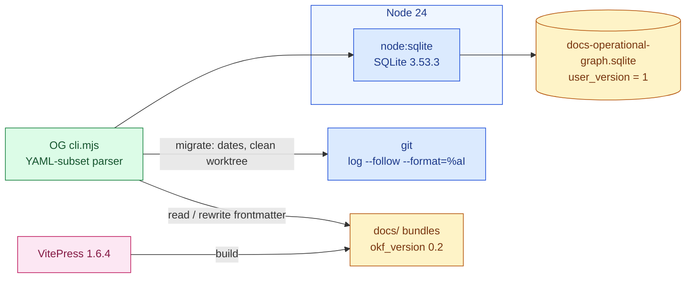

# DESIGN-20261117-7931 — Stack

The solution adds no new dependency. It pins the Open Knowledge Format version and relies on the SQLite, git and parser capabilities already present.

Components and flows are in [Architecture.md](Architecture.md). This file lists only changed or newly constrained technology.

## Technology to responsibility

| Technology              | Version / constraint                                                                   | Used by          | Note                                                      |
| ----------------------- | -------------------------------------------------------------------------------------- | ---------------- | --------------------------------------------------------- |
| Open Knowledge Format   | 0.2 (`okf_version: "0.2"` on four or five bundle roots (Product only when configured)) | Docs, OG `check` | Format pin; `updated` is a harness extension key.         |
| Node.js `node:sqlite`   | Node 24 (bundled SQLite 3.53.3); needs SQLite ≥ 3.25 for `RENAME COLUMN`               | OG               | `PRAGMA user_version` for schema versioning.              |
| YAML frontmatter subset | Hand-written in `utils.mjs`, no new dependency                                         | OG               | Flow/block lists, one-level flow/block mappings, scalars. |
| git                     | Any version with `log --follow --format=%aI`                                           | OG `migrate`     | Seeds `generated.at`/`updated.at`; clean-worktree check.  |
| Prettier                | Existing `printWidth: 100`                                                             | Repo formatting  | Unchanged; parser tolerates its wrapping.                 |
| VitePress               | 1.6.4, unchanged                                                                       | `apps/web-docs`  | No rewrites; nav targets updated.                         |

## Compatibility

- Node 24 bundles SQLite 3.53.3 in `node:sqlite`. The v0→v1 migration uses `ALTER TABLE … RENAME COLUMN`, which needs SQLite 3.25 or later.
- OG versions the schema with `PRAGMA user_version`. A v0 DB migrates in place on open. A v1 DB is a no-op.
- Before the v0→v1 migration, OG copies the DB to `docs/.og/docs-operational-graph.v0.bak.sqlite`. This also covers projects that do not track the DB in git. The backup is git-ignored by a canonical `docs/.og/.gitignore` line. It may be deleted once the migrated project is committed; `check` never requires it.
- The rule "this repo's `docs/.og/` matches canonical" excludes project-owned and generated files: `og.config.json`, `docs-operational-graph.sqlite`, `docs-operational-graph.v0.bak.sqlite`, `graph.mmd`.
- OG released with this change exits non-zero when `user_version` is above the version it supports.
- Today's OG has no `user_version` check. On a v1 DB it fails with raw SQL errors on writes and `list --missing`, and `search` loses data. Rolling back OG therefore restores the v0 DB (backup or git) together with the old code.
- Tier names stay a static list in OG constants (`HLD`, `LLD`, `EngineeringGuide`, `Product`, `Story`). Only the path prefixes come from `og.config.json`. `scripts/ci/check-tier-sync.mjs` keeps reading the static names.
- The parser is hand-written in `utils.mjs`. It accepts inline and Prettier-wrapped flow lists, block lists, and one-level flow or block mappings.
- VitePress needs no rewrites. Only nav targets change, to the new `00 Overview.md` pages.

## Verification

| Check            | Evidence                                                                                           |
| ---------------- | -------------------------------------------------------------------------------------------------- |
| SQLite migration | v0 fixture migrates to `user_version = 1`; rows and all edges preserved.                           |
| Greenfield DB    | Fixture with no DB creates v1; `migrate --check` reports not pending.                              |
| Newer DB guard   | DB with `user_version` above the supported version makes OG exit non-zero.                         |
| Parser           | Golden round-trip test over every current doc in this repo passes before `migrate` rewrites files. |
| git seeding      | `migrate --dry-run` JSON shows `generated.at`/`updated.at` from first and last commit dates.       |
| OKF pin          | `check` lists every bundle root with `okf_version: "0.2"`.                                         |
| VitePress        | `yarn nx run web-docs:build` passes; nav links resolve.                                            |
