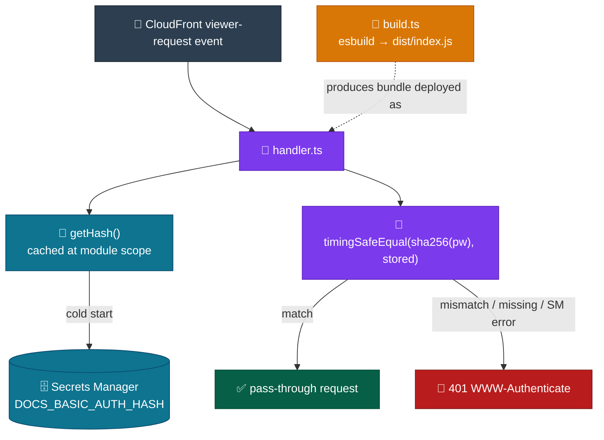

# Auth — Overview

Implementation detail for the Auth container: the Lambda@Edge handler enforcing basic auth on every CloudFront viewer request. Mirrors `docs/Target Architecture (HLD)/v1/Containers/Auth.md`.

## Component detail

- `src/handler.ts` — single-file handler. `getHash()` fetches and caches (module-level `cachedHash`, survives across warm invocations of the same execution environment) the secret from Secrets Manager on cold start, validating the `DOCS_BASIC_AUTH_HASH` shape (64-character lowercase hex) before caching and throwing otherwise. `handler()` parses the CloudFront viewer-request event, decodes `Authorization: Basic <base64>`, extracts the password (everything after the first `:` in the decoded credentials — the username is decoded but never checked), and compares via `timingSafeEqual(sha256(password), Buffer.from(stored, 'hex'))`. Every failure path — missing/malformed header, Secrets Manager fetch error, hash mismatch — converges on the same `unauthorized()` 401 response, so no path leaks which failure occurred.
- `build.ts` — esbuild bundle script, run outside NX/webpack. Bundles `src/handler.ts` to CJS `dist/index.js` targeting `node22`; `@aws-sdk/client-secrets-manager` is marked `external` (present in the Lambda Node.js runtime). `SM_SECRET_NAME` and `AWS_REGION` are injected as compile-time string literals via esbuild's `define`, not read from `process.env` at runtime — the deployed bundle carries no runtime env-var dependency.

## Integration pattern — deploy

CDK (`EdgeStack`, see `../Infrastructure/00. Overview.md`) provisions only a placeholder passthrough Lambda and its IAM role at synth/deploy time. The real handler ships out-of-band, in two NX targets:

1. `lambda-auth:build` → `scripts/ci/lambda-auth-build.sh` — in CI, loads `SM_SECRET_NAME`/`AWS_REGION` from SSM first (Vite/esbuild need them at build time), then runs `build.ts` and zips `dist/index.js` to `dist/lambda-auth.zip`.
2. `lambda-auth:deploy` → `scripts/ci/lambda-edge-deploy.sh` — hard-fails unless `AWS_REGION=us-east-1` (procedural enforcement of the Lambda@Edge region constraint). Sequence: `update-function-code` → wait for update → `publish-version` → `add-permission` granting `edgelambda.amazonaws.com` invoke on the new version → directly patches the _live_ CloudFront distribution's `LambdaFunctionAssociations` via `get-distribution-config` / `update-distribution` (not through CDK) → waits for CloudFront propagation (~2 min) → removes `AllowCloudFrontInvoke-*` permission statements for every published version older than latest−1.

This deploy must be re-run after any CDK deploy touching `EdgeStack`/`DocsStack` — CDK only ever wires the placeholder.

## Key decisions

- Only the password half of `user:password` Basic-auth credentials is checked; the username is decoded but not validated — consistent with the HLD's framing of this as password protection, not per-user auth.
- The comparison operates on the SHA-256 digest of the supplied password, not the raw string — `timingSafeEqual` is applied to digest bytes, so the code never does a variable-time plaintext comparison.
- The secret is cached at module scope with no TTL or invalidation logic — warm invocations skip the Secrets Manager round trip entirely; a rotated secret only takes effect on the next cold start (new execution environment).
- The Secrets Manager IAM policy resource ARN uses a wildcard secret-name suffix (`{secretName}-*`) because AWS appends a random 6-character suffix to secret ARNs, and a wildcard region (`arn:aws:secretsmanager:*:...`) because Lambda@Edge executes across edge locations while the secret lives in one specific region.
