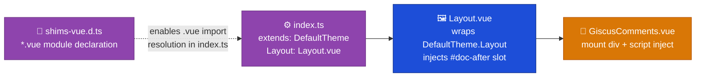

# Discuss — Overview

Implementation detail for the Discuss container's giscus comments widget, which lives inside the Web container's VitePress theme layer (`apps/docs-web/.vitepress/theme/`) — no dedicated NX app. Mirrors `docs/Target Architecture (HLD)/v1/Containers/Discuss.md`.

## Component detail

- `index.ts` — theme entry point. `extends: DefaultTheme`, custom `Layout` key, pre-existing `setup()` (mermaid/image zoom, unrelated to comments).
- `Layout.vue` — the site's first custom Layout override. Destructures `Layout` off `DefaultTheme`, re-renders it with `GiscusComments` injected into the `#doc-after` named slot. This slot only renders on `layout: doc` pages, excluding the homepage (`layout: home`) by VitePress's own routing, not manual logic.
- `GiscusComments.vue` — owns the giscus embed lifecycle: builds a `<script>` element with the widget's `data-*` config, appends it to a template-ref'd mount `
` on `onMounted`, and re-runs on every route change.
- `shims-vue.d.ts` — minimal ambient `declare module '*.vue'` so `tsc` can resolve `.vue` imports from `.ts` files (this project has no `vue-tsc`; `.vue` file contents themselves aren't type-checked).

## Integration pattern — comments (giscus)

Vanilla `<script src="https://giscus.app/client.js">` embed (giscus's official framework-agnostic method) — no npm dependency. `GiscusComments.vue` watches VitePress's `route.path` (same reactive pattern as the pre-existing zoom `setup()` logic) and, on every change, clears the mount `
` via `replaceChildren()` and re-injects a fresh script, since giscus has no postMessage API for remapping an already-loaded widget to a different discussion.

## Key decisions

- Discussion mapping: `data-mapping="specific"` with an explicit `data-term` computed as `decodeURIComponent(window.location.pathname)` (wrapped in a try/catch fallback to the raw pathname) — not `data-mapping="pathname"`, which would leave discussion titles percent-encoded (`%20`) for VitePress pages with spaces in their filenames.
- `data-strict="1"` — exact title matching, avoiding accidental collisions with other discussions whose titles happen to contain the page path as a substring.
- giscus GitHub App installed on the private repo configured via `GITHUB_ORG`/`GITHUB_REPO`, scoped to a dedicated "ADLC Comments" Discussions category in Announcements format (only maintainers/giscus start new top-level discussions there).
- Access is asymmetric, confirmed by manual testing: **posting** a comment requires GitHub repository permission on that repo — an authenticated GitHub account without repo access cannot post. **Reading** comments is not gated by GitHub permission at all — giscus.app's backend fetches discussion data using the giscus GitHub App's own installation token, not the viewer's identity, so it serves comment content to any visitor of the page regardless of GitHub login state. In practice, "who can read comments" = "who has the site's Lambda@Edge basic-auth password" — the same population as the rest of the site, not a narrower one (see `Target Architecture (HLD)/v1/Non-Functional Concerns/Requirements.md` NFR-6).
