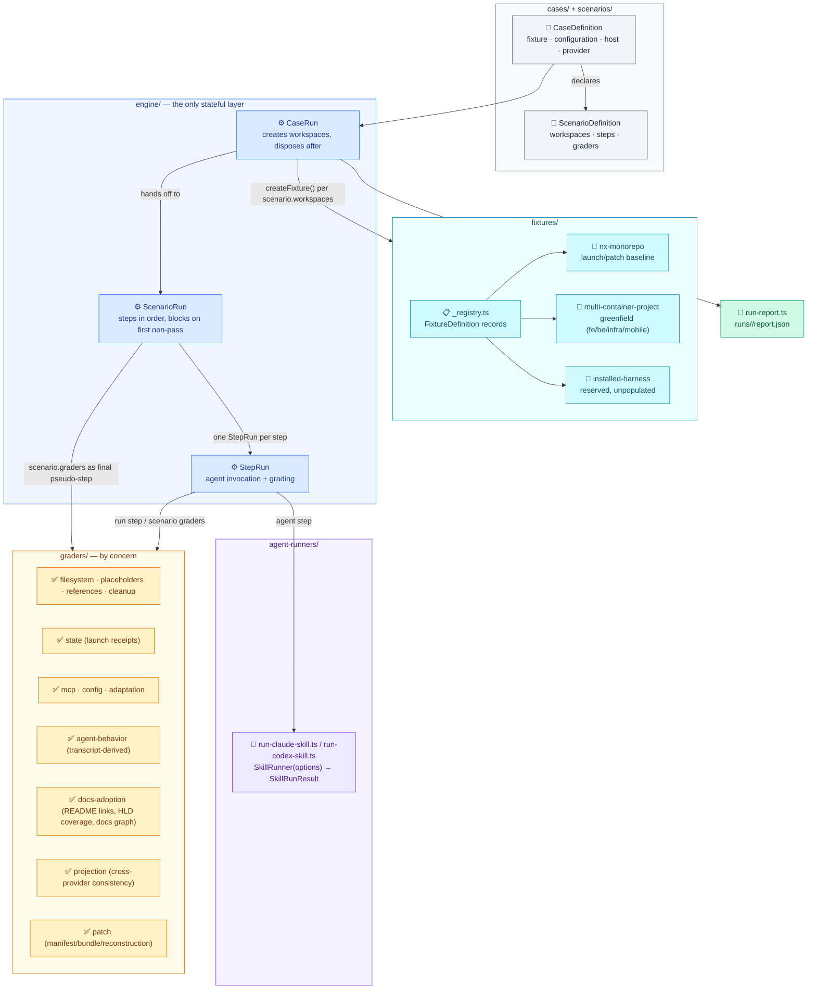

# Harness Bootstrap E2E — Overview

Implementation detail for the Harness Bootstrap E2E container: the test harness validating `.canonical-implementation-harness/` itself. Mirrors `docs/Target Architecture (HLD)/v1/Containers/Harness Bootstrap E2E.md`.

Component documents: [`01. Fixtures.md`](./01.%20Fixtures.md) · [`02. Cases and Scenarios.md`](./02.%20Cases%20and%20Scenarios.md) · [`03. Engine.md`](./03.%20Engine.md) · [`04. Agent Runners.md`](./04.%20Agent%20Runners.md) · [`05. Graders.md`](./05.%20Graders.md)

## Component detail

### Fixtures (`fixtures/`)

`_registry.ts` defines each fixture as a plain `FixtureDefinition` (`id`, `path`, `projectName`, `purpose`, `populated`, `hasHarness`, `hasDocs`, and a `containers[]` list of `{ name, path, evidence, stack }`) — repository facts only; requested integrations and lifecycles belong to the case, not the fixture. Three fixtures exist: `nx-monorepo` (minimal deterministic launch/patch baseline, one `sample-app` container), `multi-container-project` (greenfield bootstrap smoke fixture with four containers — `fe`/react, `be`/express, `infra`/aws-cdk-lib, `mobile`/react-native — explicitly "not a real product"), and `installed-harness` (reserved, `populated: false`, no containers yet). `utils/fixture.ts`'s `createFixture()` copies a fixture into a disposable scratch workspace per case; `installSkillPackage()` optionally pre-installs the bootstrap package for the declared host before the case runs.

### Cases and scenarios (`cases/`, `scenarios/`)

A **case** (`CaseDefinition`) is the concrete instance: which fixture, which `configuration`, optionally which `host` (Claude/Codex) and `provider`. A **scenario** (`ScenarioDefinition`) is the reusable shape: how many `workspaces` it needs, its `steps[]`, an optional `installPackage` flag, and an optional `requires` block (`fixtures`/`configurations`/`hosts`/`providers`) that `CaseRun.execute()` checks before running anything — a case that doesn't match what its scenario accepts fails immediately with every mismatch named at once, not one per rerun. `scenarios/bootstrap.ts` is the canonical example: a `requires` block scoped to `multi-container-project`/`aws-dev`, one agent step gated on `agentRunSucceeded()`, and a scenario-level grader list that runs one extra check (`codexPlanToolConfigured()`, via `when()`) only when the provider is Codex. `scenarios/patch-prepare-apply.ts` runs a two-workspace seed/prepare/apply patch workflow. `scenarios/feature-flows.ts` holds scenarios not yet wired to a case.

### Engine (`engine/`) — the only stateful layer

- **`CaseRun`** (`case-run.ts`) — validates requirement mismatches, creates the scenario's declared workspace count via `createFixture()`, builds the initial `GradeContext` (workspaces, fixture, provider/host, an empty `artifacts` map), hands off to `ScenarioRun`, disposes every workspace in a `finally` block (cleanup failures are collected into the report, not thrown), then assembles the `CaseReport`. Two safety nets live here: a scenario with zero steps and zero failures still fails (`"Scenario has no steps"`), and a scenario where every step passed but no grader ever ran also fails (`"Scenario completed without evaluating any grader"`) — a scenario that forgot its graders must not report a confident pass.
- **`ScenarioRun`** (`scenario-run.ts`) — runs each step via its own `StepRun` in declared order; the first step that doesn't pass sets `blockedBy`, and every subsequent step is recorded `blocked` (not executed, not failed) rather than skipped silently. After all steps, the scenario's own `graders` run as a final pseudo-step named for the scenario itself, sharing the same `<step>/<grader>` report keying and the same blocking rule as a real step.
- **`StepRun`** (`step-run.ts`) — a step may declare an `agent` invocation, arbitrary `run(context)` code, or both (the agent result lands on the shared `GradeContext` before `run` sees it, via `absorb()`). `launchAgent()` resolves the host from the step or the case, picks the target workspace, builds a transcript path under the workspace's launch directory, and calls the matching `runners[host]` adapter. A non-zero agent exit is never thrown here — it is reported by the `agentRunSucceeded()` grader, so a failed agent launch is a graded outcome, not a crash that aborts the run.

`run-report.ts`'s `recordCaseReport()` persists each case's final `CaseReport` to `runs/<case>/report.json` — the retained artifact a developer inspects after a run.

### Agent runners (`agent-runners/`)

Every host adapter implements the same `SkillRunner` shape: `(options: SkillRunOptions) => Promise<SkillRunResult>`. `options` carries `cwd` (must be an isolated scratch workspace, never a real project or this repo), `prompt`, `timeoutMs`, optional extra `addDirs`, an optional `transcriptPath`, and `logProgress` (on by default — `--output-format json` gives zero output until the whole turn ends, otherwise indistinguishable from a hang on a multi-minute launch/patch turn). The result carries `exitCode`, `stdout`/`stderr`, `durationMs`, the final stream-json `result` event if any (`json`), and the full ordered `events[]` transcript — graders that need to check _how_ the agent worked (task tracking usage, plan-mode usage) read `events`, not just the filesystem left behind. `run-claude-skill.ts` and `run-codex-skill.ts` are the two concrete adapters; `_registry.ts` maps `Provider` → adapter in a `runners` record.

### Graders (`graders/`) — by concern

`_registry.ts` is the single import surface scenarios configure against; it re-exports a `GraderBinding` factory per check from the concern module that owns it, while the underlying pure `grade*()` functions stay behind their own module, imported directly by that module's unit specs. Concerns: **filesystem/placeholders/references/cleanup** (`filesystem.grader.ts`, `placeholders.grader.ts`, `references.grader.ts`, `cleanup.grader.ts`) — raw file/content checks and unresolved-placeholder/INTENT-cleanup detection; **state** (`state.grader.ts` — the largest grader module) — launch receipts and operation-record consistency; **provider configuration** (`mcp.grader.ts`, `config.grader.ts`, `adaptation.grader.ts`) — MCP wiring, Codex plan-tool config, adaptation completeness; **agent behavior** (`agent-behavior.grader.ts`) — reads the transcript for `agentRunSucceeded`, `taskTrackingUsed`, `noPlanModeDuringAutomatedRun`; **documentation adoption** (`docs-adoption.grader.ts`) — `rootReadmeBudget`, `appReadmesLinkToArchitecture`, `hldCoversContainers`, `docsIndexExists`, `containerAgentsDeployed`, `docsGraphAdopted` — the grader family that checks exactly the kind of HLD/LLD/README coverage this document and its sibling container doc exist to satisfy; **projection** (`projection.grader.ts`) — cross-provider (Claude/Codex) consistency; **patch** (`patch.grader.ts`) — manifest schema, bundle hashes, apply reconstruction, provider scope.

## Integration pattern — CI and local

Deterministic layers (`unit`, `integration`) are Nx-cached (`cache: true` in `project.json`) and run with `nx affected --target=test` inside `ci.yml`, same as every other project's `test` target — no live model, no special wiring. Agent E2E (`agent-e2e`) is `cache: false` and never invoked by `ci.yml`; it only runs when a developer explicitly runs `yarn nx run harness-bootstrap-e2e:agent-e2e` (a guarded command per `CLAUDE.md`), using CLI authentication and model usage from their own environment.

## Key decisions

- Deterministic (`unit`/`integration`) and live-agent (`agent-e2e`) layers are three separate Vitest configs (`vitest.unit.config.ts`, `vitest.config.ts`, `vitest.agent-e2e.config.ts`), not one suite gated by an env var — this makes "does this test call a live model" a build-time fact (which config loaded it), not a runtime check that can be bypassed.
- `CaseRun` always disposes workspaces in a `finally`, even when workspace setup itself throws — a scratch fixture never survives a failed run to pollute a later one.
- `ScenarioRun` marks everything after the first non-passing step `blocked`, never silently skipped — a reader of the report can tell "didn't run because an earlier step failed" from "ran and failed" at a glance.
- Agent exit codes are graded, not thrown — `agentRunSucceeded()` turns a failed live launch into the same kind of reportable outcome as any other grader, instead of an uncaught exception that aborts the whole case.
