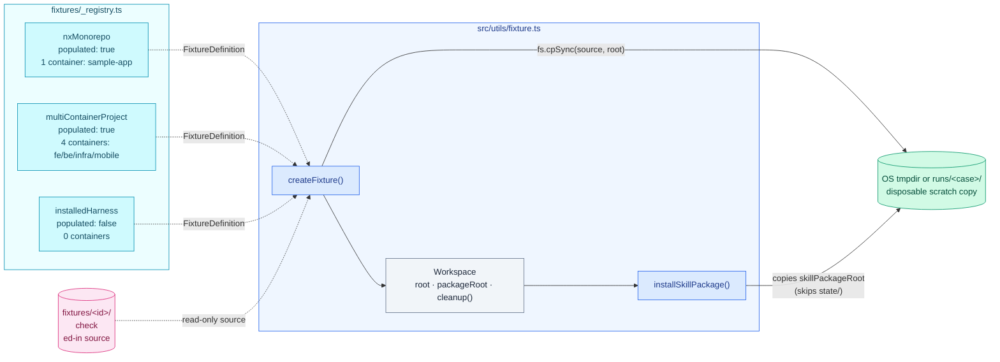

# Harness Bootstrap E2E — Fixtures

Scratch workspace sourcing for every case. Mirrors [`00. Overview.md`](./00.%20Overview.md)'s Fixtures section; drills into `fixtures/_registry.ts` and `src/utils/fixture.ts`.

## Component structure

`_registry.ts` defines each fixture as a plain `FixtureDefinition` — `id`, `path`, `projectName`, `purpose`, `populated`, `hasHarness`, `hasDocs`, and a `containers[]` list of `{ name, path, evidence, stack }`. These are repository facts only; requested integrations and lifecycles belong to the case, not the fixture.

Three fixtures exist:

| Fixture                 | `populated` | Containers                                                                      | Purpose                                                                 |
| ----------------------- | ----------- | ------------------------------------------------------------------------------- | ----------------------------------------------------------------------- |
| `nxMonorepo`            | `true`      | `sample-app` (no stack)                                                         | Minimal disposable Nx repository for deterministic harness launch tests |
| `multiContainerProject` | `true`      | `fe`/react, `be`/express, `infra`/aws-cdk-lib + cdk.json, `mobile`/react-native | Greenfield bootstrap smoke fixture — explicitly "not a real product"    |
| `installedHarness`      | `false`     | none                                                                            | Reserved for a project with an existing harness; not populated yet      |

## Execution flow

`createFixture(fixture, caseId)` in `src/utils/fixture.ts`:

1. Throws if `fixture.populated` is `false` — `installedHarness` cannot be used as a workspace source today.
2. Resolves `fixturesRoot/<fixture.path>` and throws if it doesn't exist on disk.
3. Picks a destination: `nextFixtureDir(caseId)` under `runs/` when `persistRuns` is set, otherwise an OS tmpdir (`hb-e2e-<fixture.id>-*`).
4. `fs.cpSync(source, root, { recursive: true })` — a full copy, never a reference into the checked-in fixture.
5. Computes `packageRoot` from the default Claude skills path; returns a `Workspace` (`{ fixture, root, packageRoot, cleanup() }`).

If `persistRuns` or `CLEANUP_WORKSPACES` is off, `cleanup()` is a no-op and the workspace is logged as kept — a retained run keeps its project by definition. Otherwise the workspace root is added to a module-level `live` set and a single `process.on('exit', …)` hook (registered once, lazily) force-removes any workspace a test forgot to dispose, so a thrown-before-cleanup test never leaks a tmpdir.

`installSkillPackage(workspace, host)` resets `workspace.packageRoot` to the chosen host's skill directory (`PROVIDER_DETAILS[host].skills`) and copies every entry of `skillPackageRoot` into it except `state/` — package state is never carried into a fresh test project. This is a local fixture convenience only; real consumer installation is a separate release-ZIP workflow.

## Constraints

- A fixture source directory (`fixtures/<id>/`) is read-only — no test target writes back into it; only the scratch copy under a tmpdir or `runs/` is ever mutated.
- `createFixture()` throws immediately on an unpopulated fixture (`installedHarness` today) rather than producing an empty workspace.
- The exit-hook backstop in `fixture.ts` only guards throwaway workspaces — it is skipped whenever `persistRuns` or a disabled `CLEANUP_WORKSPACES` means the caller asked to keep the directory.
