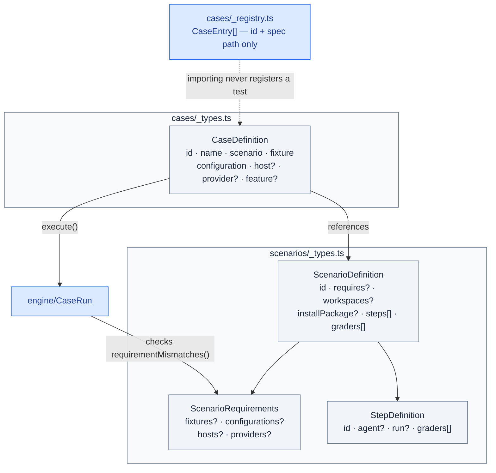

# Harness Bootstrap E2E — Cases and Scenarios

Case/scenario definitions: what runs, against what, and what it checks. Mirrors [`00. Overview.md`](./00.%20Overview.md)'s Cases and scenarios section; drills into `src/cases/_types.ts`, `src/scenarios/_types.ts`, `src/scenarios/bootstrap.ts` and `src/scenarios/patch-prepare-apply.ts`.

## Component structure

A **case** (`CaseDefinition`, `cases/_types.ts`) is the concrete instance: which `scenario`, which `fixture`, which `configuration` string, optionally which `host` (the CLI that executes) and `provider` (whose outputs are generated — the two need not match). `cases/_registry.ts` holds only `CaseEntry` rows (`{ id, path }`) so importing the registry never registers a Vitest spec by side effect; the actual `CaseDefinition` lives in each case's own `.spec.ts` file (e.g. `boot-claude-from-scratch-greenfield.spec.ts`, `patch-prepare-apply.spec.ts`).

A **scenario** (`ScenarioDefinition`, `scenarios/_types.ts`) is the reusable shape: `workspaces` (how many scratch projects to create, default none), an optional `installPackage` flag, ordered `steps[]`, and scenario-level `graders[]` run once every step passes. There is deliberately no `setup`/`cleanup` hook — the engine creates and disposes workspaces; anything a scenario needs first is just its first step.

`requires` (`ScenarioRequirements`) names what the scenario accepts — `fixtures`, `configurations`, `hosts`, `providers` — checked by `CaseRun.execute()` before any workspace exists. A case that doesn't match fails immediately with every mismatch named at once (see `requirementMismatches()` in `03. Engine.md`), not one per rerun.

## Scenario: `bootstrap` (`scenarios/bootstrap.ts`)

The canonical example. `requires` scopes it to `fixtures.multiContainerProject`, `configuration: 'aws-dev'`, and both hosts/providers (`claude`, `codex`). One workspace, `installPackage: true`.

- **Step `launch`** — an `agent` step whose `prompt` is built by `buildScratchLaunchPrompt(provider, host, fixture)`, timed out at `AGENT_RUN_TIMEOUT_MS`. Its only grader is `agentRunSucceeded()` — a non-zero host exit leaves nothing else worth judging, so this step gates the rest of the scenario rather than joining it.
- **Scenario graders** (run once `launch` passes): `taskTrackingUsed()`, `noPlanModeDuringAutomatedRun()`, a `filesystemCheck('installed', …)` asserting the dev skill and host instructions file exist, `launchState({ verified: true })`, `referencesResolve()`, `intentCleanup()`, `adaptationsComplete({ trackerSelected: false })`, `rootReadmeBudget()`, `mcpConfigured('aws-mcp')`, `appReadmesLinkToArchitecture()`, `hldCoversContainers()`, `docsIndexExists()`, `containerAgentsDeployed()`, `docsGraphAdopted()`, `noUnresolvedProviderPlaceholders(...)`.
- `when((c) => c.provider === PROVIDERS.codex, codexPlanToolConfigured())` — one grader runs conditionally, only for the Codex provider; `when()` returns `null` (not applicable) rather than failing when the predicate is false.

## Scenario: `patch-prepare-apply` (`scenarios/patch-prepare-apply.ts`)

`requires: { fixtures: [fixtures.nxMonorepo] }`, two workspaces (sender/receiver), no `installPackage` — the steps install state manually via `seedProjects`.

1. **`seed`** (`run` only, no agent) — for each workspace: `runStubbedLaunch()` then `initGitBaseline()` (a real git repo, committed, so patch prepare's `git status`/`git diff`-based drift detection has something to compare against). Appends a deterministic marker edit to the sender's canonical `where-we-are/TEMPLATE.md` and snapshots `PROJECTION_BEFORE`/`BUNDLES_BEFORE` into `grade.artifacts` for later graders to diff against.
2. **`prepare`** — a Claude agent step (`/harness-bootstrap patch prepare …`) against the sender; its `run` (`recordBundle`) finds the one new bundle folder created under `patch/` and records `BUNDLE_DIR`/`MANIFEST` in `artifacts`. Graders: `agentRunSucceeded()`, `patchManifestSchema(MANIFEST)`, `patchBundleHashes(BUNDLE_DIR, MANIFEST)`, `patchApplyReconstruction(...)` against the recorded `ORIGINAL_CANONICAL` bytes, `prepareDoesNotDeploy()` (prepare must only package, never deploy to a provider projection), `patchProviderScope('prepare', …)` (prepare's own record must claim no provider).
3. **`apply`** — a Claude agent step against the receiver's workspace (`workspace: 1`) running `/harness-bootstrap patch apply <relative bundle path>`; `transferBundle()` copies only the bundle directory across, never other project state. Graders: `agentRunSucceeded()`, `applyUpdatesCanonical()` (the canonical edit marker must now be present in the receiver), `patchProviderScope('apply', …, [claude, codex])` — apply must cover both providers the receiver had launched for.

`scenarios/feature-flows.ts` (`designDevScenario`, `devOnlyScenario`) holds scenarios registered in `scenarios/_registry.ts` but not yet wired to a case.

## Constraints

- Scenario and case IDs are centralized in `scenarios/_registry.ts` and `cases/_registry.ts` — no spec file registers itself by import side effect elsewhere.
- `requirementMismatches()` is checked before any workspace is created — a misconfigured case never spends a fixture copy or an agent invocation before failing.
- Patch scenario graders never cross the sender/receiver boundary except through the explicitly transferred bundle directory — `transferBundle()` is the only path that copies files between workspaces.
