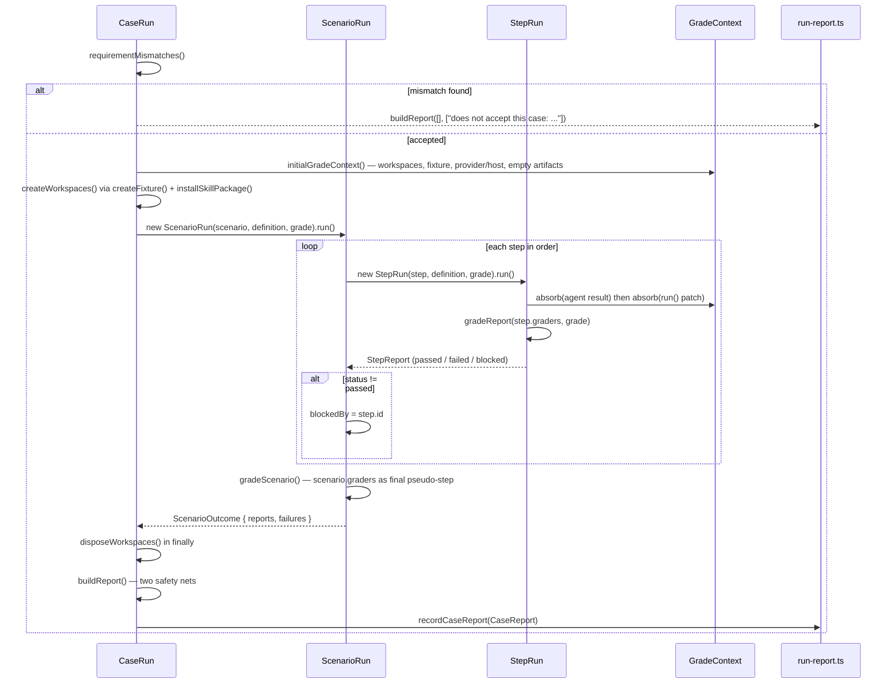
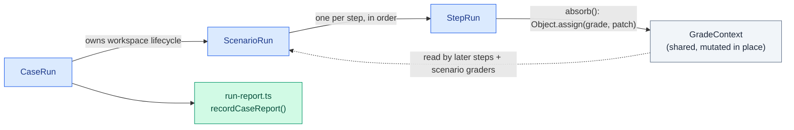

# Harness Bootstrap E2E — Engine

The only stateful layer: runs one case end to end and produces its report. Mirrors [`00. Overview.md`](./00.%20Overview.md)'s Engine section; drills into `src/engine/case-run.ts`, `scenario-run.ts`, `step-run.ts` and `run-report.ts`.

## Execution flow

## `CaseRun` (`case-run.ts`)

`execute()`:

1. `requirementMismatches(definition, scenario)` — short-circuits with a failed report naming every mismatch (fixture/configuration/host/provider) at once if the scenario's `requires` rejects the case; no workspace is created on this path.
2. `initialGradeContext()` builds the starting `GradeContext`: `workspaces`, `root`/`packageRoot` shorthands (`workspaces[0]`), `fixture`, `containers` (names from `fixture.containers`), `provider`/`host`, `providers` (singleton array when `provider` is set), and an empty `artifacts` Map.
3. `createWorkspaces()` calls `createFixture(fixture, definition.id)` once per `scenario.workspaces ?? 0`, and `installSkillPackage(workspace, host ?? claude)` when `scenario.installPackage` is set.
4. Hands the grade context to `new ScenarioRun(scenario, definition, grade).run()`.
5. In a `finally` block, `disposeWorkspaces()` calls `workspace.cleanup()` for every created workspace — a cleanup failure is pushed into `failures` and collected into the report, never thrown, and this runs even when workspace setup itself threw.
6. `buildReport()` assembles the final `CaseReport`.

**Two safety nets in `buildReport()`:**

- A scenario with zero step reports and zero run-level failures still fails: `"Scenario has no steps"`.
- A scenario where every step reports `passed` but no grader entry exists in the flattened `graders` map also fails: `"Scenario completed without evaluating any grader"` — a scenario that forgot its graders must not report a confident pass.

`outcome()` derives the case's `Outcome` (`'passed' | 'failed' | 'blocked'`) from the reports and failures: any failure or any `failed` step makes the case `failed`; any `blocked` step (with no failure) makes it `blocked`; otherwise `passed`.

## `ScenarioRun` (`scenario-run.ts`)

Runs each `StepDefinition` via its own `StepRun`, in declared order, against the one shared `GradeContext` instance. `collect()` records every `StepReport` and sets `blockedBy` to the first step whose status isn't `passed` — every step after that is recorded via `blockedStep()` (status `blocked`, not executed, not failed) rather than silently skipped, so a reader can tell "didn't run because an earlier step failed" from "ran and failed" at a glance.

After all steps, `gradeScenario()` runs the scenario's own `graders[]` as a final pseudo-step named for the scenario itself (`gradeReport(scenario.id, graders, grade, ...)`) — sharing the same `<step>/<grader>` report keying and the same blocking rule as a real step (if `blockedBy` is already set, the scenario graders report `blocked` too, never run).

A throw inside `gradeScenario()` itself (not a step — those are caught inside their own `StepRun`) is caught here and recorded as a run-level failure, `Scenario <id> failed: <message>`.

## `StepRun` (`step-run.ts`)

A step may declare an `agent` invocation, arbitrary `run(context)` code, or both; a step with neither is immediately `blockedStep()`. When both are present, `agent` runs first so `run` sees its result already merged onto the context — `absorb()` does `Object.assign(this.context.grade, output ?? {})` after each phase, so later phases and later steps see what earlier ones discovered.

`launchAgent()` resolves the host from `agent.host?.(grade) ?? grade.host` (throws if neither names one), picks `grade.workspaces[agent.workspace ?? 0]`, builds a transcript path under `<workspace.packageRoot>/<LAUNCH_DIR>/<host>-<step.id>-transcript-<timestamp>.jsonl`, and calls `runners[host]({ cwd, prompt, timeoutMs, transcriptPath })`. **Blocking semantics**: a non-zero agent exit is never thrown from here — it becomes a `{ launch, transcriptPath }` patch absorbed onto the context like any other step output, and `agentRunSucceeded()` (see `05. Graders.md`) is what turns it into a graded failure. A thrown error (e.g. missing host/workspace, or the adapter itself rejecting) is caught by `execute()` and reported as a `failed` step with `transcriptDiagnostics(grade)` appended to its failures.

## `run-report.ts`

`recordCaseReport(report)` writes the case's `CaseReport` to `runs/<case>/report.json` only when `persistRuns` is set — a discarded run writes nothing. This is the retained artifact a developer inspects after a run.

## Constraints

- `GradeContext` is one mutable object per case run, shared by reference across every `StepRun` and the scenario's own grading — there is no per-step copy.
- Workspace disposal always runs, in a `finally`, even when workspace creation itself throws.
- A step's agent exit code is a graded outcome, never a thrown exception that aborts the case.
