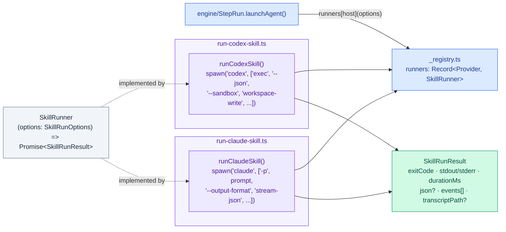

# Harness Bootstrap E2E — Agent Runners

Headless CLI adapters, one per host. Mirrors [`00. Overview.md`](./00.%20Overview.md)'s Agent runners section; drills into `src/agent-runners/_types.ts`, `run-claude-skill.ts`, `run-codex-skill.ts` and `_registry.ts`.

## Component structure

Every host adapter implements the same `SkillRunner` shape (`agent-runners/_types.ts`): `(options: SkillRunOptions) => Promise<SkillRunResult>`. `SkillRunOptions` carries `cwd` (must be an isolated scratch workspace, never a real project or this repo), `prompt`, `timeoutMs`, optional extra `addDirs`, an optional `transcriptPath`, and `logProgress` (defaults `true` — `--output-format json`/`--json` gives zero output until the whole turn ends, otherwise indistinguishable from a hang on a multi-minute launch/patch turn). `SkillRunResult` carries `exitCode`, `stdout`/`stderr`, `durationMs`, the final stream-json `result`/`turn.completed` event if any (`json`), and the full ordered `events: StreamEvent[]` — graders that need to check _how_ the agent worked (task tracking usage, plan-mode usage) read `events`, not just the filesystem left behind.

`_registry.ts` maps `Provider → adapter` in a `runners: Record<Provider, SkillRunner>` record, keyed so `StepRun.launchAgent()` resolves its adapter by provider instead of branching.

## `run-claude-skill.ts`

Spawns `claude -p <prompt> --output-format stream-json --include-partial-messages --verbose --permission-mode bypassPermissions`, plus `--add-dir` per entry in `addDirs`. Reads `stdout` line by line, parsing each line as a `StreamEvent`; a non-JSON mid-stream line is silently skipped (streams can be split across chunks). Tracks the `type: "result"` event as `finalResult`. On `close`, writes the complete raw `stdout` to `transcriptPath` if given, and resolves `exitCode` as whatever the process actually exited with — no post-hoc success/failure reinterpretation. `describeEvent()` renders a short progress line per event (`[init] model=...`, `[tool] <name>`, `[text] <snippet>`, `[result] <subtype> in <ms>ms`) when `logProgress` is on.

## `run-codex-skill.ts`

Spawns `codex exec --json --ephemeral --skip-git-repo-check --model <HB_E2E_CODEX_MODEL env or default> --sandbox workspace-write -c approval_policy="never" -c tools.update_plan.enabled=true -`, writing the prompt to the child's `stdin` and closing it. Before spawning, it creates `.agents` and `.codex` directories under `cwd` and adds them as extra writable roots via `--add-dir` — Codex protects its own provider directories by default, and bootstrap needs to write skills/agents/config under them during the run. Differs from the Claude adapter in two ways that matter:

- **Success determination**: `exitCode` in the returned result is forced to `1` whenever `timedOut`, the raw process `code !== 0`, no `turn.completed` event appeared, or any `turn.failed` event appeared — a completed turn with a zero process exit is treated as authoritative, but a reconnect-style `error` event alone does not fail the run (Codex emits those for recoverable stream reconnects).
- **Timeout handling**: on timeout it sends `SIGTERM` then schedules a `SIGKILL` five seconds later if the process hasn't exited, and appends `"\nCodex timed out"` to `stderr`.

Both adapters persist the full raw `stdout` to `transcriptPath` (when given) inside their `close` handler, wrapping the write in its own `try/catch` so a transcript-write failure degrades to an appended `stderr` note rather than losing the run's result.

## Constraints

- `cwd` for either adapter must be a disposable scratch workspace — neither adapter validates this itself; it is a caller contract enforced by `StepRun`/`CaseRun` always sourcing it from `createFixture()`.
- Only `exitCode === 0`-for-Claude or the Codex-specific completed-turn check determines pass/fail at the adapter boundary; grading a failed launch is the `agentRunSucceeded()` grader's job (see `05. Graders.md`), never the adapter's.
- Real agent spend per call — both adapters invoke a live CLI; they are only ever exercised from the `agent-e2e` layer, never `unit`/`integration`.
