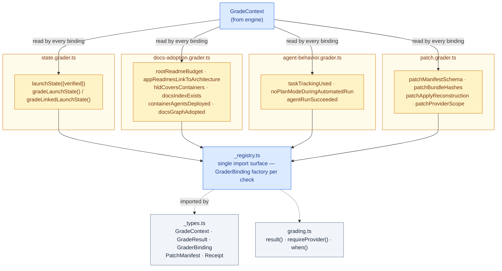

# Harness Bootstrap E2E — Graders

Filesystem/transcript/receipt checks, grouped by concern. Mirrors [`00. Overview.md`](./00.%20Overview.md)'s Graders section; drills into `src/graders/_registry.ts`, `_types.ts`, `grading.ts`, and the `state.grader.ts`, `docs-adoption.grader.ts`, `agent-behavior.grader.ts` and `patch.grader.ts` modules.

## Component structure

`_registry.ts` is the single import surface scenarios configure against: it re-exports a `GraderBinding` factory per check from the concern module that owns it, while the underlying pure `grade*()` functions stay behind their own module, imported directly by that module's unit specs. A `GraderBinding` is `(context: GradeContext) => GradeResult | null | Promise<GradeResult | null>` (`_types.ts`); returning `null` means "not applicable here" — the runner skips it rather than counting it as a pass or a failure. `grading.ts` supplies three shared helpers: `result(grader, failures)` (wraps a `GradeResult`, `pass = failures.length === 0`), `requireProvider(context)` (throws if the context has no single `provider` — a configuration error, not a test failure), and `when(predicate, binding)` (returns `null` when the predicate is false, used for provider-conditional graders).

## State (`state.grader.ts`)

The largest grader module. `gradeLaunchState(packageRoot, runId, expectVerified)` validates `runId` against `/^[A-Za-z0-9_-]+$/` then delegates to `gradeState()`, which checks the materialization receipt (`<packageRoot>/state/launch/runs/<runId>/materialization.json`) matches `runId` and `status: 'materialized'` with a non-empty `files[]`, and — when `expectVerified` — that a verification receipt exists and `verifyReceipt()` passes: receipt/verification `run_id` and `plan_sha256` agree, every verification check is `status: 'passed'` with non-empty `evidence`, the verified `outputs[]` set exactly matches the receipt's non-temporary `files` + `derived_outputs`, and every output's current on-disk hash still matches its recorded `sha256` (`checkedOutputPath()` additionally rejects absolute paths, `..`/`.git` segments and symlinks). When `expectVerified` is true but no verification receipt exists yet, `gradeExternalGatePartialLaunch()` instead accepts a truthful **partial** state: a matching in-progress launch operation record, stage progress agreeing with the Stage E report, recorded local-verification evidence, and at least one outstanding external gate (independent review or Mermaid rendering) explicitly still `pending`/`blocked`.

`gradeLinkedLaunchState()` covers the multi-stage (A/B/C) linked-materialization shape: it requires exactly one linked launch operation, a Stage E report still honestly in-progress, a pending-or-accepted review verdict, an outstanding Mermaid gate, verified stage receipts for every one of A/B/C, and every recorded output hash still matching disk. `launchState({ verified })` is the exported `GraderBinding`: it resolves `runId` from `context.runId` or `resolveLaunchRunId(packageRoot)` and calls `gradeLaunchState()`.

## Docs adoption (`docs-adoption.grader.ts`)

The grader family that checks exactly the kind of HLD/LLD/README coverage this document and its sibling container doc exist to satisfy:

| Export                           | Checks                                                                                                                                                                         |
| -------------------------------- | ------------------------------------------------------------------------------------------------------------------------------------------------------------------------------ |
| `rootReadmeBudget()`             | Root `README.md` exists, is under `ROOT_README_BUDGET_CHARS` (6000, a generous ceiling catching "whole project history inlined" drift), and links into `docs/`                 |
| `appReadmesLinkToArchitecture()` | Each container's `apps/<container>/README.md` mentions `HLD`/`Target Architecture` and `LLD`/`System Architecture`                                                             |
| `hldCoversContainers()`          | `docs/Target Architecture (HLD)/README.md` exists and every discovered container name appears somewhere in the whole HLD tree                                                  |
| `docsIndexExists()`              | `docs/README.md` exists                                                                                                                                                        |
| `containerAgentsDeployed()`      | Each container has a deployed agent file at `<agents>/<container>.<extension>` for `requireProvider(c)`                                                                        |
| `docsGraphAdopted()`             | `docs/.og/` contains every file in `DOCS_GRAPH_FILES` (the operational-graph deploy set) and does **not** contain `cli.test.mjs` (canonical-only tooling that must never ship) |

## Agent behavior (`agent-behavior.grader.ts`)

`agentRunSucceeded()` fails if `c.launch` is absent, or reports the host's `exitCode`/`stderr`/`stdout` when it is non-zero — this is where a `StepRun.launchAgent()` non-throwing failure becomes a graded outcome. `gradeTaskTrackingUsed(events, packageRoot)` detects native tracker usage from `StreamEvent[]` (tool calls named `TaskCreate`/`TaskUpdate`/`TaskList`/`TodoWrite`/`update_plan`, or a `todo_list` item, excluding any whose tool result was an error) and, when `packageRoot` is given, cross-checks the durable launch report's `## Progress` table against the live native-tracker snapshot (`nativeProgress()`): exact stage count and order, only the first incomplete stage may be `in progress`, and native/report statuses must agree per stage. `gradeNoPlanModeDuringAutomatedRun(events)` fails if any `EnterPlanMode`/`ExitPlanMode` tool call appears — launch is meant to execute once Q&A resolves, not re-enter planning mid-run.

## Patch (`patch.grader.ts`)

Four checks over a patch bundle's manifest/payload contract (schema version 2, per `.canonical-implementation-harness`'s patch-state reference):

- `patchManifestSchema(manifest)` — `schema_version === 2`, `id` is a UUID, `operation` is one of `harvest`/`prepare`/`apply`/`launch`, at least one change, and each change's required fields match its `operation` (`add`: null `before_sha256` + present `after_sha256`/`payload`; `update`: both hashes + a diff `payload`; `rename`/`copy`: `old_path` + both hashes; `delete`: `before_sha256` present, `after_sha256` null).
- `patchBundleHashes(bundleDir, manifest)` — every change's payload file exists under `bundleDir`, its bytes hash to `payload_sha256`, and an `add` payload's bytes also hash to `after_sha256`.
- `patchApplyReconstruction(bundleDir, manifest, baseFor)` — for every `update` change, applying its diff payload to `baseFor(path)` reproduces exactly `after_sha256` (via the `diff` package's `applyPatch`) — the core portability guarantee that a bundle can reconstruct the canonical change.
- `patchProviderScope(operation, expectedProviders?)` — the local operation record's `providers[]` array respects `SCOPE_BY_MODE` bounds (`prepare`: 0; `harvest`: exactly 1; `apply`/`launch`: 0..N), has no duplicates, every entry is a known `Provider`, every mapped per-file result either names a provider inside that scope or is `shared`/`canonical-only`, an `applied` status covers every provider in scope, and (when `expectedProviders` is given) the recorded scope includes every one of them.

## Constraints

- A new check is added to the module owning its concern first, then re-exported from `_registry.ts` — scenarios never import a concern module directly.
- `GraderBinding` factories resolve all their arguments from `GradeContext`/`artifacts`; the pure `grade*()` functions underneath take explicit arguments and are what unit specs import and test directly.
- `requireProvider()` throwing is a scenario misconfiguration (no single provider set), distinct from any grader returning a failing `GradeResult`.
