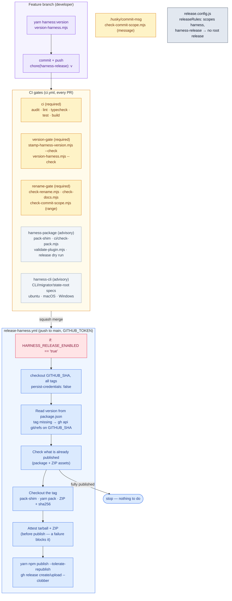

# Harness Release Pipeline — Overview

The PR stamps the harness version with `scripts/release/version-harness.mjs`; on merge, `.github/workflows/release-harness.yml` tags that version through the API and publishes it with `GITHUB_TOKEN` only. Mirrors `docs/Target Architecture (HLD)/v1/Containers/Harness Release Pipeline.md`.

## Component detail

## Nx Release configuration (`nx.json`)

`release.projects` is `["artisyn-implementation-harness"]` in `projectsRelationship: independent` mode, tag pattern `{projectName}-v{version}`, conventional-commit versioning with `fallbackCurrentVersionResolver: disk`, a project changelog into the harness `CHANGELOG.md` with `automaticFromRef`, and `conventionalCommits.useCommitScope: false` — with Nx's default, a `feat(harness)!:` commit would be scored as an indirect patch because the scope is not the project name, and the breaking rename would never have produced 4.0.0.

## Release scripts

| Script                                      | Role                                                                                                                                                                                                                                                                                                                                                             |
| ------------------------------------------- | ---------------------------------------------------------------------------------------------------------------------------------------------------------------------------------------------------------------------------------------------------------------------------------------------------------------------------------------------------------------- |
| `scripts/release/version-harness.mjs`       | `yarn harness:version`. Finds the latest `artisyn-implementation-harness-v*` tag reachable from HEAD (`git tag --merged HEAD`), runs `nx release version` with no commit, tag or staging, stamps the manifests, drops changelog entries for unreleased versions from earlier runs and runs `nx release changelog <version>`. Fails clearly with no reachable tag |
| `version-harness.mjs --check`               | Runs the same version step, restores `package.json`, and exits 1 when the stamped version differs, the changelog lacks the entry, the changelog has an entry for a version the branch does not release, or the manifests disagree. Passes when the branch releases nothing                                                                                       |
| `scripts/release/stamp-harness-version.mjs` | Writes the version from `skills/implementation-harness/package.json` into 7 fields (frontmatter `metadata.version` of the harness and the shim, `plugin.json` `version`, `version` + tag `ref` in both marketplace files); `--check` writes nothing and names each mismatch. The shim target is skipped once the legacy shim's `SKILL.md` is removed (5.0.0)     |

The baseline tag `artisyn-implementation-harness-v3.5.0` on `c8d82c9` gives the first computation a starting point. `NX_CMD` overrides how Nx runs; `version-harness.spec.ts` uses it with a fake Nx.

## As-built mechanisms

Four mechanisms differ from the design text and stand as built (accepted 2026-11-15; versioning moved into the PR under TD-5, 2026-11-16):

| Mechanism      | As built                                                                                                                                                                                      |
| -------------- | --------------------------------------------------------------------------------------------------------------------------------------------------------------------------------------------- |
| Versioning     | `nx release version` on the feature branch, through `version-harness.mjs`; requires the `@nx/js` plugin — an exact-pinned dev dependency                                                      |
| npm publish    | `yarn npm publish --tolerate-republish` (not `nx release publish`): yarn-only and re-run-safe; needs `npmScopes.dataart` in `.yarnrc.yml` (GitHub Packages registry, `GITHUB_PACKAGES_TOKEN`) |
| GitHub Release | Created by `gh release create --verify-tag` after the workflow creates the tag                                                                                                                |
| Changelog      | Written in the PR; entries link the PR's commit hashes, which stay reachable on GitHub through the PR after a squash merge                                                                    |

## Execution flow and re-run safety

The workflow checks out the triggering commit (`GITHUB_SHA`) with all tags and reads the version from `skills/implementation-harness/package.json`. When the tag is missing, it creates it on `GITHUB_SHA` through `gh api repos/$GITHUB_REPOSITORY/git/refs`. When the tag exists — a merge that did not change the harness, or a re-run — it goes on to finish that release. The publish state check queries the npm version and the Release assets, prints "fully published" and stops when both exist, otherwise rebuilds from the tag checkout and republishes. Attestations run before publish, so a failed attestation blocks the release and a re-run repeats it.

## Token model

Every step runs with `GITHUB_TOKEN`. Checkout sets `persist-credentials: false`. The workflow never commits or pushes to `main`, and branch rulesets do not cover tags, so no bypass actor is involved. `workflows.spec.ts` asserts no push to `main`, no release token, API tag creation and attest-before-publish.

| Credential                               | Holder and use                                                                                                                   |
| ---------------------------------------- | -------------------------------------------------------------------------------------------------------------------------------- |
| `GITHUB_TOKEN` (this workflow)           | Tag creation (`gh api`), `yarn npm info`/publish (`GITHUB_PACKAGES_TOKEN`), `gh release`, attestations                           |
| Developer's own git credentials          | Push the `chore(harness-release): <version>` commit to the feature branch                                                        |
| `GITHUB_TOKEN` as the GitHub Actions app | Root `release.yml` only: pushes its `chore(release)` commit, which needs the GitHub Actions app as a ruleset bypass actor (TD-5) |

## Gates and scope rules

| Gate                             | What it enforces                                                                                                                                                                                                                                                                                                                                                                                                                                                                            |
| -------------------------------- | ------------------------------------------------------------------------------------------------------------------------------------------------------------------------------------------------------------------------------------------------------------------------------------------------------------------------------------------------------------------------------------------------------------------------------------------------------------------------------------------- |
| `scripts/ci/check-pack.mjs`      | `yarn pack --dry-run --json` matches the `files` allowlist; the generated shim copy under the package's `legacy/` folder (written by `scripts/pack-shim.mjs` on `prepack`) is present while the shim exists; nothing forbidden ships                                                                                                                                                                                                                                                        |
| `stamp --check`                  | The 7 stamped fields agree with `package.json` on every PR                                                                                                                                                                                                                                                                                                                                                                                                                                  |
| `version-harness.mjs --check`    | The branch is stamped with the version its commits call for and carries exactly that changelog entry (`version-gate`, `fetch-depth: 0`)                                                                                                                                                                                                                                                                                                                                                     |
| `scripts/validate-plugin.mjs`    | Runs `claude plugin validate --json` on the root and `plugin.json`; fails on every error and warning except the one named root-`CLAUDE.md` note — `--strict` cannot pass with the repo root as the plugin root                                                                                                                                                                                                                                                                              |
| `scripts/check-rename.mjs`       | No retired package name outside the allowlisted history/migration places; the full name is never a skill, folder or command                                                                                                                                                                                                                                                                                                                                                                 |
| `scripts/check-docs.mjs`         | No `/releases/latest` links and no unpinned `gh skill install` examples in docs                                                                                                                                                                                                                                                                                                                                                                                                             |
| `scripts/check-commit-scope.mjs` | A commit touching `skills/implementation-harness/**`, the shim, `.claude-plugin/`, `.agents/plugins/` or `skills.sh.json` must use scope `harness` or `harness-release`; run by `.husky/commit-msg` per message (skips `Merge`/`Revert` subjects) and by CI over the PR range with `git log --no-merges` (skips merges only, so a GitHub `Revert "…"` commit needs a scoped subject); NUL-separated file lists, so non-ASCII names are seen. It checks commits, not a squash-merge PR title |

The root semantic-release lane stays separate: `release.config.js` carries `releaseRules` that produce no root `v*` release for scopes `harness` and `harness-release`, placed ahead of the preset so a breaking harness commit cannot cut a root major.

## Constraints

- The workflow is inert until the repository variable `HARNESS_RELEASE_ENABLED` is `true`. It needs no secret and no actor guard; it creates no commit, so it cannot retrigger itself.
- Only `ci`, `version-gate` and `rename-gate` are required checks on `main`; `harness-package` and `harness-cli` run on every PR as advisory signals
- One job holds `contents`, `packages`, `id-token` and `attestations` write for all steps
- Operation (ruleset, baseline tag, per-PR versioning, first release, smoke checks): `docs/Engineering Guide/08 Harness Release Runbook.md`
