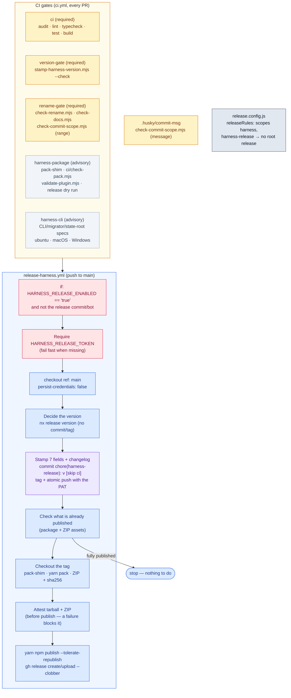

# Harness Release Pipeline — Overview

Implementation detail for the Harness Release Pipeline container: `.github/workflows/release-harness.yml` plus the scripts and gates around it. Mirrors `docs/Target Architecture (HLD)/v1/Containers/Harness Release Pipeline.md`.

## Component detail

## Nx Release configuration (`nx.json`)

`release.projects` is `["artisyn-implementation-harness"]` in `projectsRelationship: independent` mode, tag pattern `{projectName}-v{version}`, conventional-commit versioning with `fallbackCurrentVersionResolver: disk`, a project changelog into the harness `CHANGELOG.md` with `automaticFromRef` (works with no earlier tag), and `conventionalCommits.useCommitScope: false` — with Nx's default, a `feat(harness)!:` commit would be scored as an indirect patch because the scope is not the project name, and the breaking rename would never have produced 4.0.0.

## As-built mechanisms

Four mechanisms differ from the design text and stand as built (accepted 2026-11-15):

| Mechanism      | As built                                                                                                                                                                                      |
| -------------- | --------------------------------------------------------------------------------------------------------------------------------------------------------------------------------------------- |
| Versioning     | `nx release version` requires the `@nx/js` plugin — an exact-pinned dev dependency                                                                                                            |
| npm publish    | `yarn npm publish --tolerate-republish` (not `nx release publish`): yarn-only and re-run-safe; needs `npmScopes.dataart` in `.yarnrc.yml` (GitHub Packages registry, `GITHUB_PACKAGES_TOKEN`) |
| GitHub Release | Created by `gh release create` after the tag is pushed — Nx would create it before the tag exists on the remote                                                                               |
| Changelog      | `automaticFromRef`, so the first release works without a baseline tag                                                                                                                         |

## Execution flow and re-run safety

The workflow always checks out the tip of `main` (`ref: main`), not the triggering commit, so a run queued behind another release sees that release's commit. When `nx release version` changes nothing, the run resolves the latest harness tag reachable from `origin/main` (`git tag --merged`) and finishes whatever that tag still misses: the publish state check queries the npm version and the Release assets, prints "fully published" and stops when both exist, otherwise rebuilds from the tag checkout and republishes. The release commit (`chore(harness-release): <version> [skip ci]`) and the tag are pushed with `git push --atomic` — branch and tag land together or not at all. Attestations run before publish, so a failed attestation blocks the release and a re-run repeats it.

`scripts/release/stamp-harness-version.mjs` reads the version from `skills/implementation-harness/package.json` and writes it into 7 fields in place (frontmatter `metadata.version` of the harness and the shim, `plugin.json` `version`, and `version` + tag `ref` in both marketplace files); `--check` writes nothing and names each mismatch. The shim target is skipped once the legacy shim's `SKILL.md` is removed (5.0.0).

## Token model

Checkout runs with `persist-credentials: false` and no PAT. `HARNESS_RELEASE_TOKEN` is read in exactly two steps: the fail-fast presence check and the push. `workflows.spec.ts` asserts that confinement, the `ref: main` checkout and the atomic push.

| Credential                               | Holder and use                                                                                                                           |
| ---------------------------------------- | ---------------------------------------------------------------------------------------------------------------------------------------- |
| `HARNESS_RELEASE_TOKEN` (interim)        | Fine-grained repo-admin PAT, expires in ≤ 1 year; pushes the release commit and tag through the ruleset's Repository admin bypass (TD-2) |
| GitHub App token (target)                | Org-level App as the bypass actor, token minted per run; then the workflow splits into a version job and a publish job (TD-3)            |
| `GITHUB_TOKEN` as the GitHub Actions app | Second bypass actor, so the root `release.yml` keeps pushing its `chore(release)` commit                                                 |
| `GITHUB_TOKEN` (this workflow)           | Every other step: `yarn npm info`/publish (`GITHUB_PACKAGES_TOKEN`), `gh release`, attestations                                          |

## Gates and scope rules

| Gate                             | What it enforces                                                                                                                                                                                                                                                                                                                                                                                                                                                                            |
| -------------------------------- | ------------------------------------------------------------------------------------------------------------------------------------------------------------------------------------------------------------------------------------------------------------------------------------------------------------------------------------------------------------------------------------------------------------------------------------------------------------------------------------------- |
| `scripts/ci/check-pack.mjs`      | `yarn pack --dry-run --json` matches the `files` allowlist; the generated shim copy under the package's `legacy/` folder (written by `scripts/pack-shim.mjs` on `prepack`) is present while the shim exists; nothing forbidden ships                                                                                                                                                                                                                                                        |
| `stamp --check`                  | The 7 stamped fields agree with `package.json` on every PR                                                                                                                                                                                                                                                                                                                                                                                                                                  |
| `scripts/validate-plugin.mjs`    | Runs `claude plugin validate --json` on the root and `plugin.json`; fails on every error and warning except the one named root-`CLAUDE.md` note — `--strict` cannot pass with the repo root as the plugin root                                                                                                                                                                                                                                                                              |
| `scripts/check-rename.mjs`       | No retired package name outside the allowlisted history/migration places; the full name is never a skill, folder or command                                                                                                                                                                                                                                                                                                                                                                 |
| `scripts/check-docs.mjs`         | No `/releases/latest` links and no unpinned `gh skill install` examples in docs                                                                                                                                                                                                                                                                                                                                                                                                             |
| `scripts/check-commit-scope.mjs` | A commit touching `skills/implementation-harness/**`, the shim, `.claude-plugin/`, `.agents/plugins/` or `skills.sh.json` must use scope `harness` or `harness-release`; run by `.husky/commit-msg` per message (skips `Merge`/`Revert` subjects) and by CI over the PR range with `git log --no-merges` (skips merges only, so a GitHub `Revert "…"` commit needs a scoped subject); NUL-separated file lists, so non-ASCII names are seen. It checks commits, not a squash-merge PR title |

The root semantic-release lane stays separate: `release.config.js` carries `releaseRules` that produce no root `v*` release for scopes `harness` and `harness-release`, placed ahead of the preset so a breaking harness commit cannot cut a root major.

## Constraints

- The workflow is inert until the repository variable `HARNESS_RELEASE_ENABLED` is `true`. Today it skips its own release commit two ways: `[skip ci]` and the `chore(harness-release):` message-prefix check. The actor guard (`github.actor != vars.HARNESS_RELEASE_BOT`) takes effect only once `HARNESS_RELEASE_BOT` is set to a GitHub App's bot login.
- Only `ci`, `version-gate` and `rename-gate` are required checks on `main`; `harness-package` and `harness-cli` run on every PR as advisory signals
- One job currently holds `id-token`/`attestations` for all steps and both pushes and publishes — split into a version job and a publish job when the PAT is replaced by a GitHub App (TD-2/TD-3)
- Operation (ruleset, secrets, first release, smoke checks): `docs/Engineering Guide/08 Harness Release Runbook.md`
