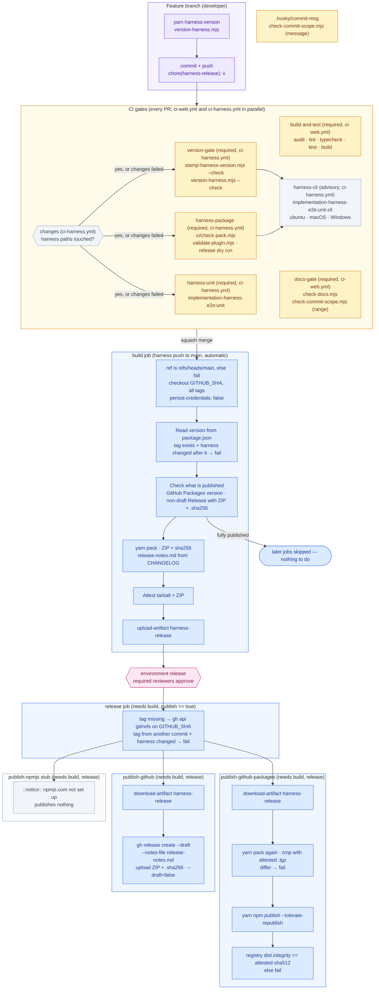

# Harness Release Pipeline — Overview

The PR stamps the harness version with `scripts/release/version-harness.mjs`. On every merge, the `build` job of `.github/workflows/deploy-harness.yml` (`Deploy harness`) builds and attests that version; after a reviewer approves the `release` environment, the `release` job tags it through the API, and `publish-github-packages` and `publish-github` publish it in parallel. A third job, `publish-npmjs`, is a stub that publishes nothing. Every job uses `GITHUB_TOKEN` only. It is the repository's only release lane. Mirrors `docs/Target Architecture (HLD)/v1/Containers/Harness Release Pipeline.md`.

## Component detail

## Nx Release configuration (`nx.json`)

`release.projects` is `["artisyn-implementation-harness"]` in `projectsRelationship: independent` mode, tag pattern `releaseTag.pattern: v{version}` (releases up to 4.0.2 carry the long tag `artisyn-implementation-harness-v{version}`), conventional-commit versioning with `fallbackCurrentVersionResolver: disk`, a project changelog into the harness `CHANGELOG.md` with `automaticFromRef` and a custom renderer (`scripts/release/changelog-renderer.mjs`), and `conventionalCommits.useCommitScope: false` — with Nx's default, a `feat(harness)!:` commit would be scored as an indirect patch because the scope is not the project name, and a breaking harness commit would never produce a major version.

## Release scripts

| Script                                      | Role                                                                                                                                                                                                                                                                                                                                                                                                                                                                                                                                                                            |
| ------------------------------------------- | ------------------------------------------------------------------------------------------------------------------------------------------------------------------------------------------------------------------------------------------------------------------------------------------------------------------------------------------------------------------------------------------------------------------------------------------------------------------------------------------------------------------------------------------------------------------------------- |
| `scripts/release/version-harness.mjs`       | `yarn harness:version`. Finds the latest `v*` tag reachable from HEAD (`git tag --merged HEAD --list 'v*' --sort=-version:refname`), runs `nx release version` with no commit, tag or staging, stamps the manifests, drops changelog entries for unreleased versions from earlier runs and runs `nx release changelog <version>`. Fails clearly with no reachable tag                                                                                                                                                                                                           |
| `version-harness.mjs --check`               | Runs the same version step, restores `package.json`, and exits 1 when the stamped version differs, the changelog lacks the entry (a `## [<version>]` heading), the changelog has an entry for a version the branch does not release, or the manifests disagree. Also exits 1 while the base branch (`--base`, default `origin/main`) carries an untagged version and the branch changes the harness: that release waits for approval. Passes when the branch releases nothing                                                                                                   |
| `scripts/release/changelog-renderer.mjs`    | Nx Release changelog renderer (`release.changelog.projectChangelogs.renderer`). Writes each entry in the format semantic-release's conventionalcommits preset used: heading `## [<version>](<compare link between v* tags>) (<YYYY-MM-DD>)` (no link on a first release), then `### ⚠ BREAKING CHANGES`, `### Features`, `### Bug Fixes`, `### Performance Improvements`, `### Reverts`. Bullets are `- **scope:** subject ([hash](commit link))`, sorted by scope, then subject. Hidden types (refactor, docs, chore, ci, test, …) stay out; no emoji sections, no author list |
| `scripts/release/stamp-harness-version.mjs` | Writes the version from `skills/implementation-harness/package.json` into 8 fields (harness `SKILL.md` frontmatter `metadata.version`, `skills/.claude-plugin/plugin.json` `version`, `version` + tag `ref` `v<version>` in each of the three marketplace files); `--check` writes nothing and names each mismatch                                                                                                                                                                                                                                                              |

The bridge tag `v4.0.2`, on the commit `artisyn-implementation-harness-v4.0.2` points to, gives the `v*` computation its starting point; without it the newest `v*` tag would be the old `v1.1.1` from before the current release scheme. It has no GitHub Release. (The first computation started from the long baseline tag `artisyn-implementation-harness-v3.5.0` on `c8d82c9`.) `NX_CMD` overrides how Nx runs; `version-harness.spec.ts` uses it with a fake Nx.

## Plugin and marketplace layout

The plugin root is the repo's `skills/` folder, so a host's plugin cache holds only the harness skill package. The manifest is `skills/.claude-plugin/plugin.json` with `"skills": ["./"]`; it loads `skills/implementation-harness/` as the skill `implementation-harness`. `skills/` holds only `.claude-plugin/` and `implementation-harness/`; `plugin-layout.spec.ts` pins this. After install, the cache (for example `~/.claude/plugins/cache/dataart/artisyn/<version>/`) holds `.claude-plugin/plugin.json` and `implementation-harness/`. The package finds itself there by the folder name `implementation-harness` (`scripts/lib/state-root.mjs`).

Three marketplace files list the plugin `artisyn` in marketplace `dataart`. Each pins the release tag and fetches only `skills/`:

| File                               | Host        | Source                                                                                                         |
| ---------------------------------- | ----------- | -------------------------------------------------------------------------------------------------------------- |
| `.claude-plugin/marketplace.json`  | Claude Code | `git-subdir`: `url` `https://github.com/DataArt/artisyn-implementation-harness`, `path: "skills"`, `ref` = tag |
| `.agents/plugins/marketplace.json` | Codex       | `git-subdir`, `path: "skills"`, `ref` = tag                                                                    |
| `.github/plugin/marketplace.json`  | Copilot CLI | `github`: `repo`, `path: "skills"`, `ref` = tag                                                                |

Copilot CLI documents `github` + `path` and not `git-subdir`. Claude Code documents `git-subdir`, and its `github` source has no `path`. Copilot CLI reads `.github/plugin/marketplace.json` before `.claude-plugin/marketplace.json`, so each host reads the form it supports.

The npm package and the Release ZIP come from `yarn pack` with the package's `files` allowlist, so they hold only the package. GitHub attaches a "Source code (zip)" to every Release; that is the whole repository and cannot be removed.

## As-built mechanisms

Four mechanisms differ from the design text and stand as built (accepted 2026-11-15; versioning moved into the PR under TD-5, 2026-11-16):

| Mechanism      | As built                                                                                                                                                                                                                                                                                                                                                                                                           |
| -------------- | ------------------------------------------------------------------------------------------------------------------------------------------------------------------------------------------------------------------------------------------------------------------------------------------------------------------------------------------------------------------------------------------------------------------ |
| Versioning     | `nx release version` on the feature branch, through `version-harness.mjs`; requires the `@nx/js` plugin — an exact-pinned dev dependency                                                                                                                                                                                                                                                                           |
| npm publish    | `yarn workspace … npm publish --tolerate-republish` (not `nx release publish`): yarn-only and re-run-safe; needs `npmScopes.dataart` in `.yarnrc.yml` (GitHub Packages registry, `GITHUB_PACKAGES_TOKEN`). Yarn cannot publish a prebuilt tarball, so the job packs again and `cmp` must find it byte-identical to the attested `.tgz`; after publish, the registry's `dist.integrity` must be the attested sha512 |
| GitHub Release | `gh release create --verify-tag --draft --notes-file release-notes.md` in `publish-github`, after the `release` job creates the tag; the notes are the version's changelog entry, not `--generate-notes`. The ZIP and `.sha256` are uploaded to the draft, then `gh release edit --draft=false` publishes it                                                                                                       |
| Changelog      | Written in the PR; entries link the PR's commit hashes, which stay reachable on GitHub through the PR after a squash merge                                                                                                                                                                                                                                                                                         |

## Execution flow and re-run safety

The `build` job runs on a push to `main` that touches `skills/implementation-harness/`, `skills/.claude-plugin/`, `.claude-plugin/`, `.agents/plugins/`, `.github/plugin/`, `skills.sh.json` or the workflow itself (a site-only merge starts nothing), or a manual run. Its first step, "Only main is released", fails any run whose ref is not `refs/heads/main` before anything is built or attested: a manual run can start from any branch, and the `release` environment's `main`-only branch policy (set 2026-11-17) would stop it only after the build. It then checks out `GITHUB_SHA` with all tags and reads the version from `skills/implementation-harness/package.json`. The tag is `${TAG_PREFIX}<version>` with `TAG_PREFIX: v` (e.g. `v4.1.0`); the files are named with `ASSET_PREFIX: artisyn-implementation-harness-v` (e.g. `artisyn-implementation-harness-v4.1.0.zip`, `.zip.sha256`, `.tgz`), and the GitHub Release is titled with the tag. When the tag exists and `git diff` shows harness changes between the tag and `GITHUB_SHA`, it fails: a PR merged a version that was already released. It then checks the publish state: `yarn npm info` for the version, and `gh release view` for a non-draft Release carrying the ZIP and `.sha256`. When both exist, it prints "fully published", sets `publish=false`, and the later jobs are skipped. Otherwise it builds the tarball (`yarn pack`) and the ZIP + `.sha256`, and extracts this version's entry from the harness `CHANGELOG.md` into `release-notes.md`; a missing entry fails the job. It attests the tarball and the ZIP with `actions/attest-build-provenance`, and uploads `dist/` as artifact `harness-release`. A failed attestation fails the build, so nothing is published.

The `release` job has `needs: build`, runs only when `publish == 'true'`, and uses `environment: release`. With required reviewers on that environment, the run waits until one approves. It then creates the tag on `GITHUB_SHA` through `gh api repos/$GITHUB_REPOSITORY/git/refs`. When the tag already exists and `git diff` shows harness changes between it and `GITHUB_SHA`, another run released this version from a different commit while this one waited, so the job fails.

`publish-github-packages` and `publish-github` both have `needs: [build, release]` and run in parallel. `publish-github-packages` checks out the commit and downloads the artifact. `yarn npm publish` packs the workspace itself and cannot upload a file, so the job first packs again and compares the result with the attested tarball (`cmp`); if they differ, it fails before publish. Yarn packs reproducibly, and both jobs run on `ubuntu-latest`: the uncompressed tar is identical across machines, and only gzip output differs between zlib builds. After publish, the job reads `dist.integrity` from the registry and fails unless it is the attested tarball's sha512. So the package on GitHub Packages is the attested tarball, and `gh attestation verify` holds for it as for the ZIP. `publish-github` has no checkout: it downloads the artifact and publishes the GitHub Release from a draft. `publish-npmjs` has the same `needs` and runs alongside them. It only prints a notice that npmjs.com publishing is not set up; it is not a channel, and npm installs come from GitHub Packages. The setup that makes it publish is in the runbook, step 6. The tag appears only after approval, so npm on GitHub Packages, the Release ZIP, the marketplace, `gh skill` and skills.sh pins open together. Between merge and approval, the marketplace manifests on `main` pin a tag that does not exist, so marketplace and `gh skill` installs of the new version fail (accepted 2026-11-16).

A re-run finishes only what is missing: an existing tag stays, `--tolerate-republish` skips a version already on GitHub Packages, and an already-published Release keeps its assets (the upload step runs only while the Release is a draft). Publishing from a draft means a repository with GitHub immutable releases gets the assets attached before the Release is frozen. **Re-run failed jobs** re-runs one failed publish job alone, without a new approval.

## Token model

Every step runs with `GITHUB_TOKEN`, scoped per job; the workflow sets `permissions: {}` at the top. Checkout sets `persist-credentials: false`. No workflow commits or pushes to `main`, and branch rulesets do not cover tags, so the pipeline needs no ruleset bypass. The `main` ruleset's one bypass actor, the repository owner (mode "always", accepted 2026-11-17), exists for the owner's direct pushes, not for releases. `workflows.spec.ts` asserts the five jobs and their order, the `release` environment, the per-job permissions, no push to `main`, no release token, tag creation only in `release`, GitHub Packages and the GitHub Release in their own jobs, a `publish-npmjs` stub that runs no `npm publish`, and draft-before-publish.

| Credential                                  | Holder and use                                                                                                                 |
| ------------------------------------------- | ------------------------------------------------------------------------------------------------------------------------------ |
| `GITHUB_TOKEN` in `build`                   | `contents: read`, `packages: read`, `id-token: write`, `attestations: write`: `yarn npm info`, `gh release view`, attestations |
| `GITHUB_TOKEN` in `release`                 | `contents: write`: tag creation (`gh api`)                                                                                     |
| `GITHUB_TOKEN` in `publish-github-packages` | `contents: read`, `packages: write`: `yarn npm publish`, `yarn npm info` (`GITHUB_PACKAGES_TOKEN`)                             |
| `GITHUB_TOKEN` in `publish-github`          | `contents: write`: `gh release create/upload/edit`                                                                             |
| `GITHUB_TOKEN` in `publish-npmjs` (stub)    | `contents: read`: nothing used; no npmjs.com token exists                                                                      |
| `release` environment reviewers             | Approve the `release` deployment in the Actions run; they hold no token                                                        |
| Developer's own git credentials             | Push the `chore(harness-release): <version>` commit to the feature branch                                                      |

## Gates and scope rules

| Gate                             | What it enforces                                                                                                                                                                                                                                                                                                                                                                                                                                                                                                               |
| -------------------------------- | ------------------------------------------------------------------------------------------------------------------------------------------------------------------------------------------------------------------------------------------------------------------------------------------------------------------------------------------------------------------------------------------------------------------------------------------------------------------------------------------------------------------------------ |
| `scripts/ci/check-pack.mjs`      | `yarn pack --dry-run --json` matches the `files` allowlist; nothing forbidden ships                                                                                                                                                                                                                                                                                                                                                                                                                                            |
| `stamp --check`                  | The 8 stamped fields agree with `package.json` on every harness PR                                                                                                                                                                                                                                                                                                                                                                                                                                                             |
| `version-harness.mjs --check`    | The branch is stamped with the version its commits call for and carries exactly that changelog entry (`version-gate`, `fetch-depth: 0`)                                                                                                                                                                                                                                                                                                                                                                                        |
| `scripts/validate-plugin.mjs`    | Runs `claude plugin validate --json` on three targets: `.` (the Claude marketplace), `skills` (the plugin) and `.github/plugin/marketplace.json`; fails on every error and every warning, with no exemptions                                                                                                                                                                                                                                                                                                                   |
| `scripts/check-docs.mjs`         | `docs-gate`. No `/releases/latest` links and no unpinned `gh skill install` examples; the full name `artisyn-implementation-harness` is never a slash or Codex command, a `skills/` folder or a frontmatter skill name (the skill is `implementation-harness`). Scans `docs`, the READMEs, `CLAUDE.md`, `skills`, `.claude`, `.agents`, `.claude-plugin` and `.github`; skips `docs/Stories`, `docs/.og` and the patch bundles                                                                                                 |
| `scripts/check-commit-scope.mjs` | A commit touching `skills/implementation-harness/**`, `skills/.claude-plugin/`, `.claude-plugin/`, `.agents/plugins/`, `.github/plugin/` or `skills.sh.json` must use scope `harness` or `harness-release`; run by `.husky/commit-msg` per message (skips `Merge`/`Revert` subjects) and by CI over the PR range with `git log --no-merges` (skips merges only, so a GitHub `Revert "…"` commit needs a scoped subject); NUL-separated file lists, so non-ASCII names are seen. It checks commits, not a squash-merge PR title |

The scope rule keeps harness changes apart in history and in the changelog Nx Release writes. There is no other release lane: the repository itself is not versioned, and the root `CHANGELOG.md` is frozen history.

## Constraints

- The workflow starts on a push to `main` that touches the harness paths (`on.push.paths`) or by `workflow_dispatch`; the `build` job has no job condition, but its first step fails any ref other than `refs/heads/main`. The workflow needs no secret and no actor guard; it creates no commit, so it cannot retrigger itself.
- Nx Release counts only commits that touch `skills/implementation-harness/`. A change to only the plugin manifest or a marketplace file computes no new version, yet hosts read `main`'s marketplace files, which point at the release tag. So a plugin layout or marketplace source change must ship in a harness release with a real `fix(harness)` or `feat(harness)` change inside the package; otherwise hosts fetch a tag that does not match the new layout
- The `release` environment must exist with required reviewers before the first harness merge; GitHub creates a missing environment on first use with no protection
- The site deploy (`deploy-web.yml`) is a separate workflow and does not wait for the release approval
- The required checks on `main` are `build-and-test`, `docs-gate` (both `ci-web.yml`, every PR) and `version-gate`, `harness-package`, `harness-unit` (`ci-harness.yml`). D-17 named the first three; the set was extended on 2026-11-17 with `harness-package` and `harness-unit`. `harness-cli (<os>)` stays advisory, so one flaky macOS or Windows runner cannot block a merge. `ci-harness.yml` starts on every PR (no `on: paths`, so `version-gate` always reports) and filters inside: its `changes` job (`git diff --no-renames --name-only`, so a file moved out of a harness path still counts) outputs `harness=true` when the PR touches anything under `skills/` or `.claude/skills/` (both checked by `package-smoke.spec.ts`), the channel manifests, the harness scripts and e2e app, `.github/workflows/`, `.github/actions/` or the root toolchain files. Only then do `version-gate`, `harness-package` and `harness-unit` run; the advisory `harness-cli` runs after `version-gate` and `harness-package`, and may not run when `changes` itself failed (that skip propagation is not verified). They also run when `changes` fails, because a job skipped after a failed dependency reports success. On other PRs all four are skipped, and a skipped required check reports success. `harness-unit` runs the e2e `unit` specs because Nx does not count `.github/` or the root `scripts/` as inputs of `implementation-harness-e2e`: [09 CI-CD](../../Engineering%20Guide/09%20CI-CD.md)
- Write permissions (`contents`, `packages`) exist only in `release`, `publish-github-packages` and `publish-github`, which run after approval
- Operation (ruleset, `release` environment, bridge tag, per-PR versioning, approval, first release, smoke checks): `docs/Engineering Guide/08 Harness Release Runbook.md`
