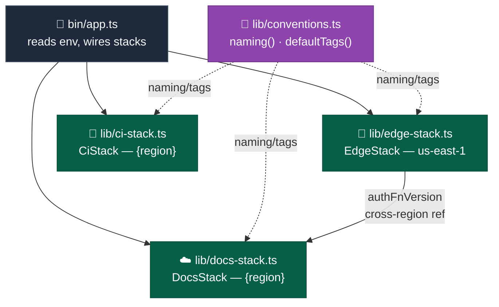

# Infrastructure — Overview

Implementation detail for the Infrastructure container: three independent CDK stacks instantiated from `apps/infra/bin/app.ts`. Mirrors `docs/Target Architecture (HLD)/v1/Containers/Infrastructure.md`.

## Component detail

- `bin/app.ts` — entry point. Reads config from env vars (`ENVIRONMENT`, `WORKLOAD`, `LOCATION_SHORT`, `CF_PRICE_CLASS`, `ORG_PREFIX`, `LAMBDA_REGION`, `AWS_REGION`, GitHub OIDC identifiers), throwing immediately if `LAMBDA_REGION`, `LOCATION_SHORT`, `ORG_PREFIX`, or any GitHub identifier is missing. Instantiates `EdgeStack` in `LAMBDA_REGION`, then `DocsStack` in `AWS_REGION` — passing the live `edgeStack` construct as a prop — then `CiStack` independently. Both `EdgeStack` and `DocsStack` set `crossRegionReferences: true`.
- `lib/conventions.ts` — single source of truth for resource naming (`naming()`) and tagging (`defaultTags()`). Every stack derives bucket/function/secret/role names from the same 4 props (`orgPrefix`, `environment`, `workload`, `locationShort`); no stack hardcodes a name.
- `lib/edge-stack.ts` (`EdgeStack`, deployed in `LAMBDA_REGION`) — IAM role assumable by both `lambda.amazonaws.com` and `edgelambda.amazonaws.com` (composite principal, required for Lambda@Edge), with an inline policy scoped to `secretsmanager:GetSecretValue` on the auth secret. The Lambda function ships with **placeholder** inline passthrough code (`exports.handler = async (event) => event.Records[0].cf.response`) — the real handler is deployed separately (see `../Auth/00. Overview.md`). `memorySize` is deliberately left unset (defaults to 128 MB) to avoid changing the version hash. `currentVersion` gets `RemovalPolicy.RETAIN` — Lambda@Edge versions can't be deleted while still replicated to edge locations.
- `lib/docs-stack.ts` (`DocsStack`, deployed in `AWS_REGION`) — a private `LogsBucket` (`BLOCK_ALL` public access, `OBJECT_WRITER` ownership — required for CloudFront's ACL-based log delivery, 180-day lifecycle expiration), a site S3 bucket (versioned, `RETAIN`, `enforceSSL`, `BLOCK_ALL` public access, `serverAccessLogsBucket` pointed at `LogsBucket`), a placeholder Secrets Manager secret (value populated later by `lambda-auth:sm-push`, never by CDK), and a CloudFront distribution: OAC-signed S3 origin, `errorResponses` remapping S3's 403-for-missing-object to `/404.html`, standard access logging to the same `LogsBucket`, and an `edgeLambdas` viewer-request association pointing at `edgeStack.authFnVersion`. Price class resolves from `CF_PRICE_CLASS` via a lookup map, defaulting to `PriceClass_100`.
- `lib/ci-stack.ts` (`CiStack`) — GitHub Actions OIDC federation, split into two roles rather than one. Conditionally creates the OIDC provider (`CREATE_OIDC_PROVIDER` env flag, default `true`) since the provider is an AWS-account-wide singleton and a shared account must create it only once. Both roles' trust policies pin the `sub` claim to `repo:{org}@{orgId}/{repo}@{repoId}:*` — org/repo numeric IDs, not just names, so the trust relationship survives a repo rename — plus one additional claim each: `CiReadRole` additionally requires `event_name = pull_request` and holds only `ssm:GetParameter`; `DeployRole` additionally requires `ref = refs/heads/main` and holds the four inline least-privilege policies scoping exactly to what the deploy pipeline touches (S3 object/list on the site bucket, CloudFront invalidation and distribution-config actions, Lambda code/version/permission actions split across unversioned and versioned ARN patterns, and SSM `GetParameter`). `environment: dev` alone can't distinguish `ci.yml` from `cd.yml` — both workflows set it, collapsing `sub` to an identical value regardless of trigger — so the split relies on `event_name`/`ref` instead.

## Integration patterns

- Cross-stack, cross-region wiring: `DocsStack` receives the live `EdgeStack` construct (not an ARN string) as a prop, so CDK generates the CloudFormation cross-region export/import automatically — the reason both stacks set `crossRegionReferences: true`.
- NX targets (`apps/infra/project.json`) wrap the `cdk` CLI: `synth`/`diff`/`destroy` target `'**'` (all stacks); `bootstrap` runs twice sequentially (once per default region, once for `$LAMBDA_REGION`); `provision` is `cdk deploy '**' --require-approval never`; `output`/`output-ci` run `describe-stacks` for stack outputs. `env-push`/`env-pull`/`sm-push`/`sm-pull` follow the same shape used identically across all three apps for SSM/Secrets Manager sync.
- Deploy ordering is implicit: `bin/app.ts` constructs `EdgeStack` before `DocsStack`, but the actual apply order under `provision` (`'**'`) is resolved by CDK's own dependency graph, derived from the cross-stack reference — not by script sequencing.

## Key decisions

- `EdgeStack` and `DocsStack` are split because Lambda@Edge functions must be authored in `us-east-1` while the rest of the stack deploys in the workload's actual region — a single-stack design would force everything into `us-east-1`.
- `CiStack`'s OIDC provider creation is opt-out (`CREATE_OIDC_PROVIDER=false`), not opt-in, because the default case is one dedicated AWS account per deployment — a fresh account has no provider yet.
- Region strings never appear as literals inside `lib/` — always threaded through as stack props derived from env vars — enforcing the root `CLAUDE.md` hard-stop constraint (region is deployment configuration only) structurally, not just by convention.
- `CiStack` issues two roles instead of one so that an unreviewed PR run (`ci.yml`) can never assume deploy-grade credentials before merge — a single shared role trusted only on `sub` would let any PR, including one editing `ci.yml` itself, reach the same S3/CloudFront/Lambda write access as a post-merge deploy.
- `DocsStack`'s `LogsBucket` exists so CloudFront and S3 access are auditable (client IP, status, request path) for basic-auth brute-force or credential-sharing detection — before this, neither had logging enabled.
