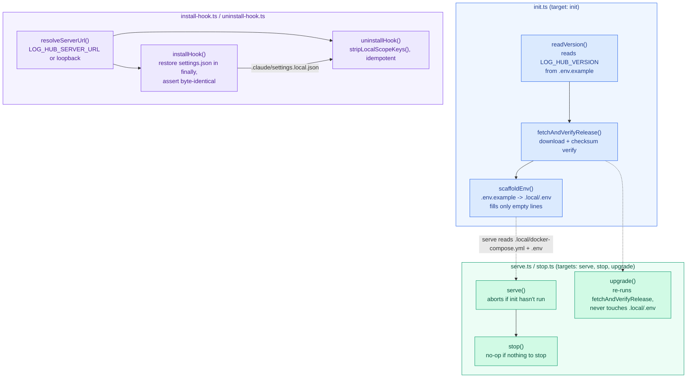

# Log Hub — Overview

Implementation detail for the Log Hub container: the `apps/log-hub` Nx project. Mirrors `docs/Target Architecture (HLD)/v1/Containers/Log Hub.md`.

## Component detail

## project.json targets

`apps/log-hub/project.json` (`nx:run-commands`, `sourceRoot: apps/log-hub/src`): `init`, `serve`, `stop`, `upgrade`, `install-hook`, `upgrade-hook`, `uninstall-hook` run `tsx src/<name>.ts` with `cache: false` (each has a real side effect — download, Docker, or a plugin write). `typecheck` and `lint` are cached and Docker-free. `test` (`tsx --test src/*.test.ts`) is cached and participates in `nx affected --target=test` like every other TS project — additive, not a change to the Docker-dependent targets' CI exclusion.

## init then serve — why split

`init` (target `init`) and `serve` (target `serve`) are two separate scripts, not one combined step: `init` is a one-time setup (download, verify, scaffold `.local/.env`) while `serve` is a repeatable operational step (bring the stack up). Splitting them means `serve` never re-downloads or re-generates secrets on every invocation, and a contributor can re-run `serve` without re-triggering a network fetch. `serve` aborts with "run `yarn nx run log-hub:init` first" if `.local/docker-compose.yml` is missing — it never attempts a Docker call against a state `init` hasn't produced yet. `upgrade` reuses `init`'s exported `fetchAndVerifyRelease()` to re-pull a newly bumped `LOG_HUB_VERSION` without ever touching `.local/.env`, then runs the same `docker compose pull && up -d` as `serve`.

## Checksum verification before any file touches disk

`checksums.ts`'s `verifySha256Sums(dir, sumsFileContent)` hashes every file named in a `SHA256SUMS`-format listing with `node:crypto` and throws, naming the first missing or mismatching file, before `init.ts` does anything else with the downloaded files. `fetchAndVerifyRelease()` downloads `install.sh`, `docker-compose.yml` and `SHA256SUMS` into `.local/`, then filters the full upstream `SHA256SUMS` listing (which also names assets this project never downloads, like the source zip) down to just those three filenames before verifying — a mismatch or an unfiltered miss both abort before `scaffoldEnv()` runs.

## `.env.example` → `.local/.env`: scaffold once, fill only empty lines

`apps/log-hub/.env.example` is committed and carries this design's settled defaults (`AUTH_MODE=none`, `POSTGRES_USER=postgres`, `POSTGRES_DB=a-log`, and `LOG_HUB_VERSION=1.4.1` — the pinned release, read by `readVersion()`) plus three lines left empty on purpose: `LOG_HUB_DATA_DIR`, `POSTGRES_PASSWORD`, `SESSION_SECRET`. `scaffoldEnv()` copies this file to `apps/log-hub/.local/.env` only if that file doesn't exist yet, then fills only lines still matching `KEY=` (empty) — `LOG_HUB_DATA_DIR` from `$HOME/.cache/artisyn-log-hub/<repo-slug>/pgdata` (repo-slug from `git remote get-url origin`, else the checkout basename), the two secrets from `node:crypto.randomBytes(32).toString('hex')`. A line a contributor already filled by hand is never touched; a second run against an already-scaffolded file is byte-identical.

## Hook install/uninstall and the settings.json byte-identity guarantee

`install-hook.ts`'s `installHook()` snapshots `.claude/settings.json` before running the upstream installer (via `npx`, the sole mechanism — `yarn dlx` refuses a plain `http://` package source, and the default target is loopback `http://`), restores that snapshot in a `finally` block regardless of success or failure, then asserts the restored file is byte-identical to the snapshot — throwing and naming the diff if not. Only after that guarantee holds does it re-register the plugin at **local** Claude Code scope (`claude plugin marketplace add`/`install --scope local`). `uninstall-hook.ts`'s `stripLocalScopeKeys()` is JSON-aware: it parses `.claude/settings.local.json`, deletes any `enabledPlugins`/`extraKnownMarketplaces` key starting with `log-hub-hooks@`/`artisyn-`, drops an emptied parent key, and no-ops on an unparsable or missing file — safe to call twice in a row.

No automated check asserts that `.claude/settings.json` stays free of Log Hub plugin keys, that `.artisyn/` and `apps/log-hub/.local/` stay gitignored and untracked, that the two `permissions.deny` entries stay present, or that the canonical harness `settings.json` is unchanged. The `installHook()` byte-identity assertion above is the only runtime guard.

## Remote server override

`install-hook.ts`'s `resolveServerUrl()` reads `LOG_HUB_SERVER_URL`, falling back to the loopback default `http://127.0.0.1:5003`. `uninstall-hook.ts` resolves the same value for its uninstaller tarball fetch. `disclosureText()` is computed per call from the resolved URL and adds an explicit `WARNING` whenever it isn't loopback — Mode 1 (`AUTH_MODE=none`) has no authentication of its own, so a non-loopback target has no built-in access control.

→ See `docs/Engineering Guide/07 Log Hub Setup.md` for the disclosure and setup walkthrough.
