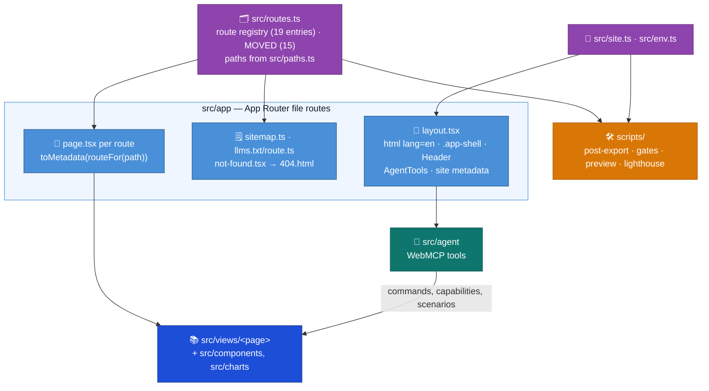
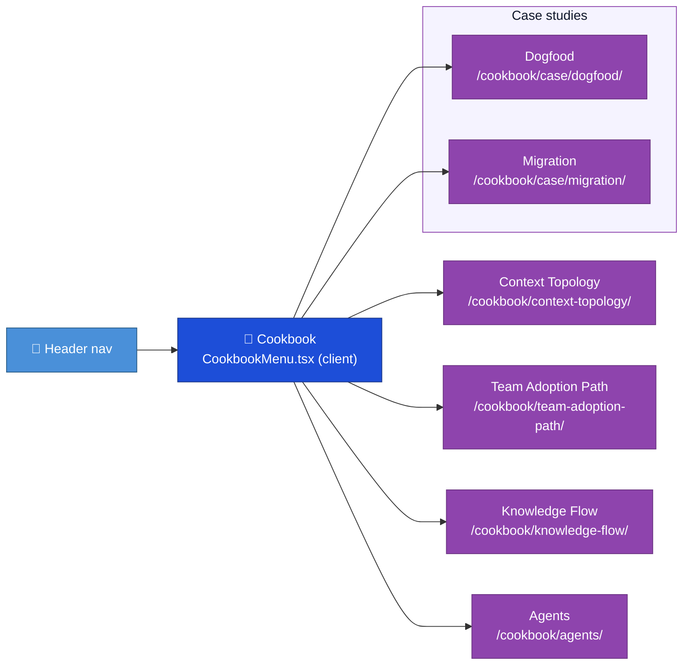

# Web Explorer — Overview

Web Explorer is a Next.js 16.4.6 App Router app at `apps/web-explorer`, exported to static files by `next build` (`output: 'export'`, `basePath: '/artisyn-implementation-harness'`, `trailingSlash: true` in `next.config.ts`). Every route in the route registry is pre-rendered to `out/<route>/index.html`. Mirrors `docs/Target Architecture (HLD)/v1/Containers/Web Explorer.md`.

| Companion doc                                                           | Covers                                                                              |
| ----------------------------------------------------------------------- | ----------------------------------------------------------------------------------- |
| [01. Build and Gates](./01.%20Build%20and%20Gates.md)                   | Build pipeline, post-export step, site gate, preview                                |
| [02. Agent Interface](./02.%20Agent%20Interface.md)                     | WebMCP tools, agent indexes, `llms.txt`, `/cookbook/agents/`                        |
| [03. Pages and Design System](./03.%20Pages%20and%20Design%20System.md) | Design tokens, landing, Team Adoption Path, `/get-started`, Dogfood, Migration case |
| [04. Test Targets](./04.%20Test%20Targets.md)                           | `test`, `e2e`, `lighthouse`, the WCAG baseline                                      |

## Component structure

| Component       | Location                                                                                                                        | Responsibility                                                                                                                                                                                                                                                                  |
| --------------- | ------------------------------------------------------------------------------------------------------------------------------- | ------------------------------------------------------------------------------------------------------------------------------------------------------------------------------------------------------------------------------------------------------------------------------- |
| Root layout     | `src/app/layout.tsx`                                                                                                            | `<html lang="en">`, Inter via `next/font/local`, site metadata (title template, referrer, publisher, icons via `asset()`), Search Console meta when its variable is set, `.app-shell` with `Header`, `AgentTools`                                                               |
| Route paths     | `src/paths.ts`                                                                                                                  | `ROUTE_PATHS` (the Cookbook paths) and `topicPath(slug)`; the single source for paths, dependency-free so client components import it without the registry; re-exported by `src/routes.ts`                                                                                      |
| Route registry  | `src/routes.ts`                                                                                                                 | Path, title, description, keywords, social image, index flag and `sources` per route; `routeFor()` and `toMetadata()` build canonical, Open Graph, Twitter, keywords, robots; `MOVED` maps each old path to its new one                                                         |
| Redirect pages  | `src/components/Moved.tsx`, `src/app/{inside-the-loop,inside-the-loop/[slug],docs-flow,agents,dogfood,migration-case}/page.tsx` | 15 pages for the pre-Cookbook paths: instant meta refresh to the new path, canonical to it, robots `noindex, follow`, a visible link to the new page                                                                                                                            |
| Site constants  | `src/site.ts`, `src/env.ts`                                                                                                     | Base path and origin literals; `asset()` prefixes the base path to `public/` files (Next does not prefix `metadata.icons` or ``); repo and docs URLs with fallbacks                                                                                                    |
| File routes     | `src/app/**/page.tsx`                                                                                                           | One page per registry route, under `src/app/cookbook/…` for the Cookbook pages; the topic route `cookbook/team-adoption-path/[slug]` uses `generateStaticParams` over `TEAM_ADOPTION_PATH_SLUGS`, `dynamicParams = false`                                                       |
| Generated files | `src/app/sitemap.ts`, `src/app/llms.txt/route.ts`                                                                               | `force-static`; sitemap `lastModified` from `git log -1 --format=%cI -- <sources>` (build time as fallback); `llms.txt` from the registry                                                                                                                                       |
| Views           | `src/views/<page>/`, `src/views/cookbook/<page>/`                                                                               | Page content, mirroring the routes (`cookbook/context-topology`, `cookbook/team-adoption-path`, `cookbook/knowledge-flow`, `cookbook/agents`, `cookbook/case/dogfood`, `cookbook/case/migration`); named `views` because Next.js always treats `src/pages/` as its Pages Router |
| Legacy redirect | `public/legacy-hash-redirect.js`                                                                                                | Rewrites `#/<path>?<query>` to `<base>/<path>/?<query>`, base path from `document.currentScript.src`; added to `/` only by the post-export step. An old hash link then lands on its redirect page, which forwards to the new path                                               |

## Rendering model

Pages are Server Components; a component is `'use client'` only when it needs state, effects, handlers, browser APIs or `motion`.

| Page                                           | Server-rendered                                         | Client islands                                                                                                                          |
| ---------------------------------------------- | ------------------------------------------------------- | --------------------------------------------------------------------------------------------------------------------------------------- |
| `/`                                            | `views/landing/Landing.tsx`                             | `FadeIn` (motion), `CopyCommand`, `HeroPreview`, `TerminalScenarios`                                                                    |
| `/cookbook/context-topology/`                  | `ContextTopology.tsx`                                   | `TopologyExplorer` (topology tabs)                                                                                                      |
| `/cookbook/team-adoption-path/` + 10           | layout `<main>`, `TeamAdoptionPathDetailPage`           | `TeamAdoptionPathHub`, `InsideLoopMap` via `next/dynamic` (`ssr: false`) with a sized placeholder, nav provider (`TeamAdoptionPathNav`) |
| `/get-started/`                                | `<Suspense>` fallback renders the default pair          | `GetStarted`: `useSearchParams` applies the query after hydration                                                                       |
| `/cookbook/knowledge-flow/`                    | `KnowledgeFlow` as a whole, incl. its `<main>`          | `KnowledgeFlow` (positioned divs and inline SVG, no graph library); DM Sans via `next/font/local`                                       |
| `/cookbook/case/dogfood/`, `/cookbook/agents/` | `Dogfood.tsx`, `Agents.tsx`                             | `GraphExplorer` on the Dogfood page only                                                                                                |
| `/cookbook/case/migration/`                    | `MigrationCase.tsx`; its other charts are HTML/CSS bars | `LifecycleExplorer` (lifecycle tabs and stage disclosures)                                                                              |
| 15 redirect pages                              | `Moved` as a whole                                      | —                                                                                                                                       |
| `/comic/`                                      | —                                                       | `Comic` (one scroll handler)                                                                                                            |

Navigation uses `next/link` and `next/navigation`. The header (`components/Header.tsx`) nav is How It Works · Capabilities · Get Started · Cookbook · Docs ↗, plus a separate GitHub button for the repository. "How It Works" and "Capabilities" are plain `<a href="<base>/#…">` anchors. The footer (`components/Footer.tsx`), on every page, links the Migration case and For AI agents pages. Nothing links `/comic/`. `hooks/usePrefersReducedMotion.ts` reads reduced motion (`useSyncExternalStore`, server snapshot `false`).

`CookbookMenu.tsx` is a disclosure: a button with `aria-expanded`/`aria-controls` opens a panel of links, each with a one-line description. The panel closes on Escape (focus returns to the button), on a click outside, when focus leaves the menu, and on navigation. The link for the current page carries `aria-current="page"`, and the button is marked current when any entry is.

The header layout lives in `src/styles.css`. The nav does not scroll horizontally.

| Viewport width | Header behaviour                                        |
| -------------- | ------------------------------------------------------- |
| ≥ 960 px       | Full brand with the "/ implementation harness" subtitle |
| < 960 px       | Subtitle hidden                                         |
| < 800 px       | GitHub button collapses to its icon                     |
| ≤ 700 px       | Nav hidden                                              |
