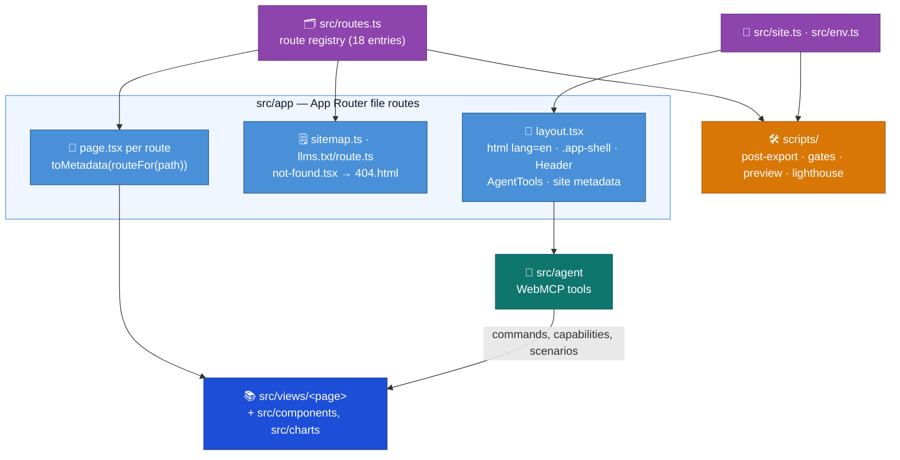

# Web Explorer — Overview

Web Explorer is a Next.js 16.4.6 App Router app at `apps/web-explorer`, exported to static files by `next build` (`output: 'export'`, `basePath: '/artisyn-implementation-harness'`, `trailingSlash: true` in `next.config.ts`). Every route in the route registry is pre-rendered to `out/<route>/index.html`. Mirrors `docs/Target Architecture (HLD)/v1/Containers/Web Explorer.md`.

| Companion doc                                                           | Covers                                                                                    |
| ----------------------------------------------------------------------- | ----------------------------------------------------------------------------------------- |
| [01. Build and Gates](./01.%20Build%20and%20Gates.md)                   | Build pipeline, post-export step, site gate, preview                                      |
| [02. Agent Interface](./02.%20Agent%20Interface.md)                     | WebMCP tools, agent indexes, `llms.txt`, `/agents/`                                       |
| [03. Pages and Design System](./03.%20Pages%20and%20Design%20System.md) | Design tokens, landing, `/inside-the-loop`, `/get-started`, `/dogfood`, `/migration-case` |
| [04. Test Targets](./04.%20Test%20Targets.md)                           | `test`, `e2e`, `lighthouse`, the WCAG baseline                                            |

## Component structure

| Component       | Location                                          | Responsibility                                                                                                                                                                                                    |
| --------------- | ------------------------------------------------- | ----------------------------------------------------------------------------------------------------------------------------------------------------------------------------------------------------------------- |
| Root layout     | `src/app/layout.tsx`                              | `<html lang="en">`, Inter via `next/font/local`, site metadata (title template, referrer, publisher, icons via `asset()`), Search Console meta when its variable is set, `.app-shell` with `Header`, `AgentTools` |
| Route registry  | `src/routes.ts`                                   | Path, title, description, keywords, social image, index flag and `sources` per route; `routeFor()` and `toMetadata()` build canonical, Open Graph, Twitter, keywords, robots                                      |
| Site constants  | `src/site.ts`, `src/env.ts`                       | Base path and origin literals; `asset()` prefixes the base path to `public/` files (Next does not prefix `metadata.icons` or ``); repo and docs URLs with fallbacks                                      |
| File routes     | `src/app/**/page.tsx`                             | One page per registry route; the detail route uses `generateStaticParams` over `INSIDE_THE_LOOP_SLUGS`, `dynamicParams = false`                                                                                   |
| Generated files | `src/app/sitemap.ts`, `src/app/llms.txt/route.ts` | `force-static`; sitemap `lastModified` from `git log -1 --format=%cI -- <sources>` (build time as fallback); `llms.txt` from the registry                                                                         |
| Views           | `src/views/<page>/`                               | Page content; named `views` because Next.js always treats `src/pages/` as its Pages Router                                                                                                                        |
| Legacy redirect | `public/legacy-hash-redirect.js`                  | Rewrites `#/<path>?<query>` to `<base>/<path>/?<query>`, base path from `document.currentScript.src`; added to `/` only by the post-export step                                                                   |

## Rendering model

Pages are Server Components; a component is `'use client'` only when it needs state, effects, handlers, browser APIs or `motion`.

| Page                     | Server-rendered                                         | Client islands                                                                                               |
| ------------------------ | ------------------------------------------------------- | ------------------------------------------------------------------------------------------------------------ |
| `/`                      | `views/landing/Landing.tsx`                             | `FadeIn` (motion), `CopyCommand`, `HeroPreview`, `TerminalScenarios`                                         |
| `/inside-the-loop/` + 10 | layout `<main>`, `InsideTheLoopDetailPage`              | `InsideTheLoopHub`, `InsideLoopMap` via `next/dynamic` (`ssr: false`) with a sized placeholder, nav provider |
| `/get-started/`          | `<Suspense>` fallback renders the default pair          | `GetStarted`: `useSearchParams` applies the query after hydration                                            |
| `/docs-flow/`            | `DocsFlow` as a whole, incl. its `<main>`               | `DocsFlow` (positioned divs and inline SVG, no graph library); DM Sans via `next/font/local`                 |
| `/dogfood/`, `/agents/`  | `Dogfood.tsx`, `Agents.tsx`                             | `GraphExplorer` on `/dogfood/` only                                                                          |
| `/migration-case/`       | `MigrationCase.tsx`; its other charts are HTML/CSS bars | `LifecycleExplorer` (lifecycle tabs and stage disclosures)                                                   |
| `/comic/`                | —                                                       | `Comic` (one scroll handler)                                                                                 |

Navigation uses `next/link` and `next/navigation`. The header (`components/Header.tsx`) nav has 9 entries: plain `<a href="<base>/#…">` anchors for "How it works" and "Capabilities", then `/inside-the-loop/`, `/docs-flow/`, `/get-started/`, `/dogfood/`, `/migration-case/`, `/agents/` ("Agents") and the docs; a separate GitHub link opens the repository. The footer (`components/Footer.tsx`), on every page, links `/migration-case/` and `/agents/`. Nothing links `/comic/`. `hooks/usePrefersReducedMotion.ts` reads reduced motion (`useSyncExternalStore`, server snapshot `false`).

The header layout lives in `src/styles.css`. Nav links never wrap and the brand never shrinks. If the nav cannot fit, it scrolls horizontally.

| Viewport width | Header behaviour                                        |
| -------------- | ------------------------------------------------------- |
| ≥ 1400 px      | Full brand with the "/ implementation harness" subtitle |
| < 1400 px      | Subtitle hidden; nav gap 20 px                          |
| < 1180 px      | Nav gap 14 px                                           |
| < 1100 px      | Nav gap 12 px, link text 12.5 px                        |
| ≥ 1024 px      | All 9 entries fit without scrolling                     |
| 701 – ~960 px  | Nav scrolls horizontally                                |
| ≤ 700 px       | Nav hidden                                              |
