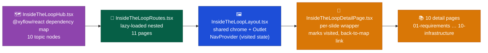

# Web Explorer — Overview

Implementation detail for the Web Explorer container: a React 19 + Vite app at `apps/web-explorer` with two route groups under a `HashRouter` — the landing page at `/`, and the `/inside-the-loop` section. Mirrors `docs/Target Architecture (HLD)/v1/Containers/Web Explorer.md`.

## Design system

Trigger.dev-inspired developer-tool visual register: near-black canvas, strong typographic rhythm, thin separators, crisp terminal-style surfaces, an indigo/purple primary accent with a teal secondary accent, meaningful (not decorative) transitions. The Artisyn identity lives in the supplied blue/teal/purple brand mark; the indigo accent is the interface/action color (CTAs, headline emphasis, selected state), teal marks success/positive/demo indicators.

| Token            | Value                | Use                                              |
| ---------------- | -------------------- | ------------------------------------------------ |
| Background       | `#090D12`            | Main canvas                                      |
| Surface          | `#0F151D`            | Cards, panels                                    |
| Raised surface   | `#131B26`            | Header, terminal chrome                          |
| Border           | `#27313D`            | Fine outlines and dividers                       |
| Text             | `#F3F6F9`            | Titles and important content                     |
| Muted            | `#A1AFBD`            | Secondary copy                                   |
| Accent (primary) | `#7C6CF0`            | Selected state, primary CTA, headline emphasis   |
| Accent (teal)    | `#2DD4BF`            | Success/positive indicators, demo/preview badges |
| Icon gradient    | Purple → blue → teal | Brand mark only                                  |

One strong accent per interaction; no colored full-height swimlanes. Typography: a modern system sans for display, 14–18px/1.6–1.75 line-height body copy (60–75 character measure), JetBrains Mono or system monospace for technical UI (11–13px). Cards: 1px outline, 8–12px radius, flat surface fill. Motion: 150–250ms microtransitions for tab/step changes, small opacity/y changes only, `prefers-reduced-motion` respected — transitions stay comprehensible with motion off.

## Content and demo boundaries

The interactive `/design`/`/dev` lifecycle walkthrough in `src/data/lifecycles.ts` uses the real phase names, order, and artifacts from `docs/Engineering Guide/Lifecycles/01 Dev Lifecycle.md` and `02 Design Lifecycle.md` — not an invented storyboard. Descriptions are condensed to one line per phase for a landing page; they are not the full invariant text, and the walkthrough never claims to be a live execution: it is explicitly labeled **SIMULATED RUN** in the UI. All interaction state (phase selection, step navigation, Back/Next/Replay) is local and deterministic — no simulated typing or anything that could read as an active server. Keep `lifecycles.ts` in sync if either lifecycle doc's stage list changes. Product positioning copy (hero, core-concept cards, operating-model strip) is derived from this repo's own README/CONTRIBUTING content, not independent verification of product behavior; reconcile against `docs/Harness/` before treating any of it as authoritative.

## Brand asset provenance

`public/brand/artisyn-logo-original.png` is the original supplied high-resolution logo (light-background use). `artisyn-wordmark-light.png` is a cropped derivative, light-background only. `artisyn-mark.svg` (and its raster variants, including the favicon set) is a manually simplified derivative optimized for dark surfaces — it differs slightly from the original logo by design. **Not yet independently brand-approved for public use** — confirm before this app goes live publicly.

## Key decisions

- Lucide React's brand/logo icon set (e.g. a GitHub mark) is not available in the pinned `lucide-react` version used here — the generic `Code2` icon substitutes for GitHub links. No dedicated brand-icon package was added; revisit if a true GitHub mark becomes a hard requirement.
- Design inspiration only from [Trigger.dev](https://trigger.dev/) — no copied artwork, layout, or assets.

## `/inside-the-loop` section

A hub page (a dependency-graph map of 10 topics, `@xyflow/react`) plus 10 routed detail pages, reached via `InsideTheLoopHub.tsx` → `InsideTheLoopRoutes.tsx` (`React.lazy()`-loaded, so the landing page's own entry chunk never downloads this section) → `InsideTheLoopLayout.tsx` (shared chrome, hosts the nav provider so "visited" state survives navigating to a detail page and back) → `InsideTheLoopDetailPage.tsx` (per-slide wrapper).

All content — ~40 chart/component/page files plus a 4034-line stylesheet — is adapted from an external source deck (`ai-case-study/apps/frontline-report`), not written from scratch for this app:

- **Vendor-specific tech genericized.** Azure, Azure DevOps, Durable Functions, Azure-tied Terraform resources, Snowflake, PostgreSQL, Drizzle, and NestJS were replaced with generic equivalents (cloud provider, IaC, warehouse, relational DB, ORM, BFF framework) across `data.ts` and the ported chart/page files. Terraform itself stayed as a named example — it is a generic, non-identifying tool, not tied to any one vendor.
- **PII and internal references removed.** Real people's names, bios, emails, and internal company/legal references were deleted from `data.ts` and `03-harness.tsx` — confirmed as dead data unused by any rendered page before removal, not a content rewrite of something that was displayed.
- **Styling is aliased, not rewritten.** The 4034-line source stylesheet (`pages/inside-the-loop.css`) was copied wholesale and its `:root` block replaced with a small alias layer onto this app's existing dark-theme tokens, rather than hand-ported rule-by-rule. This is deliberate "good enough" visual coverage, not pixel-perfect — a residual ~47 unremapped low-occurrence hex colors and a duplicate rule set in the main `styles.css` are tracked as tech debt (see the implementation report's TD-5/TD-6).
- **Code-splitting keeps the budget safe.** `React.lazy()` isolates this section into its own chunk, so the landing page's bundle-size budget (enforced against the entry chunk only) is unaffected by this section's size.
