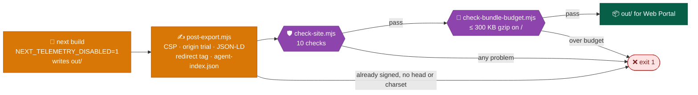

# Web Explorer — Build and Gates

`web-explorer:build` runs `next build`, then the post-export step, then two gates; any failure stops the build, so Web Portal never assembles an unchecked site. Part of [Web Explorer — Overview](./00.%20Overview.md); the browser checks are in [04. Test Targets](./04.%20Test%20Targets.md).



The command runs with `cwd: apps/web-explorer` (`project.json`). The scripts import `src/site.ts`, `src/routes.ts` and `src/env.ts` through Node's type stripping, so those files keep to erasable TypeScript with `.ts` import extensions. Every input below is declared in `project.json`, so a change invalidates the Nx cache; output is `{projectRoot}/out`.

| Build input                                    | Effect                                                                         |
| ---------------------------------------------- | ------------------------------------------------------------------------------ |
| `default`, `^default`                          | App source and its dependencies                                                |
| `skills/implementation-harness/package.json`   | Harness version, set as `HARNESS_VERSION` in `next.config.ts` `env`            |
| `NEXT_PUBLIC_REPO_URL`, `NEXT_PUBLIC_DOCS_URL` | Outbound links (`src/env.ts`), with fallbacks to the public repo and docs URLs |
| `NEXT_PUBLIC_GOOGLE_SITE_VERIFICATION`         | `google-site-verification` meta on every page when set (`src/app/layout.tsx`)  |
| `WEBMCP_ORIGIN_TRIAL_TOKEN`                    | Origin-trial meta on every page when set (post-export step)                    |
| `BUNDLE_BUDGET_BYTES`                          | Lowers the gzip budget; an integer from 1 to 307,200 only, else the gate fails |

## Post-export step

`scripts/post-export.mjs` (parse5) rewrites every `out/**/*.html` in place; GitHub Pages sends no custom headers, so the meta tag is the only policy channel.

| Operation     | Behaviour                                                                                                                                                                                                                                                                                                                                           |
| ------------- | --------------------------------------------------------------------------------------------------------------------------------------------------------------------------------------------------------------------------------------------------------------------------------------------------------------------------------------------------- |
| Preconditions | Fails on a page with no `<head>`, no `<meta charset>`, or an existing CSP meta (unless `--resign`)                                                                                                                                                                                                                                                  |
| JSON-LD       | `pageJsonLd()` per indexable registry page: `WebSite` + `SoftwareSourceCode` on `/`, `WebPage` + `BreadcrumbList` under `/inside-the-loop/`, `WebPage` elsewhere; none for `noindex` pages or `404.html`. `jsonForScript()` replaces every `<` with its JSON Unicode escape (a backslash followed by `u003c`), so the text cannot close the element |
| Redirect tag  | `<script src="<base>/legacy-hash-redirect.js">` on `index.html` only, before the first head script                                                                                                                                                                                                                                                  |
| Hashes        | SHA-256 of every inline executable script (no `src`; type absent, `module` or a JavaScript MIME type); JSON data blocks are not hashed                                                                                                                                                                                                              |
| CSP meta      | `buildPolicy()` inserted right after `<meta charset>`; `upgrade-insecure-requests` only for an `https:` origin                                                                                                                                                                                                                                      |
| Origin trial  | `<meta http-equiv="origin-trial">` right after the CSP meta when `WEBMCP_ORIGIN_TRIAL_TOKEN` is set; never with `--resign` (the token is bound to the production origin)                                                                                                                                                                            |
| Agent index   | Writes `out/agent-index.json` from each indexable page's `<main>` (not with `--resign`); see [02. Agent Interface](./02.%20Agent%20Interface.md#agent-index-contract)                                                                                                                                                                               |

`buildPolicy({ hashes, site, upgradeInsecure })` returns the NFR-16 policy:

```text
default-src 'none'; script-src <hashes> <site>/; style-src <site>/ 'unsafe-inline'; img-src <site>/;
font-src <site>/; connect-src <site>/ <origin>/robots.txt <origin>/llms.txt; manifest-src <site>/;
object-src 'none'; base-uri 'none'; form-action 'none'; upgrade-insecure-requests
```

## Site gate

`scripts/check-site.mjs` collects every problem, prints each with its file, and exits 1 if there is any.

| Check                 | Scope                 | Fails when                                                                                                                                                                                                                                             |
| --------------------- | --------------------- | ------------------------------------------------------------------------------------------------------------------------------------------------------------------------------------------------------------------------------------------------------ |
| `checkMetadata`       | every registry route  | A missing title, description, keywords, `og:*` or `twitter:image:alt` tag; wrong referrer, canonical or `og:url`; `og:image` not absolute or its file missing; `twitter:card` not `summary_large_image`; `noindex` not matching the index flag         |
| `check404`            | `404.html`            | Missing title, description, referrer or `noindex`                                                                                                                                                                                                      |
| `checkSitemap`        | `sitemap.xml`         | URLs not exactly the indexable routes, or a URL without an ISO-8601 `<lastmod>`                                                                                                                                                                        |
| `checkSecurity`       | every page            | Not exactly one CSP meta right after `<meta charset>`; a `<script>` before it; an unhashed inline script; any directive differing from `buildPolicy()` rebuilt from the page's hashes; a subresource URL outside `<site>/` (`data:` counts as outside) |
| `checkOriginTrial`    | every page            | Origin-trial meta present without the token, missing with it, another value, or not right after the CSP meta                                                                                                                                           |
| `checkVerification`   | every page            | Search Console meta present without the variable, missing with it, or another value                                                                                                                                                                    |
| `checkJsonLd`         | `index.html`          | No JSON-LD block, or a block that does not parse                                                                                                                                                                                                       |
| `checkStructuredData` | every indexable route | Not exactly one block; missing `@type`s; a breadcrumb that is not a registry URL or does not end at the page                                                                                                                                           |
| `checkAgentIndex`     | `agent-index.json`    | Missing, not parsing, over 1 MB, not exactly the indexable routes, an entry without title or text                                                                                                                                                      |
| `checkLlmsTxt`        | `llms.txt`            | No H1, no Markdown link, under 50 characters, an indexable URL not linked, or `/comic/` linked                                                                                                                                                         |

`check-bundle-budget.mjs` sums the `zlib` gzip size of every `_next/static/` JS and CSS file `out/index.html` references and fails above 307,200 bytes; other routes' chunks are not counted. Target and current measurement: NFR-19 in `docs/Target Architecture (HLD)/v1/Non-Functional Concerns/Requirements.md`.

## Preview and local servers

`preview` (`dependsOn: build`) copies `out/` to `.preview/artisyn-implementation-harness/`, runs `post-export.mjs --resign --origin http://localhost:4173` on the copy (policy for the local origin, no `upgrade-insecure-requests`, no origin-trial meta) and serves `.preview/` with `scripts/serve-preview.mjs`. The server applies the GitHub Pages rules: `dir/` serves `dir/index.html`, `/dir` answers 301, an existing file is served with its content type, and anything else, `/docs/*` included, gets the site's `404.html` with status 404. It gzips text responses when accepted, listens on `127.0.0.1` (`PORT` overrides 4173) and refuses paths outside its root. `out/` is never modified. `serve` and `dev` run `next dev --hostname 0.0.0.0` (port 3000) with no post-export step, so dev pages carry no CSP. `.preview/` is gitignored.
