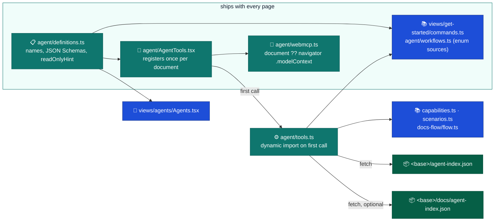

# Web Explorer — Agent Interface

Every Web Explorer page registers five WebMCP tools with the browser's native `modelContext`; the tools answer from static files, so no server is involved. Part of [Web Explorer — Overview](./00.%20Overview.md).

The registration shim, the definitions and the enum sources they import (`commands.ts`, `workflows.ts`) ship with every page; `tools.ts`, the other source modules and the indexes load on the first tool call. The `/agents/` page renders the same definitions, so it documents exactly what the browser registers.

`AgentTools.tsx` runs once in the root layout. When `getModelContext()` finds no `modelContext` (WebMCP off), it registers nothing and the page works the same. Otherwise a module-level `registered` flag registers each tool once per document — Chrome's docs do not say what registering a name twice does — and client navigation keeps the layout mounted. Each `execute` imports `tools.ts` and calls `runTool(name, input, urls)`, which returns a plain JSON value.

## Tools

| Tool                       | Input (`additionalProperties: false`)                                                                                                  | Output                                                                                                                                          | Read-only |
| -------------------------- | -------------------------------------------------------------------------------------------------------------------------------------- | ----------------------------------------------------------------------------------------------------------------------------------------------- | --------- |
| `search_documentation`     | `query` 1–200 chars (required); `limit` 1–10, default 5; `source` `all` \| `site` \| `docs`, default `all`                             | `{ results: [{ source, title, url, path, description, snippet }], docsAvailable }`                                                              | yes       |
| `get_page`                 | `path` 1–300 chars, starting with `/` (required)                                                                                       | `{ source, title, url, path, description, headings, text }`                                                                                     | yes       |
| `get_install_instructions` | `provider` `claude` \| `codex` \| `copilot`; `channel` `skills-sh` \| `marketplace` \| `gh-skill` \| `npmjs` \| `gh-packages` \| `zip` | `{ version, channel, provider, install, launch, update, url }`; blocks from `commands.ts`, `url` the `/get-started/?…` share link               | yes       |
| `open_workflow`            | `workflow` `dev` \| `design` \| `evolve` \| `architecture` \| `documents-flow`                                                         | `{ workflow, name, opened }`, then navigates the tab to `opened` on the next tick                                                               | no        |
| `get_harness_capabilities` | none                                                                                                                                   | Name, summary, version, URLs, pillars, capabilities, lifecycles with commands and docs links, providers, channels, demo and docs-flow scenarios | yes       |

Invalid input throws `Invalid input: <reason>`, returned to the agent as a tool error.

| Behaviour        | Implementation (`tools.ts`)                                                                                                                                                                                                                           |
| ---------------- | ----------------------------------------------------------------------------------------------------------------------------------------------------------------------------------------------------------------------------------------------------- |
| Ranking          | Lower-case letter/number tokens; per token: title +5, headings +3, description +2, text +1; ties keep index order; zero scores dropped                                                                                                                |
| Snippet          | 200 characters from 60 before the first token hit; the description when no token is in the text                                                                                                                                                       |
| Excluded         | `/comic/`, from search and `get_page`                                                                                                                                                                                                                 |
| Path matching    | `get_page` compares `decodeURI` forms, so a docs path passes decoded or `%20`-encoded; a malformed `%` falls back to exact match                                                                                                                      |
| Workflow targets | `workflowUrl()` joins `NEXT_PUBLIC_DOCS_URL` with the `Harness/03 Lifecycles/` article path, percent-encoded, plus `.html`                                                                                                                            |
| Index loading    | `loadIndexes()` fetches both indexes in parallel once per page. A failed docs index gives `docsAvailable: false`; a failed site index rejects with "The site index could not be loaded", and the rejected promise is dropped so the next call retries |

Local `dev` and `preview` have no Web Docs, so docs search there reports `docsAvailable: false`.

## Agent-index contract

Web Explorer and Web Docs each publish an agent index with the same entry shape; neither imports the other's code.

| Field         | Web Explorer (`post-export.mjs`, `source: 'site'`)                                        | Web Docs (`.vitepress/utils/agent-index.ts`, `source: 'docs'`)      |
| ------------- | ----------------------------------------------------------------------------------------- | ------------------------------------------------------------------- |
| `path`        | Registry path, e.g. `/get-started/`                                                       | `/docs/<link>`, percent-encoded, pages end `.html`, index pages `/` |
| `url`         | `siteUrl + path`                                                                          | `https://dataart.github.io<base><link>`                             |
| `title`       | Registry title                                                                            | `<title>` without the site-title suffix; first heading as fallback  |
| `description` | Registry description                                                                      | Meta description; empty when it equals the site-wide fallback       |
| `headings`    | `h1`–`h3` inside `<main>`                                                                 | `h1`–`h3` inside `.vp-doc` (`.VPHome` on the home page)             |
| `text`        | Visible `<main>` text without header, footer, nav, script, style, svg, template, noscript | Article text without anchors, code labels, buttons and svg          |

| Check                     | Where                              | Limit                                                                                 |
| ------------------------- | ---------------------------------- | ------------------------------------------------------------------------------------- |
| Site index coverage       | `check-site.mjs` `checkAgentIndex` | Exactly the indexable routes, title and text non-empty, ≤ 1 MB                        |
| Docs index content        | Web Docs `buildEnd`                | ≥ 1 entry, title and text non-empty, ≤ 5 MB                                           |
| Both indexes, every entry | Web Portal `portal-assemble.ts`    | `path`/`url`/`title`/`text` non-empty strings, `description` string, `headings` array |

Web Portal is the only check that sees both real files; the e2e suite answers `/docs/agent-index.json` from a fixture ([Web Portal — Overview](../Web%20Portal/00.%20Overview.md)).

## `llms.txt` and `/agents/`

`src/app/llms.txt/route.ts` (`force-static`) exports `out/llms.txt`: the landing title as H1, a `>` summary, `## Pages` with one `- [title](url): description` per indexable route, and `## Docs` with the documentation and source links. Lighthouse checks `llms.txt` only at the origin root, so its `llms-txt` audit reads as not applicable. `views/agents/Agents.tsx` (server) renders a card per tool (inputs from the schemas, a "read-only" or "opens a page" badge, `data-tool-name`), how to enable WebMCP in Chrome, a DevTools sample as text, links to `llms.txt`, both indexes and `sitemap.xml`, and the tools' limits. Locally, enable `chrome://flags/#enable-webmcp-testing`; the origin-trial meta ([01. Build and Gates](./01.%20Build%20and%20Gates.md#post-export-step)) applies only on the production origin.

## Constraints

- The page CSP's `connect-src` limits the tools to this site's files.
- `open_workflow` is the only tool with `readOnlyHint: false`; it navigates the current tab and writes nothing. No WebMCP SDK is used.
- `tools.ts`, `workflows.ts` and their imports keep to erasable TypeScript, because `node --test` imports them (`src/agent/tools.test.ts`).
