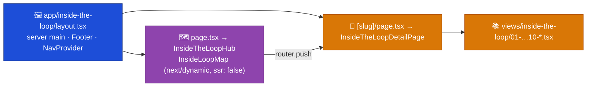

# Web Explorer — Pages and Design System

Every page shares one dark-theme token set in `src/styles.css`; page content lives in `src/views/<page>/`. Part of [Web Explorer — Overview](./00.%20Overview.md), which covers the rendering model.

## Design system

Trigger.dev-inspired developer-tool register (inspiration only, no copied assets): near-black canvas, thin separators, terminal-style surfaces. Indigo marks actions and selected state; teal marks success and demo indicators; the blue/teal/purple gradient is for the brand mark only.

| Token            | Value                 | Use                                            |
| ---------------- | --------------------- | ---------------------------------------------- |
| Background       | `#090D12`             | Main canvas                                    |
| Surface          | `#0F151D`             | Cards, panels                                  |
| Raised surface   | `#131B26`             | Header, terminal chrome                        |
| Border           | `#27313D`             | Fine outlines and dividers                     |
| Text / Muted     | `#F3F6F9` / `#A1AFBD` | Titles / secondary copy                        |
| Accent (primary) | `#7C6CF0`             | Selected state, primary CTA, headline emphasis |
| Accent (teal)    | `#2DD4BF`             | Success indicators, demo/preview badges        |

Inter for UI and body (14–18px, line-height 1.6–1.75), monospace for technical UI (11–13px); cards with a 1px outline and 8–12px radius; motion 150–250ms, off under reduced motion. Requirements: `docs/Target Architecture (HLD)/v1/Non-Functional Concerns/Accessibility.md`. `public/brand/` holds the supplied logo, a cropped wordmark and `artisyn-mark.svg` (a simplified dark-surface derivative, also the favicon set); **not yet independently brand-approved for public use**. Lucide's pinned version has no GitHub mark, so `Code2` stands in.

## Landing page

`views/landing/Landing.tsx` states what the harness solves and how within the first viewport.

| Order | Section             | Source                                       | Content                                                                                                                                                                                                              |
| ----- | ------------------- | -------------------------------------------- | -------------------------------------------------------------------------------------------------------------------------------------------------------------------------------------------------------------------- |
| 1     | Hero (`.hero-band`) | `hero-intro`, `HeroPreview.tsx`              | Headline, `Explore the lifecycle` → `#how-it-works`, `View on GitHub`; a terminal card looping launch, design and dev flows, then the lifecycle strip (Design → Implement → Validate → Document), tagged `SIMULATED` |
| 1     | Pillars             | `PILLARS` in `views/landing/capabilities.ts` | Solution Design (violet), Development (blue), Knowledge (teal)                                                                                                                                                       |
| 2     | `how-it-works` — 01 | `TerminalScenarios.tsx`, `scenarios.ts`      | Interactive scenario walkthrough                                                                                                                                                                                     |
| 3     | `capabilities` — 02 | `CAPABILITIES` in `capabilities.ts`          | Four core-concept cards                                                                                                                                                                                              |
| 4     | `architecture` — 03 | inline `.model-strip`                        | Engineer → AI assistant → Harness lifecycle → Knowledge base                                                                                                                                                         |
| 5     | `docs-flow` — 04    | `.model-strip`, link to `/docs-flow/`        | Ticket → Working drafts → Automatic graduation → Permanent docs                                                                                                                                                      |
| 6     | `get-started` — 05  | `CopyCommand.tsx`                            | Copyable `/implementation-harness launch`; a manual-copy hint when the clipboard fails                                                                                                                               |

Under 1024px the hero stacks; under 700px the terminal card is hidden. `scenarios.ts` uses the real phase names, order and artifacts of the Dev and Design lifecycles, one line per phase, labeled **SIMULATED RUN**, with local deterministic state; keep it in step with those lifecycles. Positioning copy comes from this repo's README/CONTRIBUTING; reconcile against `docs/Harness/` before treating it as authoritative. `capabilities.ts` and `scenarios.ts` also feed `get_harness_capabilities`.

## `/inside-the-loop` section

The nav provider records "visited" from `usePathname()`, so a direct URL also marks a topic visited. Map node ids are typed `InsideTheLoopSlug`, so a node without a registry entry fails typecheck. The content and `inside-the-loop.css` are adapted from an external source deck: vendor-specific tech genericized (Terraform kept as a generic example), PII and internal references removed from `data.ts` and `03-harness.tsx`, and the stylesheet's `:root` aliased onto this app's tokens.

## `/get-started` page

| Part        | File / mechanism                                  | Detail                                                                                                          |
| ----------- | ------------------------------------------------- | --------------------------------------------------------------------------------------------------------------- |
| Channel     | `channels` in `views/get-started/commands.ts`     | skills.sh (soon), Plugin marketplace, GitHub CLI `gh skill`, npmjs.com (soon), GitHub Packages npm, Release ZIP |
| AI provider | `providers` in `commands.ts`                      | Claude Code, Codex, GitHub Copilot                                                                              |
| Commands    | `installBlocks` / `launchBlocks` / `updateBlocks` | Blocks for the (channel, provider) pair, pinned to `VERSION`; also returned by `get_install_instructions`       |
| Version     | `process.env.HARNESS_VERSION`                     | Set in `next.config.ts` from `skills/implementation-harness/package.json`, a `build` input                      |
| Shareable   | `useSearchParams`, `router.replace`               | `?channel=…&provider=…`; unknown values fall back to defaults; Share copies `siteUrl/get-started/?…`            |

`docs/Harness/09 Distribution/01 Install.md` and `02 Update.md` stay the source of truth; update the hand-transcribed `commands.ts` in the same change as either.

## `/dogfood` page

| Part           | File / mechanism                  | Detail                                                                                                                                              |
| -------------- | --------------------------------- | --------------------------------------------------------------------------------------------------------------------------------------------------- |
| Page           | `views/dogfood/Dogfood.tsx`       | The 4-step loop (canonical → `patch prepare` → `patch apply` → `reindex-graph`) and the 4.2.0 worked example                                        |
| Graph Explorer | `views/dogfood/GraphExplorer.tsx` | Own SVG, concentric tier rings, Product at the centre; hover or click highlights a doc's authored edges; own tier colours (unknown tier → Other)    |
| Accessibility  | `.df-gx-detail`, `.df-gx-legend`  | Detail panel `aria-live="polite"`; tier toggles with `aria-pressed`; "All docs as a list" `
` is the keyboard route; SVG dots `aria-hidden` |
| Data           | `views/dogfood/graph.json`        | Every doc and authored edge; loads on `/dogfood/` only                                                                                              |

Refresh: `node docs/.og/cli.mjs build --dir .`, then `node apps/web-explorer/scripts/export-dogfood-graph.mjs`, from the repo root, and commit `graph.json`. No CI step regenerates it.
