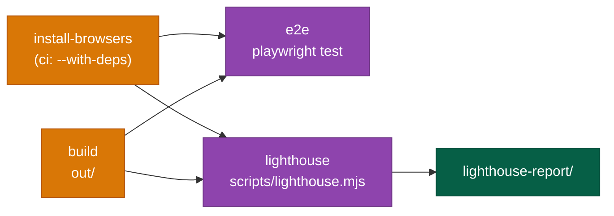

# Web Explorer — Test Targets

`e2e` and `lighthouse` check the built `out/` in Chromium and run in ci-web's "E2E and Lighthouse (affected)" step; `test` checks the scripts and tool logic without a browser. Part of [Web Explorer — Overview](./00.%20Overview.md); the build they depend on is in [01. Build and Gates](./01.%20Build%20and%20Gates.md).



| Target             | Command (`cwd: apps/web-explorer`)                                   | Depends on                  | Checks                                                                                   |
| ------------------ | -------------------------------------------------------------------- | --------------------------- | ---------------------------------------------------------------------------------------- |
| `test`             | `node --test scripts/*.test.mjs src/agent/*.test.ts`                 | —                           | The post-export step, every gate, the budget, Lighthouse `evaluate()` and the tool logic |
| `typecheck`        | `next typegen && tsc --noEmit`                                       | —                           | `src`, `scripts`, `e2e`, `playwright.config.ts`                                          |
| `lint`             | `eslint src scripts e2e playwright.config.ts`                        | —                           | ESLint flat config; `public/**/*.js` gets browser globals                                |
| `e2e`              | `playwright test`                                                    | `build`, `install-browsers` | Browser checks below                                                                     |
| `lighthouse`       | `node scripts/lighthouse.mjs`                                        | `build`, `install-browsers` | SEO and agent readiness on every route; not cached                                       |
| `install-browsers` | `playwright install chromium`; `ci` configuration adds `--with-deps` | —                           | Not cached; runs only when Nx runs `e2e` or `lighthouse`                                 |

## `e2e`

Playwright runs Chromium only (`playwright.config.ts`, `retries: 0`). The `e2e/pages-emulation.ts` fixture is `auto: true`: every test intercepts requests to `https://dataart.github.io/artisyn-implementation-harness/*`, serves them from `out/` with the GitHub Pages rules, answers `/docs/agent-index.json` from `e2e/fixtures/docs-agent-index.json`, returns `404.html` for any other `/docs/*`, and aborts every request outside the site. A missing `out/index.html` fails the test.

| Spec                          | Asserts                                                                                                                                                                                                                                                                                                     |
| ----------------------------- | ----------------------------------------------------------------------------------------------------------------------------------------------------------------------------------------------------------------------------------------------------------------------------------------------------------- |
| `site.spec.ts`                | Every route loads with zero CSP violations, console errors or hydration errors; missing paths, `/docs/` misses included, get the root 404 page with Home and Docs links                                                                                                                                     |
| `legacy-hash.spec.ts`         | Old `#/get-started?…` links land on their path URL with the query kept; `#/inside-the-loop/<slug>` lands on `/cookbook/team-adoption-path/<slug>/` through its redirect page; a plain anchor stays put                                                                                                      |
| `get-started.spec.ts`         | The exported page holds the default commands; a configured link shows its selection after hydration                                                                                                                                                                                                         |
| `navigation.spec.ts`          | A header link navigates client-side with an RSC payload, without a full reload; header anchors scroll to their section                                                                                                                                                                                      |
| `webmcp.spec.ts`              | On a `document` and a `navigator` stub: the five tools register once per route with valid schemas; tool answers; `/cookbook/agents/` lists exactly the registered tools; client navigation does not register twice                                                                                          |
| `header-menu.spec.ts`         | The main nav has five entries with Cookbook as a closed disclosure; Cookbook opens its recipes and the two case studies, Escape closes it and returns focus, an outside click closes it; a Cookbook link navigates and marks the page `aria-current`; the open menu has no serious WCAG violation (4 cases) |
| `moved.spec.ts`               | Each of the 15 old paths in `MOVED_ROUTES` (`e2e/routes.ts`) redirects to its new path; a redirect page is `noindex, follow`, canonical to the new path, and links to it (16 cases)                                                                                                                         |
| `migration-case.spec.ts`      | `/cookbook/case/migration/` lifecycle explorer: tabs switch and stage rows open and close; arrow keys move between tabs; the WCAG 2.2 AA scan passes after interaction (3 cases)                                                                                                                            |
| `agent-accessibility.spec.ts` | The 33 axe rules of Lighthouse's `agent-accessibility-tree` audit pass on every route and the 404 page; the WCAG ratchet below                                                                                                                                                                              |

## WCAG baseline ratchet

The same spec runs axe with tags `wcag2a`, `wcag2aa`, `wcag21a`, `wcag21aa` and `wcag22aa` on every route and `/no-such-page/`, and counts serious and critical violations per rule. `e2e/wcag-baseline.json` maps each page to the rules it may fail and how many elements each may flag. A test fails on a rule not listed for the page, a count above the listed one, or a listed rule that no longer fails (remove it). After a fix, rewrite the file and commit the smaller baseline:

```bash
cd apps/web-explorer && WCAG_BASELINE=update yarn playwright test agent-accessibility
```

Update mode runs the WCAG cases serially and drops pages with no violations. The baseline today holds `color-contrast` on 18 of the 19 pages (every page but `/cookbook/case/migration/`, which has no entry) and, on `/cookbook/knowledge-flow/`, `nested-interactive`, `target-size` and `label-content-name-mismatch` (NFR-A17, TD-2).

## `lighthouse`

`scripts/lighthouse.mjs` copies `out/` to `.lighthouse/<base>/`, re-signs it for a random `127.0.0.1` port, serves it in-process with `createPreviewServer` from `serve-preview.mjs`, launches Playwright's Chromium through `chrome-launcher` with `--headless=new --enable-features=WebMCP` (plus `--no-sandbox` on Linux, where Ubuntu 24.04 runners block Chrome's sandbox), and runs Lighthouse 13.4.1 (`performance`, `seo`, `agentic-browsing`; mobile, simulated throttling) on every registry route.

| `evaluate(lhr, route, { minPerformance })` flags | Exemption                                                  |
| ------------------------------------------------ | ---------------------------------------------------------- |
| SEO score below 100 on an indexable route        | `noindex` routes are not scored                            |
| Any failed SEO audit                             | `is-crawlable` on `noindex` routes                         |
| Any failed `agentic-browsing` audit              | Not-applicable, manual and informative audits do not count |
| `webmcp-registered-tools` lists no tool          | —                                                          |
| Performance below `--min-performance`            | Not asserted unless the option is given                    |

It writes one JSON report per route and `summary.json` to `lighthouse-report/`, prints a table, removes the staging copy and exits 1 on any violation. `--routes /,/cookbook/case/dogfood/` limits the run. ci-web uploads `lighthouse-report/` as an artifact ([09 CI-CD](../../Engineering%20Guide/09%20CI-CD.md)).

## Constraints

- `e2e` and `lighthouse` never write to `out/`; `.lighthouse/` and `lighthouse-report/` are gitignored.
- `ard-schema` is not in Lighthouse 13.4.1's `agentic-browsing` category, so the gate does not see it.
- Lighthouse performance is machine-dependent, so the performance requirement stays the gzip budget (NFR-19).
