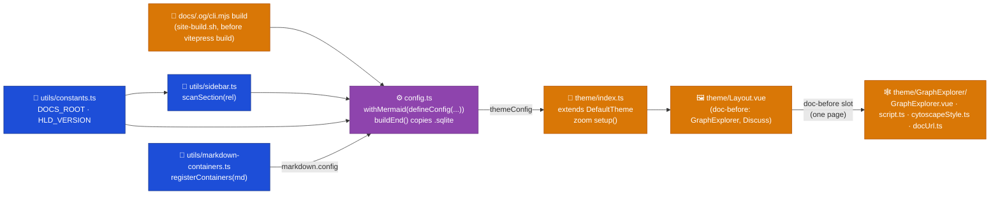

# Web — Overview

Implementation detail for the Web container: a VitePress static site rendering `docs/` (repo root) into HTML. Mirrors `docs/Target Architecture (HLD)/v1/Containers/Web.md`.

## Component detail

- `config.ts` — VitePress config, wrapped in `withMermaid()` (from `vitepress-plugin-mermaid`) around `defineConfig()`. `srcDir: '../../docs'` points at the repo-root `docs/` folder — the app itself holds no content; `srcExclude: ['Stories/**']` keeps working ticket folders out of the built site. No top nav bar entries — every section (Harness, Target Architecture, System Architecture, Engineering Guide, The Story) is reached via the homepage and is keyed in `sidebar`, each populated by `scanSection`. `markdown.html: false` disables raw HTML/`<script>` passthrough from markdown source — client-pasted content (e.g. workshop transcripts) renders as inert text instead of executing; `markdown.config` wires in `registerContainers`.
- `utils/sidebar.ts` — `scanSection(rel)` recursively reads a `docs/` subdirectory: sorts files/dirs alphabetically, strips numeric prefixes for display text (`prettify`), excludes `index.md`/`README.md` from sidebar items, and recurses into subdirectories, dropping any that yield zero items.
- `utils/constants.ts` — `DOCS_ROOT` resolves to the repo-root `docs/`; `HLD_VERSION = 'v1'` is the single source of truth for which HLD version folder (`Target Architecture (HLD)/{HLD_VERSION}`) appears in nav.
- `utils/markdown-containers.ts` — `registerContainers(md)` registers a `markdown-it-container` custom container, `::: screenshot`, as the sanctioned way to get a styled wrapper `
` without raw HTML passthrough. Styled via `.screenshot` in `theme/style.css` (720px max-width).
- `theme/index.ts` — extends `DefaultTheme`, swaps in a custom `Layout` (comments injection — see `../Discuss/00. Overview.md`), imports `./style.css`, and adds a `setup()` hook implementing click-to-zoom for Mermaid diagrams and doc images. A `MutationObserver` re-attaches zoom handlers on DOM mutation (Mermaid renders diagrams asynchronously after route navigation, so a one-time `onMounted` scan would miss them), and a `route.path` watcher re-triggers the scan on SPA navigation.
- `scripts/ci/site-build.sh` — runs `docs/.og/cli.mjs build` before `vitepress build`, keeping the operational graph database current for the build; `config.ts`'s `buildEnd(siteConfig)` hook then copies `docs/.og/docs-operational-graph.sqlite` into `siteConfig.outDir` as a static asset.
- `theme/GraphExplorer/` — `GraphExplorer.vue`, `script.ts`, `cytoscapeStyle.ts`, `docUrl.ts`, `template.html`, `style.css`, `graphExplorer.data.ts`. `GraphExplorer.vue` is the shell component `theme/Layout.vue` imports and renders in its `doc-before` slot; it renders an interactive Cytoscape.js graph (concentric layout ringed by doc tier) plus a static fallback table, for one page, `docs/Harness/07 Knowledge Graph/04 Graph Explorer.md`, the same slot mechanism already used for `GiscusComments`.

## Integration patterns

- Content and config are split: `docs/` (repo root) is the VitePress `srcDir`; `apps/docs-web/` holds only config, theme, and build wiring.
- Build/deploy is two NX targets over shell scripts: `site:build` runs `scripts/ci/site-build.sh` (in CI, loads env from SSM _before_ `vitepress build`, since Vite inlines `VITE_*` vars at build time, not at deploy time) → `vitepress build`. `site:deploy` runs `scripts/ci/site-deploy.sh`: `aws s3 sync --delete` to the site bucket, then a CloudFront `/*` invalidation, waited on to completion.
- Sidebar generation is directory-driven: adding a `.md` file under a mapped `docs/` subsection auto-appears in the sidebar; ordering is controlled purely by filename numeric prefixes, not a manual nav config.

## Key decisions

- `vitepress-plugin-mermaid`'s `withMermaid()` wrapper is required around `defineConfig()` for Mermaid diagrams to render — the config module cannot call `defineConfig()` directly for its default export.
- `Stories/**` is excluded from the built site — Stories are working documents (see root `CLAUDE.md`, "Issue tracker"), not published architecture or content.
- Zoom-on-click is a hand-rolled `MutationObserver` + click handler, not a VitePress/Vite plugin — the plugins evaluated only target ``, not Mermaid-rendered SVGs, and this project needs both.
- Raw HTML in markdown is disabled by default (VitePress otherwise defaults `markdown.html` to `true`). The one legitimate prior use of raw HTML (sized screenshots) was migrated to the `::: screenshot` custom container rather than carved out as an exception.
