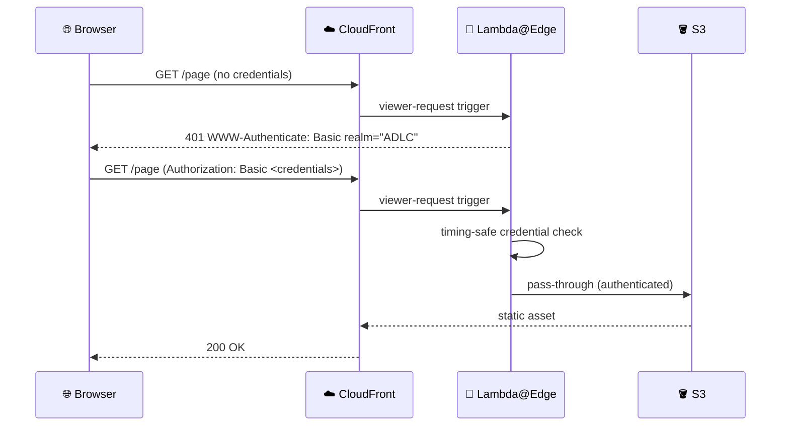

# Auth Container

Lambda@Edge handler enforcing basic auth password protection on every CloudFront request.

## Baseline diagram

## Responsibilities

- Intercept every CloudFront viewer request at the edge (viewer-request event type)
- Parse the `Authorization` header and validate the password credential
- Return a `401 WWW-Authenticate` challenge for unauthenticated requests
- Pass through authenticated requests to the S3 origin

## Technology

| Component    | Choice                                                                                                                                                                                                                                  |
| ------------ | --------------------------------------------------------------------------------------------------------------------------------------------------------------------------------------------------------------------------------------- |
| Runtime      | Node.js (Lambda@Edge)                                                                                                                                                                                                                   |
| Language     | TypeScript                                                                                                                                                                                                                              |
| Deploy model | Lambda@Edge — CDK provisions a placeholder in `us-east-1`; real handler ships via `lambda-auth:deploy` after CDK. Re-run `lambda-auth:deploy` after any DocsStack deploy. See `Engineering Guide/Infrastructure/02 Deploy Lifecycle.md` |

## Boundary contracts

- Input: every CloudFront viewer request, including the `Authorization` header if present
- Output: either a `401` with `WWW-Authenticate: Basic realm="Docs"` (no credentials, malformed header, unverifiable secret fetch, or wrong password), or the original request passed through unmodified to the S3 origin (correct password)
- Guarantee: no request reaches S3 without a successful timing-safe comparison against the stored password hash (NFR-1); the stored credential is a SHA-256 hash fetched from Secrets Manager, never a plaintext secret, and never hardcoded in source (NFR-2)

Reading the Discuss container's comments is not gated by anything beyond this Lambda — since giscus reads via its App's own token, not the viewer's, this basic-auth gate is the only thing standing between an anonymous visitor and the comment content. Posting is separately gated by GitHub repository permission, independent of this Lambda (see NFR-6).

## Constraints

- Handler execution must complete within 5 seconds
- Response payload must be under 1 MB
- Secrets Manager `GetSecretValue` is the only permitted external call — no VPC access, no async file I/O beyond the SDK call
- Password hash loaded from Secrets Manager at cold-start via `GetSecretValue` — never hardcoded in source
- Password comparisons must be timing-safe
- Memory is capped at 128 MB (Lambda@Edge viewer-request ceiling) — set explicitly in CDK
- Execution logs are written to CloudWatch Logs in the CloudFront edge region handling the request, not in `us-east-1`; the CDK log group must carry an explicit removal policy

## Key paths

| Path                | Purpose        |
| ------------------- | -------------- |
| `apps/lambda-auth/` | Handler source |
