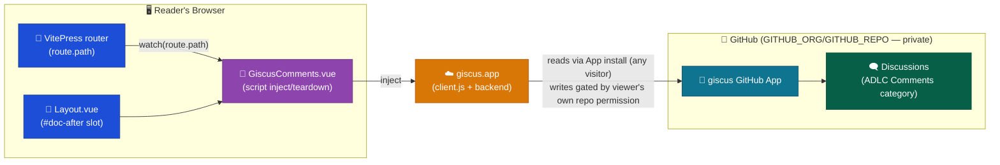

# Discuss Container

Client-side comments widget (giscus, GitHub Discussions-backed) embedded on VitePress documentation pages. No infrastructure or compute of our own — giscus and GitHub host and operate everything behind this integration.

## Baseline diagram

## Responsibilities

- Embed a client-side comments widget on VitePress `doc`-layout pages, mapped one discussion per page
- Keep the widget in sync with VitePress's client-side (SPA) navigation
- No server, database, or compute operated by this platform — giscus and GitHub own the runtime and storage

## Technology

| Component         | Choice                                                                                                                                                                                 |
| ----------------- | -------------------------------------------------------------------------------------------------------------------------------------------------------------------------------------- |
| Widget            | giscus — client-side script embed (`giscus.app/client.js`), no npm dependency                                                                                                          |
| Data store        | GitHub Discussions on the repo configured via `GITHUB_ORG`/`GITHUB_REPO` (private repo)                                                                                                |
| Access control    | Asymmetric: posting requires GitHub repository permission (verified); reading does not — gated only by the site's basic-auth gate, same population as the rest of the site (see NFR-6) |
| Theme integration | `apps/docs-web/.vitepress/theme/` (Web container) — no dedicated NX app                                                                                                                |

## Constraints

- No infrastructure, server, or database of our own — giscus and GitHub own runtime, storage and moderation; this platform performs no server-side moderation of comment content (NFR-6)
- Reading comments is bound only by NFR-1 (site-wide basic auth) — giscus.app's backend fetches via the App's own installation token, not the viewer's identity, so no narrower read gate exists or is achievable within this integration
- Posting requires GitHub repository permission on the repo configured via `GITHUB_ORG`/`GITHUB_REPO`, enforced entirely by the giscus GitHub App — this platform cannot grant, revoke or audit that permission itself (NFR-6)
- Widget lifecycle is confirmed client-side only: script inject/teardown runs in the browser on every VitePress route change; no build-time or server-side rendering of comment content

## Key paths

| Path                                                     | Purpose                                          |
| -------------------------------------------------------- | ------------------------------------------------ |
| `apps/docs-web/.vitepress/theme/GiscusComments.vue`      | Owns the giscus script inject/teardown lifecycle |
| `apps/docs-web/.vitepress/theme/Layout.vue`              | Injects the widget into the `#doc-after` slot    |
| `docs/System Architecture (LLD)/Discuss/00. Overview.md` | Implementation detail                            |
