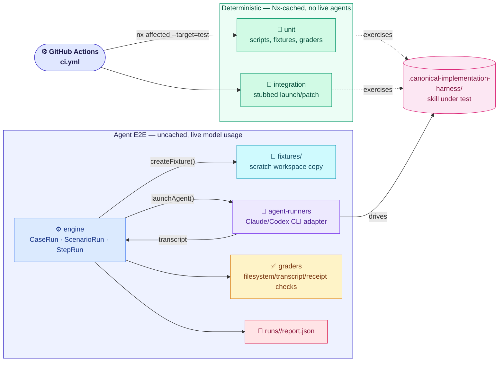

# Harness Bootstrap E2E Container

Test harness validating the `harness-bootstrap` skill (`.canonical-implementation-harness/`) itself: deterministic unit and integration coverage of its scripts and contracts, plus live agent E2E runs that drive the skill through real Claude or Codex CLI sessions against disposable fixture workspaces.

## Baseline diagram

Agent E2E runs are not triggered by `ci.yml` — they use the developer's own CLI authentication and model usage (`yarn nx run harness-bootstrap-e2e:agent-e2e`, a guarded command).

## Responsibilities

- Deterministic unit tests over the skill's own scripts, fixture/scenario helpers, and grader pass/fail logic — no live agent invocation, Nx-cached
- Deterministic integration tests over stubbed launch plans, materialization, simulated adaptation, finalization, and cross-provider projections
- Agent E2E cases that drive real Claude/Codex CLI sessions against disposable fixture workspaces, grade the resulting filesystem/transcript/receipt state, and persist a per-case `report.json`
- Validates `.canonical-implementation-harness/` as a whole — scripts, canonical templates, patch harvest/prepare/apply — never the deployed site containers (Web/Discuss)

## Technology

| Component        | Choice                                                        |
| ---------------- | ------------------------------------------------------------- |
| Test runner      | Vitest, three separate configs (unit, integration, agent-e2e) |
| Orchestration    | Nx (`unit`, `integration`, `agent-e2e`, `test` targets)       |
| Agent invocation | Claude/Codex headless CLI adapters (`agent-runners/`)         |
| Language         | TypeScript                                                    |

## Boundary contracts

- Input: fixture workspaces under `fixtures/` (seeded, disposable copies of `.canonical-implementation-harness/`'s target repositories), case/scenario definitions under `src/cases/` and `src/scenarios/`
- Output: per-case `runs/<case>/report.json`; CI-visible pass/fail from `unit`/`integration` (via the `test` target, which `ci.yml` runs through `nx affected --target=test`, between the affected typecheck and build steps)
- Guarantee: deterministic layers (`unit`, `integration`) never invoke a live model and are Nx-cached (`cache: true` in `project.json`); agent E2E is explicitly uncached (`cache: false`) and guarded — it never runs in CI, only when a developer deliberately spends agent budget
- Guarantee: fixtures are read-only sources — `createFixture()` copies each one into a disposable scratch workspace per case; no test target writes back into `.canonical-implementation-harness/` or a fixture's checked-in source

## Key paths

| Path                                            | Purpose                                                      |
| ----------------------------------------------- | ------------------------------------------------------------ |
| `apps/harness-bootstrap-e2e/fixtures/`          | Deterministic launch/patch baseline + greenfield fixtures    |
| `apps/harness-bootstrap-e2e/src/cases/`         | Agent E2E case specs                                         |
| `apps/harness-bootstrap-e2e/src/scenarios/`     | What each case runs and checks                               |
| `apps/harness-bootstrap-e2e/src/engine/`        | The only stateful layer — step loop, grading, report writing |
| `apps/harness-bootstrap-e2e/src/graders/`       | Filesystem/transcript/receipt checks, grouped by concern     |
| `apps/harness-bootstrap-e2e/src/agent-runners/` | Claude/Codex CLI adapters                                    |

## Constraints

- Agent E2E must never run automatically in CI — it spends real agent budget and is listed as a guarded command in `CLAUDE.md`
- Deterministic layers (`unit`, `integration`) must never invoke a live model — any real CLI/model call belongs in `agent-e2e` only
- Case IDs and scenario IDs are centralized in `src/cases/_registry.ts` and `src/scenarios/_registry.ts` — no test registers itself by import side effect elsewhere
