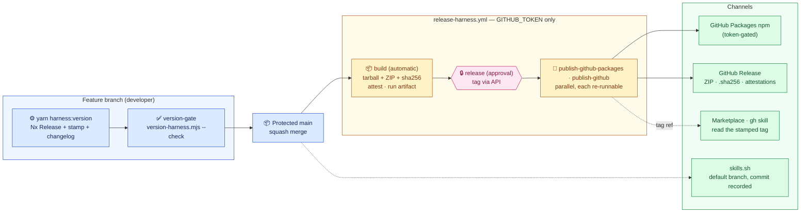

# Harness Release Pipeline Container

The harness is versioned in the PR, built on merge and published after a reviewer approves. The PR stamps the version. After the squash merge, an automatic build produces and attests the npm tarball and the Release ZIP. A `release` job then waits in the `release` environment; on approval it creates the tag, and two parallel publish jobs publish, so every channel opens at the same moment. It is the repository's only release lane, and it never pushes to `main`. Like Implementation Harness E2E, this is CI tooling, with no presence in the deployed site.

## Baseline diagram

## Responsibilities

- On the feature branch: compute the version from the latest harness tag and the conventional commits after it (Nx Release; the repository itself is not versioned), stamp every shipped manifest, write the changelog entry (`yarn harness:version`); on every PR, `version-gate` checks the stamp and blocks harness PRs while a release waits for approval
- On every merge (`build`): when the version is not fully published, build and attest the npm tarball and the Release ZIP + `.sha256` and keep them as a run artifact
- After approval: `release` creates the tag `artisyn-implementation-harness-v<version>` through the API; then, in parallel, `publish-github-packages` publishes to GitHub Packages and `publish-github` publishes the GitHub Release with the ZIP and `.sha256`

## Boundary contracts

- Input: the harness `package.json` at the merged commit is the single version source; the PR's commits that touch `skills/implementation-harness/` (scope-gated to `harness`) decide it
- Output: the channels in `docs/Harness/09 Distribution/index.md` — npm (token-gated), Release ZIP + `.sha256` + attestation (anonymous), the tag the marketplace and `gh skill` pin; skills.sh installs from the default branch and records the resolved commit
- Guarantee: a fully published version publishes nothing and asks no approval; a re-run finishes only what is missing; a failed attestation blocks publish
- Guarantee: the tag is created only after approval, so all channels open at once; the Release is published from a draft after its assets are attached, so it is complete when GitHub immutable releases freeze it
- Guarantee: integrity per channel — npm registry integrity; ZIP `.sha256`, checked by the install CLI on `update` and by hand on a first ZIP install; attestations verifiable with `gh attestation verify`

## Constraints

- Releases happen only through this pipeline; the manual ZIP flow and the root semantic-release lane are retired
- Publish requires approval from a required reviewer of the `release` environment; the site deploy (`cd.yml`) is separate and does not wait for it
- Between merge and approval, the marketplace manifests on `main` pin a tag that does not exist yet, so marketplace and `gh skill` installs of the new version fail in that window (accepted 2026-11-16)
- The `main` ruleset requires a PR, an up-to-date branch and the `ci`, `version-gate` and `docs-gate` checks, and has no bypass actors
- The developer pushes the version commit (a `GITHUB_TOKEN` push starts no workflows); no workflow commits or pushes to `main`; the pipeline runs only with `GITHUB_TOKEN`, scoped per job, and needs no PAT, GitHub App or ruleset bypass (TD-5, 2026-11-16)
- Operation: `docs/Engineering Guide/08 Harness Release Runbook.md`. Implementation: `docs/System Architecture (LLD)/Harness Release Pipeline/00. Overview.md`
