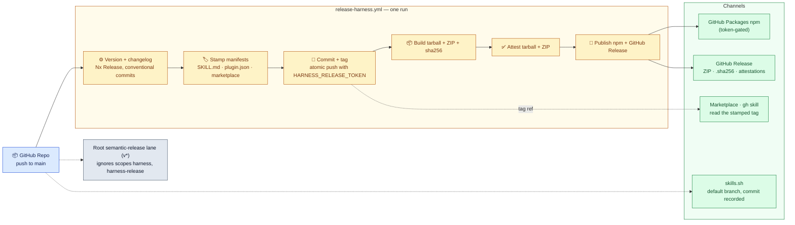

# Harness Release Pipeline Container

One automatic pipeline releases the harness package: every push to `main` that bumps the harness version produces the tag, the npm package, the Release ZIP and the attestations in a single run, with no manual publish step. Like Harness Bootstrap E2E, this is CI tooling, with no presence in the deployed site.

## Baseline diagram

## Responsibilities

- Version the harness from conventional commits (Nx Release, independent of the repo's `v*` version), write the changelog, stamp every shipped manifest
- Push the release commit `chore(harness-release): <version> [skip ci]` and the tag `artisyn-implementation-harness-v<version>` atomically to the protected `main`
- Build, attest and publish the npm tarball and the Release ZIP + `.sha256`
- Stay inert until the repository variable `HARNESS_RELEASE_ENABLED` is `true`; never retrigger on its own release commit

## Boundary contracts

- Input: merges to `main` whose commits touch `skills/implementation-harness/` (the scope gate makes those commits `harness`-scoped); the harness `package.json` is the single version source
- Output: the channels in `docs/Harness/09 Distribution/index.md` — npm (token-gated), Release ZIP + `.sha256` + attestation (anonymous), the tag the marketplace and `gh skill` pin; skills.sh installs from the default branch and records the resolved commit
- Guarantee: a re-run finishes only the missing artifacts; a failed attestation blocks publish; the root semantic-release lane ignores scopes `harness` and `harness-release`
- Guarantee: integrity per channel — npm registry integrity; ZIP `.sha256`, checked by the install CLI on `update` and by hand on a first ZIP install; attestations verifiable with `gh attestation verify`

## Constraints

- Releases happen only through this pipeline; the manual ZIP flow is retired
- The `main` ruleset requires a PR and the `ci`, `version-gate` and `rename-gate` checks
- The release push crosses the ruleset through a bypass actor — interim a repo-admin PAT, target an org GitHub App; only the presence check and the push step read that credential (token model: LLD, runbook TD-2)
- Operation: `docs/Engineering Guide/08 Harness Release Runbook.md`. Implementation: `docs/System Architecture (LLD)/Harness Release Pipeline/00. Overview.md`
