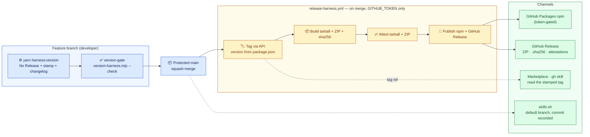

# Harness Release Pipeline Container

The harness is versioned in the PR and published on merge. The PR stamps the version; after the squash merge, one automatic run tags that version and produces the npm package, the Release ZIP and the attestations, with no manual publish step and no push to `main`. It is the repository's only release lane. Like Implementation Harness E2E, this is CI tooling, with no presence in the deployed site.

## Baseline diagram

## Responsibilities

- On the feature branch: compute the version from the latest harness tag and the conventional commits after it (Nx Release; the repository itself is not versioned), stamp every shipped manifest, write the changelog entry (`yarn harness:version`)
- On every PR: fail `version-gate` unless the branch is stamped with the computed version and its changelog entry
- On every merge: create the tag `artisyn-implementation-harness-v<version>` through the API, then build, attest and publish the npm tarball and the Release ZIP + `.sha256`

## Boundary contracts

- Input: the harness `package.json` at the merged commit is the single version source; the PR's commits that touch `skills/implementation-harness/` (scope-gated to `harness`) decide it
- Output: the channels in `docs/Harness/09 Distribution/index.md` — npm (token-gated), Release ZIP + `.sha256` + attestation (anonymous), the tag the marketplace and `gh skill` pin; skills.sh installs from the default branch and records the resolved commit
- Guarantee: an existing tag means "finish what is missing" — a merge that did not change the harness or a re-run publishes nothing new; a failed attestation blocks publish
- Guarantee: integrity per channel — npm registry integrity; ZIP `.sha256`, checked by the install CLI on `update` and by hand on a first ZIP install; attestations verifiable with `gh attestation verify`

## Constraints

- Releases happen only through this pipeline; the manual ZIP flow and the root semantic-release lane are retired
- The `main` ruleset requires a PR, an up-to-date branch and the `ci`, `version-gate` and `rename-gate` checks, and has no bypass actors; two PRs claiming the same version cannot both merge without the second re-stamping
- The version commit is pushed by the developer: a commit pushed with `GITHUB_TOKEN` starts no workflows, and the ruleset requires approval of the last push
- No workflow commits or pushes to `main`; the pipeline runs only with `GITHUB_TOKEN` and needs no PAT, GitHub App or ruleset bypass (TD-5, 2026-11-16)
- Operation: `docs/Engineering Guide/08 Harness Release Runbook.md`. Implementation: `docs/System Architecture (LLD)/Harness Release Pipeline/00. Overview.md`
