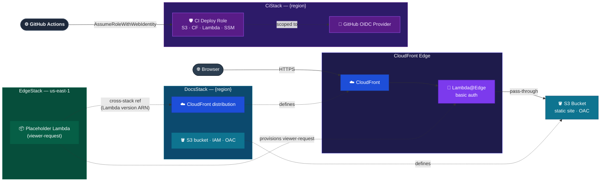

# Infrastructure Container

AWS CDK definitions for all cloud resources.

## Baseline diagram

_Auth decision path (401 challenge vs pass-through) is shown in `Containers/Auth.md`._

## Responsibilities

- CloudFront distribution configured with `defaultRootObject: index.html`; an `errorResponses` entry remaps S3 403 → HTTP 404 (private S3 buckets return 403 for missing objects, not 404)
- S3 bucket as static site origin (Origin Access Control)
- IAM roles and resource policies
- All resources defined as CDK constructs — no manual provisioning
- Secrets Manager secret provisioned as an empty placeholder (`{}`); value is populated post-deploy by `lambda-auth:sm-push` — never set by CDK
- GitHub OIDC provider (`CiStack`) enabling GitHub Actions to authenticate via short-lived credentials; scoped IAM deploy role with least-privilege policies for S3, CloudFront, Lambda, and SSM

## Technology

| Component     | Choice      |
| ------------- | ----------- |
| IaC framework | AWS CDK     |
| Language      | TypeScript  |
| Distribution  | CloudFront  |
| Origin        | S3 (static) |
| Edge auth     | Lambda@Edge |

## Boundary contracts

- Input: CDK stack/construct definitions in `apps/infra/`, deployed manually via the guarded `infra:provision` command; app deploy pipelines (`site:deploy`, `lambda-auth:deploy`) consume its outputs but never modify infrastructure (NFR-4)
- Output: CloudFormation stack outputs consumed by other containers and CI — CloudFront domain/distribution ID, S3 bucket name, Secrets Manager ARN/name, and the Lambda@Edge function name; `CiStack` outputs the IAM deploy role ARN consumed by GitHub Actions OIDC auth
- Guarantee: every resource is provisioned exclusively through CDK constructs — no manual console changes (NFR-4); stateful resources (S3 bucket, Secrets Manager secret) carry `RemovalPolicy.RETAIN`; the Secrets Manager secret is provisioned as an empty placeholder, its value populated only post-deploy by `lambda-auth:sm-push`, never by CDK

## Key paths

| Path          | Purpose                   |
| ------------- | ------------------------- |
| `apps/infra/` | CDK stacks and constructs |

## Constraints

- Region is deployment configuration — never hardcoded in source or documentation
- All stateful resources (S3 buckets, log groups) must have explicit removal policies
- IAM policies must follow least-privilege — no `*` actions or resources without justification

## Naming conventions

| Name                 | Pattern                                           |
| -------------------- | ------------------------------------------------- |
| AWS resources        | `{org}-{env}-{wl}-{locationShort}-{type}-{index}` |
| Secrets Manager path | `{org}/{env}/{wl}/lambda-auth`                    |
| SSM Parameter Store  | `/{org}/{env}/{wl}/{app}/env`                     |

All naming logic is centralised in `apps/infra/lib/conventions.ts`.
