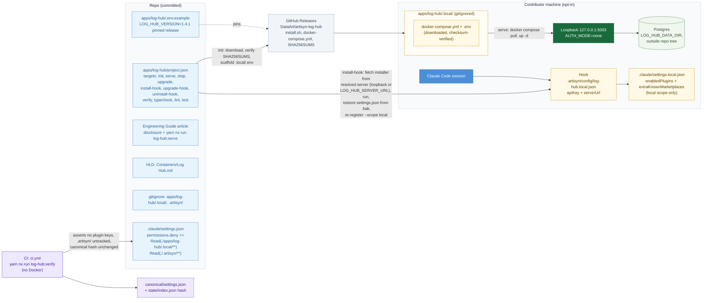

# Log Hub Container

Dev-tooling container capturing Claude Code session telemetry. A contributor who opts in runs a pinned, checksum-verified release of the upstream [Artisyn Log Hub](https://github.com/DataArt/artisyn-log-hub) server on their own machine (Docker Compose, loopback-only), then registers a Claude Code hook against it at local Claude Code scope. It runs only on a contributor's own machine, never in CI runtime, never in the GitHub Pages build, and is not registered in `apps/web-portal`'s composed deploy tree — the same precedent as the Harness Bootstrap E2E container.

## Baseline diagram

## Responsibilities

- Download and run a pinned release of the upstream Artisyn Log Hub server (Docker Compose, Mode 1 `AUTH_MODE=none`, loopback `127.0.0.1:5003`) on the contributor's own machine.
- Install, upgrade and uninstall the upstream Claude Code hook plugin against that local server, registered at **local** Claude Code scope (`.claude/settings.local.json`). This never touches the committed `.claude/settings.json`.
- Verify, in CI and on demand, that none of the above ever touches tracked settings or the canonical harness.
- Optionally target a non-loopback server for `install-hook`/`uninstall-hook` via `LOG_HUB_SERVER_URL`, for a server already running locally or remotely — Mode 1 (`AUTH_MODE=none`) has no authentication of its own, so a non-loopback target has no built-in access control.

## Technology

| Component         | Choice                                                                                                    |
| ----------------- | --------------------------------------------------------------------------------------------------------- |
| Orchestration     | Nx (`nx:run-commands`), project `log-hub` at `apps/log-hub/`                                              |
| Scripting         | TypeScript `.ts` scripts, run via `tsx` (Node 24), no build step                                          |
| Container runtime | Docker Engine + Compose v2 — opt-in, not required for `verify`/CI                                         |
| Server            | Artisyn Log Hub server, pinned release in `apps/log-hub/.env.example`'s `LOG_HUB_VERSION`                 |
| Hook              | Artisyn Log Hub hook plugin, registered with `--scope local`                                              |
| Package execution | `npx` — the sole, unconditional installer runner; `yarn dlx` cannot fetch a plain-`http://` source at all |

## Boundary contracts

- Input: pinned release artifacts from `DataArt/artisyn-log-hub` GitHub Releases (`install.sh`, `docker-compose.yml`, `SHA256SUMS`), checksum-verified before execution.
- Output: local Postgres data outside the repo tree via `LOG_HUB_DATA_DIR`; local-scope Claude Code plugin/marketplace registration in `.claude/settings.local.json`.
- Guarantee: `apps/log-hub/.local/` and `.artisyn/` are gitignored; the committed `.claude/settings.json` is byte-identical before and after any `install-hook` run.
- Guarantee: `log-hub`'s Docker-dependent lifecycle targets (`init`, `serve`, `stop`, `upgrade`, `install-hook`, `upgrade-hook`, `uninstall-hook`) never run through `nx affected`/CI. The Docker-free targets — `verify`, plus the quality targets `typecheck`, `lint` and `test` — do run through `nx affected`/CI, the same as every other TS project's.

## Key paths

| Path                                 | Purpose                                                                                                                                            |
| ------------------------------------ | -------------------------------------------------------------------------------------------------------------------------------------------------- |
| `apps/log-hub/project.json`          | Nx target definitions: `init`, `serve`, `stop`, `upgrade`, `install-hook`, `upgrade-hook`, `uninstall-hook`, `verify`, `typecheck`, `lint`, `test` |
| `apps/log-hub/.env.example`          | Committed template for `.local/.env`; its `LOG_HUB_VERSION` line pins the upstream Log Hub server release                                          |
| `apps/log-hub/.local/`               | Gitignored install directory — downloaded compose file and `.env`                                                                                  |
| `.artisyn/config/log-hub.local.json` | Gitignored hook config — `apiKey`/`serverUrl` secrets                                                                                              |

## Constraints

- Docker is an opt-in contributor prerequisite only — it is never a CI dependency; `log-hub:verify`, `typecheck`, `lint` and `test` all run in CI with no Docker.
- `.claude/settings.json`'s `permissions.deny` carries two entries introduced for this container: `Read(./apps/log-hub/.local/**)` and `Read(./.artisyn/**)`.
- The primary shipped layout is local Claude Code scope registration with nothing Log-Hub-related committed. A committed-layout fallback exists and ships only once its own gating condition, recorded in the design report, is resolved.
