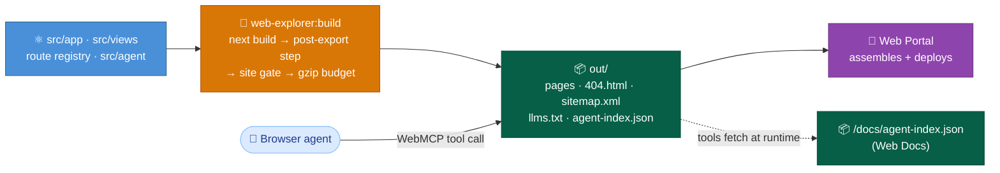

# Web Explorer Container

Promotional multi-route site at `apps/web-explorer`: a Next.js 16.4 App Router app exported to static files, one `<route>/index.html` per route at a trailing-slash path URL. It has 19 routes — `/`, `/get-started/`, the Cookbook pages (`/cookbook/context-topology/`, `/cookbook/team-adoption-path/` plus 10 topic pages, `/cookbook/knowledge-flow/`, `/cookbook/agents/`, and the case studies `/cookbook/case/dogfood/` and `/cookbook/case/migration/`) and `/comic/` — and the root `404.html`. Route paths mirror the header's Cookbook menu. All 19 routes are indexable except `/comic/`; `404.html` is `noindex`. Each of the 15 pre-Cookbook paths (`/inside-the-loop/` and its 10 topics, `/docs-flow/`, `/agents/`, `/dogfood/`, `/migration-case/`) is a `noindex, follow` redirect page to its new path, so published links keep working. Implementation: [LLD Overview](<../../../System Architecture (LLD)/Web Explorer/00. Overview.md>).

Any gate failure stops `web-explorer:build`, so Web Portal never assembles or deploys an unchecked site. Build and gates: [LLD 01](<../../../System Architecture (LLD)/Web Explorer/01. Build and Gates.md>).

## Responsibilities

- Pre-render every page with Server Components; `'use client'` only for state, effects, handlers, browser APIs or `motion`. Route with App Router file routes; redirect legacy `#/<path>` links on `/` only; old pre-Cookbook paths answer with redirect pages.
- Generate per-page metadata, `sitemap.xml` (git `lastmod`), `llms.txt` and schema.org JSON-LD from the route registry (NFR-18).
- Give every exported page its own hashed meta Content Security Policy (NFR-16).
- Register five WebMCP tools for browser agents and publish `agent-index.json`; document them on `/cookbook/agents/`.
- Render the Dogfood page with a read-only view of this repo's operational graph.
- Render the Migration case page: the measured record of the Vite → Next.js migration, server-rendered except for one client component, the lifecycle explorer.
- Keep the first-load JavaScript and CSS of `/` within a gzip budget (NFR-19).

## Agent interface

Browser agents call five WebMCP tools — `search_documentation`, `get_page`, `get_install_instructions`, `open_workflow` (the only one that acts: it navigates to a Web Docs lifecycle article) and `get_harness_capabilities`. Every page registers them once on the browser's native `modelContext`. Tool code and both agent indexes load on the first call; the site index is required, the Web Docs index is optional. Contracts and loading: [LLD 02](<../../../System Architecture (LLD)/Web Explorer/02. Agent Interface.md>).

## Technology

| Component  | Choice                                                                         |
| ---------- | ------------------------------------------------------------------------------ |
| Framework  | Next.js `~16.4.6` (App Router, `output: 'export'`, Turbopack), React 19        |
| Styling    | Tailwind CSS 4, vendored Inter and DM Sans via `next/font/local`, Motion       |
| Agent API  | Browser-native WebMCP, no SDK                                                  |
| Build-time | `parse5` for the post-export step and gates                                    |
| Checks     | Playwright + axe-core (`e2e`), Lighthouse 13.4.1 (`lighthouse`), Chromium only |

## Boundary contracts

| Kind      | Contract                                                                                                                                                                                                                 |
| --------- | ------------------------------------------------------------------------------------------------------------------------------------------------------------------------------------------------------------------------ |
| Input     | App source, route registry, vendored fonts, the committed docs-graph snapshot, the harness version from `skills/implementation-harness/package.json`                                                                     |
| Input     | Build variables `NEXT_PUBLIC_REPO_URL`, `NEXT_PUBLIC_DOCS_URL`, `NEXT_PUBLIC_GOOGLE_SITE_VERIFICATION`, `WEBMCP_ORIGIN_TRIAL_TOKEN`; each invalidates the Nx cache                                                       |
| Input     | At runtime, Web Docs's `/docs/agent-index.json` (optional)                                                                                                                                                               |
| Output    | `out/` for Web Portal: pages, `404.html`, `sitemap.xml`, `llms.txt`, `agent-index.json` (entries `{ path, url, title, description, headings, text }`, shared with Web Docs), `.nojekyll`, `_next/`                       |
| Guarantee | No raw `<script>` or `dangerouslySetInnerHTML` in source (NFR-7); `build` fails on any metadata, security-policy, structured-data, agent-index or budget gate                                                            |
| Guarantee | `e2e` fails the PR on CSP violations, hydration errors, broken routing, WebMCP regressions and WCAG regressions beyond the baseline (NFR-A17); `lighthouse` fails it below SEO 100 or on a failed agentic-browsing audit |

## Constraints

- Static output only: no rewrites, response headers, middleware or server actions; GitHub Pages limits apply (NFR-17)
- The base path is a literal in `src/site.ts`, as Web Docs's `base` is in its config
- `preview`, `e2e` and `lighthouse` never modify `out/`; local copies are re-signed and carry no origin-trial meta
- Builds send no telemetry (`NEXT_TELEMETRY_DISABLED=1`); one root Yarn workspace and lockfile
- Siblings in the Web layer: [Web Docs](Web%20Docs.md), [Web Portal](Web%20Portal.md)
