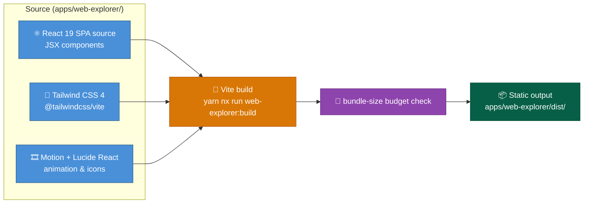

# Web Explorer Container

Promotional multi-route app at `apps/web-explorer`, owned by the Web layer alongside Web Docs and Web Portal. Two route groups under a client-side `HashRouter`: the landing page at `/`, and an `/inside-the-loop` section (a hub page plus 10 routed detail pages).

## Baseline diagram

`apps/web-explorer/dist/` is consumed by Web Portal's composition step (see `Containers/Web Portal.md`), not uploaded to GitHub Pages directly.

## Responsibilities

- Render the promotional landing page and the `/inside-the-loop` section as JSX components — no raw HTML string injection and no `<script>` tags in the rendered output (NFR-7)
- Route both sections client-side under a single `HashRouter`: `/` for the landing page, `/inside-the-loop` for the hub page plus its 10 detail pages
- Produce a static build at `apps/web-explorer/dist/` with no server runtime of its own
- Enforce a bundle-size budget against the landing page's own entry chunk — route-based code-splitting (`React.lazy()`) keeps the `/inside-the-loop` section's own chunk out of that measurement regardless of its size

## Technology

| Component        | Choice                                                                       |
| ---------------- | ---------------------------------------------------------------------------- |
| UI framework     | React `^19.3.1`                                                              |
| Build tool       | Vite, pinned to a major compatible with root TypeScript `^5.7.0` and Node 24 |
| Language         | TypeScript `^5.7.0`                                                          |
| Styling          | Tailwind CSS `^4.3.5` via `@tailwindcss/vite`                                |
| Animation        | Motion `^14.10.1`                                                            |
| Icons            | Lucide React `^1.70.0`, `simple-icons`                                       |
| Routing          | `react-router-dom` (`HashRouter`)                                            |
| Dependency graph | `@xyflow/react` — the `/inside-the-loop` hub page's dependency-graph map     |
| Chart data       | `d3-array`, `d3-scale`                                                       |

## Boundary contracts

- Input: React/JSX source, Tailwind config, root workspace `tsconfig.base.json`
- Output: static HTML/CSS/JS in `apps/web-explorer/dist/`, consumed as an input to Web Portal's `portal-assemble.ts` composition step
- Guarantee: content is rendered as JSX, not raw HTML — no `dangerouslySetInnerHTML` or raw `<script>` tags appear in the source (NFR-7)
- Guarantee: `web-explorer:build` fails if the bundle-size budget check against the landing page's entry chunk does not pass
- Guarantee: routing uses `HashRouter`, not `BrowserRouter` — this is a static artifact with no server to rewrite a deep link back to `index.html`; the hash-based approach needs zero GitHub Pages server configuration

## Constraints

- Served as static output only — no server-side runtime at request time, consistent with `System Overview.md`'s static-content design principle
- `vite.config.ts` sets `base` explicitly to the GitHub Pages project-site root — a literal path string, the same convention Web Docs's `.vitepress/config.ts` already uses for its own `base`
- Joins the root Yarn workspace (`workspaces: ["apps/*"]`) and the single root lockfile — no isolated `package-lock.json`
- One of three siblings in the Web layer: Web Explorer, [Web Docs](Web%20Docs.md), [Web Portal](Web%20Portal.md) — each has its own container doc

## Key paths

| Path                               | Purpose                                                  |
| ---------------------------------- | -------------------------------------------------------- |
| `apps/web-explorer/`               | React/Vite SPA source and config                         |
| `apps/web-explorer/dist/`          | Static build output (input to Web Portal composition)    |
| `apps/web-explorer/vite.config.ts` | Build config, sets `base` to the Pages project-site root |
