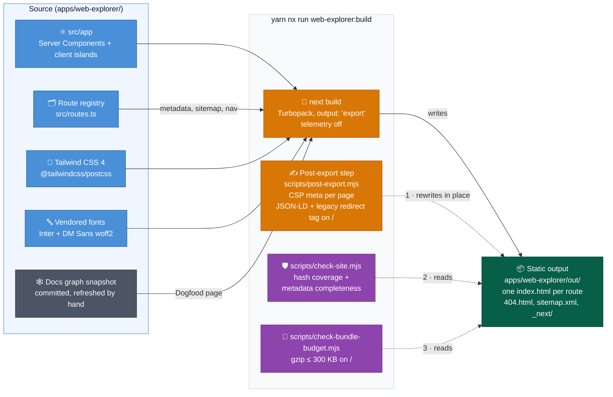

# Web Explorer Container

Promotional multi-route site at `apps/web-explorer`, owned by the Web layer alongside Web Docs and Web Portal. It is a Next.js 16.4.x App Router app exported to static files at build time. Every route is its own `<route>/index.html` at a trailing-slash path URL: `/`, `/inside-the-loop/` (a hub page plus 10 detail pages), `/get-started/`, `/docs-flow/`, `/dogfood/` and `/comic/`.

## Baseline diagram

`apps/web-explorer/out/` is consumed by Web Portal's composition step (see [Web Portal](Web%20Portal.md)), not uploaded to GitHub Pages directly. Any gate failure stops `web-explorer:build`, so nothing is assembled or deployed.

## Responsibilities

- Render every page at build time with Server Components. A component is `'use client'` only when it uses state, effects, event handlers, browser APIs or `motion`.
- Route with App Router file routes. In-page anchors are plain `/#<id>` links. React Router is not used.
- Redirect legacy `#/<path>?<query>` links to their path URL with the query kept. The external `legacy-hash-redirect.js` does this, loaded on `/` only.
- Generate per-page metadata from the route registry, plus `sitemap.xml` and schema.org JSON-LD on `/` only. `/comic/` is `noindex` and absent from the sitemap (NFR-18).
- Export the root `404.html` from `app/not-found.tsx`, with links to Home and Docs.
- Give every exported page its own hashed meta Content Security Policy (NFR-16).
- Render the Dogfood page: how this repo runs the harness on itself, with a read-only view of this repo's operational graph.
- Enforce a gzip budget on the JavaScript and CSS the landing page `/` loads first (NFR-19).

## Technology

| Component                | Choice                                                                    |
| ------------------------ | ------------------------------------------------------------------------- |
| Framework                | Next.js `~16.4.6` — App Router, `output: 'export'`, Turbopack             |
| UI library               | React `^19.3.1`                                                           |
| Language                 | TypeScript `^5.7.0`                                                       |
| Routing                  | App Router file routes, `next/link`, `next/navigation`                    |
| Styling                  | Tailwind CSS `^4.3.5` via `@tailwindcss/postcss`                          |
| Fonts                    | Inter + DM Sans `woff2`, vendored, loaded with `next/font/local`          |
| Animation                | Motion `^14.10.1`                                                         |
| Icons                    | Lucide React `^1.70.0`, `simple-icons`                                    |
| Dependency graph         | `@xyflow/react` — the `/inside-the-loop/` hub page's dependency-graph map |
| Chart data               | `d3-array`, `d3-scale`                                                    |
| Build-time HTML handling | `parse5` — post-export step and `check-site.mjs`                          |
| Browser checks           | `@playwright/test`, Chromium only — `web-explorer:e2e`                    |

## Boundary contracts

| Kind      | Contract                                                                                                                                                              |
| --------- | --------------------------------------------------------------------------------------------------------------------------------------------------------------------- |
| Input     | App source under `src/`, the route registry, Tailwind config, vendored fonts, root `tsconfig.base.json`                                                               |
| Input     | A committed, hand-refreshed snapshot of the docs operational graph, read by the Dogfood page; no CI step regenerates it                                               |
| Input     | The harness version from `skills/implementation-harness/package.json`, inlined at build time                                                                          |
| Input     | Build variables `NEXT_PUBLIC_REPO_URL`, `NEXT_PUBLIC_DOCS_URL`, `NEXT_PUBLIC_GOOGLE_SITE_VERIFICATION`; each is a `build` input, so a change invalidates the Nx cache |
| Output    | `apps/web-explorer/out/`: one `index.html` per route, `404.html`, `sitemap.xml`, `.nojekyll`, `_next/`; consumed by Web Portal's `portal-assemble.ts`                 |
| Output    | Deep links from the Dogfood page and the 404 page into the Web Docs site                                                                                              |
| Guarantee | Source contains no raw `<script>` and no `dangerouslySetInnerHTML` (NFR-7); the output's only scripts are those Next.js emits and those the post-export step injects  |
| Guarantee | Routes export as `<route>/index.html`, which GitHub Pages serves with no rewrites                                                                                     |
| Guarantee | `web-explorer:build` fails on the hash-coverage, metadata-completeness or gzip-budget gate (NFR-16, NFR-18, NFR-19)                                                   |
| Guarantee | `web-explorer:e2e` fails the PR on a CSP violation, hydration error, broken legacy redirect, broken 404 or broken client navigation                                   |
| Guarantee | Builds send no telemetry: `next build` runs with `NEXT_TELEMETRY_DISABLED=1`                                                                                          |

## Constraints

- Static output only: no rewrites, response headers, middleware or server actions, consistent with `System Overview.md`'s static-content design principle
- The base path is a literal in `src/site.ts`, the same convention Web Docs's `.vitepress/config.ts` uses for its own `base`
- GitHub Pages limits apply (NFR-17)
- `preview` and `e2e` never modify `out/`
- Joins the root Yarn workspace (`workspaces: ["apps/*"]`) and the single root lockfile — no isolated `package-lock.json`
- One of three siblings in the Web layer: Web Explorer, [Web Docs](Web%20Docs.md), [Web Portal](Web%20Portal.md) — each has its own container doc

## Key paths

| Path                                                | Purpose                                                            |
| --------------------------------------------------- | ------------------------------------------------------------------ |
| `apps/web-explorer/`                                | Next.js app source and config                                      |
| `apps/web-explorer/next.config.ts`                  | Static export, base path, trailing slash, harness version          |
| `apps/web-explorer/src/app/`                        | App Router file routes, layouts and `not-found.tsx`                |
| `apps/web-explorer/src/routes.ts`                   | Route registry: path, title, description, social image, index flag |
| `apps/web-explorer/src/site.ts`                     | Base path and site origin literals                                 |
| `apps/web-explorer/scripts/post-export.mjs`         | Post-export step; `--resign` mode for `preview`                    |
| `apps/web-explorer/scripts/check-site.mjs`          | Hash-coverage and metadata-completeness gates                      |
| `apps/web-explorer/scripts/check-bundle-budget.mjs` | Gzip budget gate on `/`                                            |
| `apps/web-explorer/public/legacy-hash-redirect.js`  | Legacy `#/` link redirect, loaded on `/` only                      |
| `apps/web-explorer/out/`                            | Static build output (input to Web Portal composition)              |
