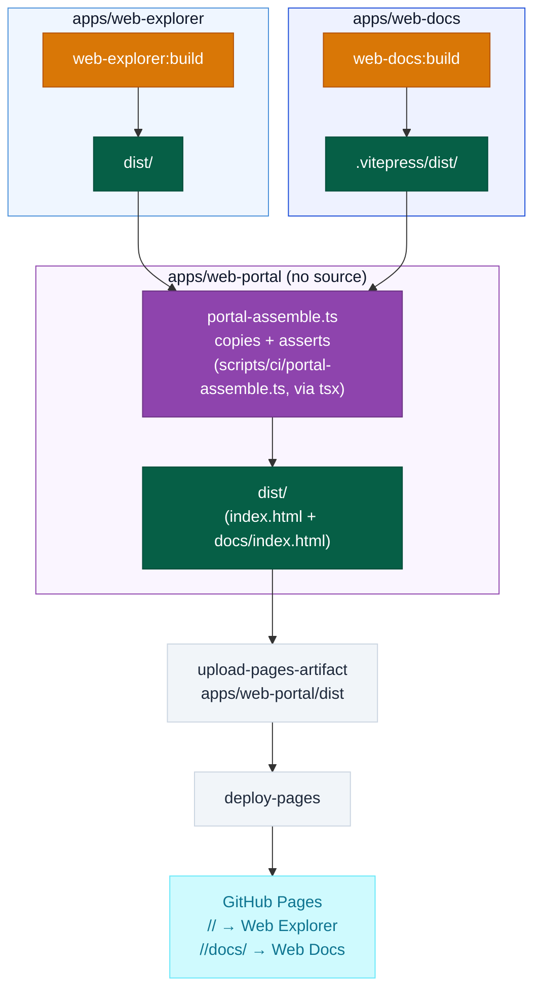

# Web Portal Container

Composition-only Nx project at `apps/web-portal`, with no application source of its own. Its sole responsibility: assemble Web Explorer's and Web Docs's independently-built static outputs into one deployable artifact tree.

## Baseline diagram

## Responsibilities

- Declare the project-graph dependency on Web Explorer and Web Docs so `nx affected` marks it affected whenever either changes
- Copy Web Explorer's `dist/` and Web Docs's `.vitepress/dist/` into one artifact tree at `apps/web-portal/dist/`
- Assert both `dist/index.html` and `dist/docs/index.html` exist before the build target succeeds — fail loudly rather than ship a partial deploy
- Introduce no application source and no server runtime — build-time composition only

## Technology

| Component          | Choice                                                                 |
| ------------------ | ---------------------------------------------------------------------- |
| Project type       | Nx `"application"`, empty `sourceRoot`                                 |
| Composition script | `scripts/ci/portal-assemble.ts`, run via `nx:run-commands` using `tsx` |
| Language           | TypeScript                                                             |

## Boundary contracts

- Input: `apps/web-explorer/dist/**` and Web Docs's `.vitepress/dist/**` (both produced by their own independent `build` targets)
- Output: `apps/web-portal/dist/` — `apps/web-explorer/dist/**` copied to its root, Web Docs's output copied under `dist/docs/`
- Guarantee: `build` target declares `outputs: ["{projectRoot}/dist"]`
- Guarantee: the assemble script throws a descriptive error — failing the Nx target and CI — if `dist/index.html` or `dist/docs/index.html` is missing after the copy; there is no partial-deploy failure mode
- `project.json` declares `implicitDependencies: ["web-explorer", "web-docs"]` (the project-graph edge `nx affected` needs) and the `build` target declares `dependsOn: ["web-explorer:build", "web-docs:build"]` (task ordering only, a separate concern from the graph edge) — the same `implicitDependencies` pattern `apps/web-docs/project.json` already used before this container existed
- Output feeds `.github/workflows/cd.yml`'s `actions/upload-pages-artifact`, whose `path` is `apps/web-portal/dist`; `nx affected --target=build` is unchanged as a command but now also builds `web-portal` via the project graph

## Constraints

- No server runtime introduced — build-time composition only, consistent with `System Overview.md`'s static-content design principle
- No staging environment exists for this pipeline; the CI-level file-existence assertion is the sole mitigation against a partial deploy
- GitHub Pages serves Web Explorer at `/<repo>/` and Web Docs at `/<repo>/docs/` from this one composed artifact tree
- One of three siblings in the Web layer: [Web Explorer](Web%20Explorer.md), [Web Docs](Web%20Docs.md), Web Portal — each has its own container doc

## Key paths

| Path                            | Purpose                                                          |
| ------------------------------- | ---------------------------------------------------------------- |
| `apps/web-portal/`              | Nx project definition, no application source                     |
| `apps/web-portal/project.json`  | `implicitDependencies`, `build` target `dependsOn` and `outputs` |
| `scripts/ci/portal-assemble.ts` | Copies both static builds, asserts both `index.html` files exist |
| `apps/web-portal/dist/`         | Composed static output — the GitHub Pages deploy artifact source |
