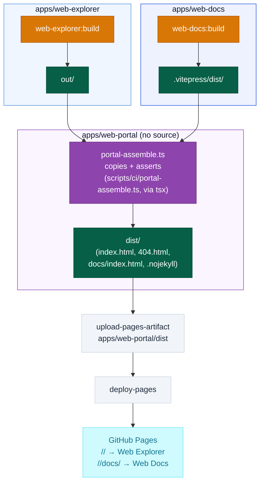

# Web Portal Container

Composition-only Nx project at `apps/web-portal`, with no application source of its own. Its sole responsibility: assemble Web Explorer's and Web Docs's independently-built static outputs into one deployable artifact tree.

## Baseline diagram

## Responsibilities

- Declare the project-graph dependency on Web Explorer and Web Docs so `nx affected` marks it affected whenever either changes
- Copy Web Explorer's `apps/web-explorer/out/` to the artifact root and Web Docs's `.vitepress/dist/` under `docs/`, in one artifact tree at `apps/web-portal/dist/`
- Fail if `apps/web-explorer/out/docs` exists before the copy, so Web Explorer output never collides with Web Docs
- Assert `dist/index.html`, `dist/404.html`, `dist/docs/index.html` and `dist/.nojekyll` exist before the build target succeeds — fail loudly rather than ship a partial deploy
- Fail when the published size of `apps/web-portal/dist/` exceeds 900 MB (NFR-17)
- Introduce no application source and no server runtime — build-time composition only

## Technology

| Component          | Choice                                                                 |
| ------------------ | ---------------------------------------------------------------------- |
| Project type       | Nx `"application"`, empty `sourceRoot`                                 |
| Composition script | `scripts/ci/portal-assemble.ts`, run via `nx:run-commands` using `tsx` |
| Language           | TypeScript                                                             |

## Boundary contracts

- Input: `apps/web-explorer/out/**` and Web Docs's `.vitepress/dist/**` (both produced by their own independent `build` targets)
- Output: `apps/web-portal/dist/` — `apps/web-explorer/out/**` copied to its root, Web Docs's output copied under `dist/docs/`
- Guarantee: `build` target declares `inputs: ["default", "^default", "{workspaceRoot}/scripts/ci/portal-assemble.ts"]` and `outputs: ["{projectRoot}/dist"]`
- Guarantee: the assemble script throws a descriptive error — failing the Nx target and CI — if `out/docs` exists before the copy, if `dist/index.html`, `dist/404.html`, `dist/docs/index.html` or `dist/.nojekyll` is missing after the copy, or if `dist/` exceeds 900 MB; there is no partial-deploy failure mode
- `project.json` declares `implicitDependencies: ["web-explorer", "web-docs"]` (the project-graph edge `nx affected` needs) and the `build` target declares `dependsOn: ["web-explorer:build", "web-docs:build"]` (task ordering only, a separate concern from the graph edge) — the same `implicitDependencies` pattern `apps/web-docs/project.json` already used before this container existed
- Output feeds `.github/workflows/deploy-web.yml`'s `actions/upload-pages-artifact`, whose `path` is `apps/web-portal/dist`; the workflow runs on every push to `main`; its `nx affected --target=build` over the whole push builds `web-portal` when the push affects the site, and the Pages steps run only when `apps/web-portal/dist` exists

## Constraints

- No server runtime introduced — build-time composition only, consistent with `System Overview.md`'s static-content design principle
- No staging environment exists for this pipeline; the CI-level file-existence assertion is the sole mitigation against a partial deploy
- GitHub Pages serves Web Explorer at `/<repo>/` and Web Docs at `/<repo>/docs/` from this one composed artifact tree
- Web Explorer's root `404.html` answers every miss on the site, including misses under `/<repo>/docs/`
- The published size stays within GitHub Pages limits (NFR-17)
- One of three siblings in the Web layer: [Web Explorer](Web%20Explorer.md), [Web Docs](Web%20Docs.md), Web Portal — each has its own container doc

## Key paths

| Path                            | Purpose                                                                                                                 |
| ------------------------------- | ----------------------------------------------------------------------------------------------------------------------- |
| `apps/web-portal/`              | Nx project definition, no application source                                                                            |
| `apps/web-portal/project.json`  | `implicitDependencies`, `build` target `dependsOn`, `inputs` and `outputs`                                              |
| `scripts/ci/portal-assemble.ts` | Copies both static builds; asserts `index.html`, `404.html`, `docs/index.html`, `.nojekyll` and the 900 MB size ceiling |
| `apps/web-portal/dist/`         | Composed static output — the GitHub Pages deploy artifact source                                                        |
