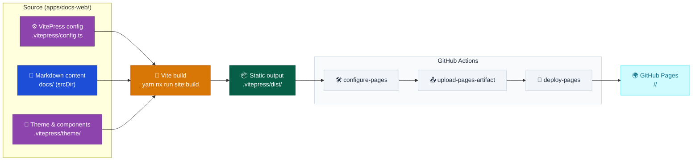

# Web Container

VitePress static documentation site.

## Baseline diagram

## Responsibilities

- Render Markdown content from `docs/` as a static site via VitePress
- VitePress configuration, sidebar navigation, and theme in `apps/docs-web/`
- Deployed to GitHub Pages — `configure-pages`, `upload-pages-artifact`, and `deploy-pages` run in the same GitHub Actions workflow that builds the site; no server-side runtime
- Hosts the theme integration point for the Discuss container's comments widget (see `Containers/Discuss.md`)

## Technology

| Component        | Choice                                                                       |
| ---------------- | ---------------------------------------------------------------------------- |
| Site framework   | VitePress 1.x                                                                |
| Build tool       | Vite                                                                         |
| Content format   | Markdown                                                                     |
| Site title       | `DataArt ADLC Discovery` (tokenized in `config.ts`)                          |
| Site description | Evidence-led problem→solution framing, tokenized `DataArt` (see `config.ts`) |

## Navigation

Nav is five fixed items in `config.ts`, one per top-level `docs/` section. Sidebar per section is generated at build time by scanning the corresponding `docs/` subdirectory via the `scanSection` helper in `config.ts`. File numeric prefix (`00`, `01`, …) controls sidebar ordering. `index.md` and `README.md` files are excluded from sidebar items. `docs/index.md` uses the VitePress `layout: home` landing page; each top-level section maintains its own `index.md` as a mini-hero entry point.

## Boundary contracts

- Input: Markdown content under `docs/` (`srcDir`), VitePress config (`.vitepress/config.ts`), theme components (`.vitepress/theme/`), and `docs/.og/cli.mjs build` — runs before `vitepress build` to keep the operational graph database current
- Output: static HTML/CSS/JS in `apps/docs-web/.vitepress/dist/`, uploaded via `actions/upload-pages-artifact` and published via `actions/deploy-pages` — the container's runtime output is build-time only, no server process. `docs-operational-graph.sqlite` is copied into `dist/` by `config.ts`'s `buildEnd` hook as an additional static output
- Runtime dependencies: `cytoscape` and `sql.js` render and live-query the operational graph on the Graph Explorer page; the WASM database fetch path is base-aware, resolved via `import.meta.env.BASE_URL`, so it resolves correctly under the `/<repo>/` prefix
- Guarantee: `nx run site:build` fails the build on any dead internal link, since `ignoreDeadLinks` is not set in `config.ts` (NFR-5)
- Build-time config values (`VITE_GITHUB_ORG`, `VITE_GITHUB_REPO`, giscus repo/category IDs) are resolved at build time from `.env.dev` locally or GitHub Actions repository variables in CI — never read at request time, since the served artifact has no server runtime

## Constraints

- Served as static output only — no server-side runtime at request time; all rendering and link-checking happen at build time (NFR-5)
- VitePress `base` is set to `/<repo>/` — the site is served as a GitHub Pages project site, not at a domain root
- Nav is five fixed items hardcoded in `config.ts`; sidebar per section is generated at build time from directory scans, not configurable at runtime
- Site title and description are tokenized in `config.ts`, not hardcoded per environment
- The site is public — no auth gate sits in front of any route

## Key paths

| Path                             | Purpose                                                        |
| -------------------------------- | -------------------------------------------------------------- |
| `apps/docs-web/`                 | VitePress config and theme                                     |
| `docs/`                          | Markdown content (srcDir)                                      |
| `apps/docs-web/.vitepress/dist/` | Static build output (GitHub Pages deploy artifact source)      |
| `docs/.og/cli.mjs`               | Operational graph build-time CLI, run before `vitepress build` |
