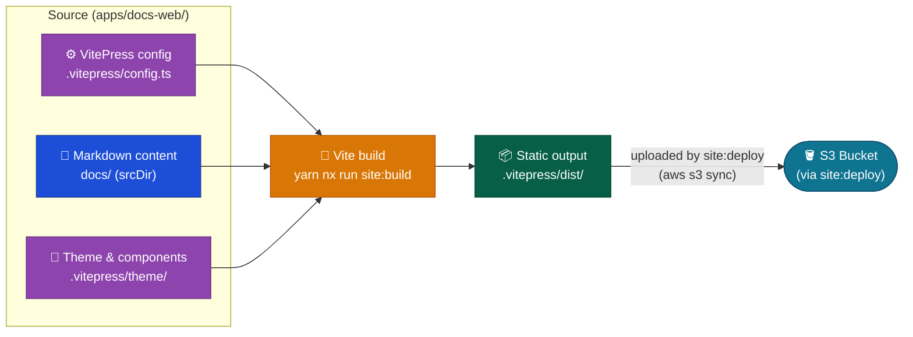

# Web Container

VitePress static documentation site.

## Baseline diagram

## Responsibilities

- Render Markdown content from `docs/` as a static site via VitePress
- VitePress configuration, sidebar navigation, and theme in `apps/docs-web/`
- Served at the CloudFront distribution origin — no server-side runtime
- Hosts the theme integration point for the Discuss container's comments widget (see `Containers/Discuss.md`)

## Technology

| Component        | Choice                                                                       |
| ---------------- | ---------------------------------------------------------------------------- |
| Site framework   | VitePress 1.x                                                                |
| Build tool       | Vite                                                                         |
| Content format   | Markdown                                                                     |
| Site title       | `DataArt ADLC Discovery` (tokenized in `config.ts`)                          |
| Site description | Evidence-led problem→solution framing, tokenized `DataArt` (see `config.ts`) |

## Navigation

Nav is five fixed items in `config.ts`, one per top-level `docs/` section. Sidebar per section is generated at build time by scanning the corresponding `docs/` subdirectory via the `scanSection` helper in `config.ts`. File numeric prefix (`00`, `01`, …) controls sidebar ordering. `index.md` and `README.md` files are excluded from sidebar items. `docs/index.md` uses the VitePress `layout: home` landing page; each top-level section maintains its own `index.md` as a mini-hero entry point.

## Key paths

| Path                             | Purpose                                |
| -------------------------------- | -------------------------------------- |
| `apps/docs-web/`                 | VitePress config and theme             |
| `docs/`                          | Markdown content (srcDir)              |
| `apps/docs-web/.vitepress/dist/` | Static build output (S3 upload target) |
