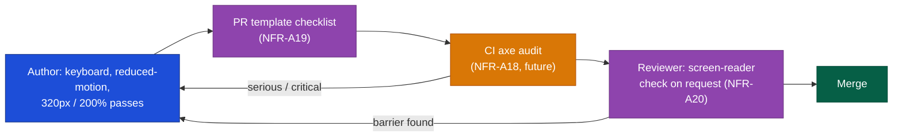

# Accessibility Requirements

## Scope

These requirements govern the two public web containers, Web Explorer (`apps/web-explorer`, React 19 + Vite SPA at the site root) and Web Docs (`apps/web-docs`, VitePress under `/docs/`), and the embedded Discuss widget (giscus) as far as this platform controls it. They apply to every page served from GitHub Pages and to every actor reaching it in a browser, with or without assistive technology. The target is WCAG 2.2 Level AA, stated in the root `ACCESSIBILITY.md` as a goal the site works toward, not a conformance claim. Requirements use IDs `NFR-A*` so they do not collide with `NFR-1..11` in `Requirements.md`.

## Requirements

| ID      | Category       | Requirement                                                                                                                                                                                                                                                                                                                                 | Priority | Verification                                                                                                                                                                                                                                                                                                                                                                                                       |
| ------- | -------------- | ------------------------------------------------------------------------------------------------------------------------------------------------------------------------------------------------------------------------------------------------------------------------------------------------------------------------------------------- | -------- | ------------------------------------------------------------------------------------------------------------------------------------------------------------------------------------------------------------------------------------------------------------------------------------------------------------------------------------------------------------------------------------------------------------------ |
| NFR-A1  | Perceivable    | Text contrast is at least 4.5:1 against its rendered background in the dark theme; large text (24px, or 19px bold) and UI component boundaries are at least 3:1                                                                                                                                                                             | P1       | Contrast check of every text/background token pair in `apps/web-explorer/src/styles.css` (`:root` block) and the VitePress theme overrides in `apps/web-docs/.vitepress/theme/`. No automated check today — gap; closed by the axe audit in NFR-A17 (`color-contrast` rule).                                                                                                                                       |
| NFR-A2  | Perceivable    | Every informative image has alternative text; decorative images use `alt=""`. Every diagram (Mermaid in Web Docs, React Flow in Web Explorer, SVG illustrations on the comic page) has a text equivalent adjacent to it: either the surrounding prose covers the full content, or a visually-hidden or collapsible text summary is provided | P1       | Review convention in the PR checklist (NFR-A18); the axe `image-alt` rule in NFR-A17 catches missing `alt`. No automated check covers diagram text equivalents — gap; reviewer inspection is the acceptance method.                                                                                                                                                                                                |
| NFR-A3  | Perceivable    | Content reflows at 320px CSS width and at 200% browser zoom with no horizontal scrolling and no loss of function. Pages under `/inside-the-loop` scale with CSS `zoom` (`--deck-zoom` in `inside-the-loop.css`); browser zoom applied on top must still produce readable, non-overlapping text                                              | P1       | Manual pass recorded in the PR checklist (NFR-A18): viewport set to 320px, then 200% zoom at 1280px, on every changed page. No automated check — gap; a Playwright viewport screenshot step in CI would close it.                                                                                                                                                                                                  |
| NFR-A4  | Perceivable    | Meaning is never conveyed by colour alone. Lifecycle strip tiles, step bullets, status pills and highlighted states pair colour with text or an icon                                                                                                                                                                                        | P1       | Reviewer inspection of changed components against the `ACCESSIBILITY.md` checklist; axe does not test this rule — gap, manual only.                                                                                                                                                                                                                                                                                |
| NFR-A5  | Operable       | All functionality is operable by keyboard alone; tab order follows reading order; there are no keyboard traps. This includes the scenarios widget (`TerminalScenarios.tsx`), the React Flow diagrams (`InsideLoopMap.tsx`, `DocsFlow.tsx`), `Modal.tsx` and the handoff into and out of the giscus iframe                                   | P1       | Manual keyboard pass recorded in the PR checklist (NFR-A18): Tab/Shift+Tab through the page, Enter/Space on every control, Escape closes the modal, focus returns to the opener. No automated check — gap.                                                                                                                                                                                                         |
| NFR-A6  | Operable       | Every focusable element shows a visible focus indicator with at least 3:1 contrast against its surroundings. No component overrides the global `:focus-visible` outline away                                                                                                                                                                | P1       | Code inspection: `styles.css:11` sets `button:focus-visible, a:focus-visible { outline: 2px solid var(--accent) }`; `docsFlow.css:58` restates it with the same outline. The global rule covers `button` and `a` only — any other focusable element (custom `tabindex`, React Flow nodes, inputs) needs its own rule. Checked by the manual keyboard pass (NFR-A5) and the axe `focus-visible` best-practice rule. |
| NFR-A7  | Operable       | A skip-to-content link is the first focusable element on every Web Explorer page and moves focus to the page's `<main>`                                                                                                                                                                                                                     | P1       | Does not exist today — gap. Closed by a `.skip-link` anchor rendered before `Header.tsx` in the app shell, verified by the manual keyboard pass and the axe `skip-link`/`bypass` rule.                                                                                                                                                                                                                             |
| NFR-A8  | Operable       | Any animation that auto-plays and lasts more than five seconds has a pause or stop control. All non-essential motion is disabled under `prefers-reduced-motion: reduce`                                                                                                                                                                     | P1       | Code inspection: `styles.css:96` zeroes animation and transition durations under reduced motion; `HeroPreview.tsx` and `TerminalScenarios.tsx` also read the media query and render fully revealed. The hero's looping terminal (`HeroPreview.tsx`) has no pause control — unmet today; closed by a pause button in the terminal chrome. Manual reduced-motion pass recorded in the PR checklist.                  |
| NFR-A9  | Operable       | No content flashes more than three times per second                                                                                                                                                                                                                                                                                         | P1       | Reviewer inspection of any new animation. No automated check — gap, manual only.                                                                                                                                                                                                                                                                                                                                   |
| NFR-A10 | Operable       | Every interactive target is at least 24x24 CSS px, or has 24px spacing from neighbouring targets                                                                                                                                                                                                                                            | P2       | Axe `target-size` rule in NFR-A17; until then, reviewer inspection of changed controls.                                                                                                                                                                                                                                                                                                                            |
| NFR-A11 | Understandable | `lang` is set on the document and on any passage written in another language                                                                                                                                                                                                                                                                | P1       | Code inspection: `apps/web-explorer/index.html` sets `<html lang="en">`; `apps/web-docs/.vitepress/config.ts` does not set `lang`, so Web Docs ships VitePress's default `lang="en-US"`. Axe `html-has-lang` rule in NFR-A17.                                                                                                                                                                                      |
| NFR-A12 | Understandable | Each page has exactly one `h1` and a heading hierarchy with no skipped levels                                                                                                                                                                                                                                                               | P1       | Axe `page-has-heading-one` and `heading-order` rules in NFR-A17; until then, reviewer inspection of the document outline.                                                                                                                                                                                                                                                                                          |
| NFR-A13 | Understandable | Link text describes its destination out of context; no "click here" or bare "here"                                                                                                                                                                                                                                                          | P2       | Axe `link-name` rule in NFR-A17 catches empty links; wording is reviewer inspection — gap for automation.                                                                                                                                                                                                                                                                                                          |
| NFR-A14 | Understandable | Every control has a programmatic name that matches its visible label; icon-only buttons carry `aria-label`                                                                                                                                                                                                                                  | P1       | Axe `button-name` and `label-content-name-mismatch` rules in NFR-A17. Current examples: `aria-label="Copy bootstrap command"` (`Landing.tsx`), `aria-label="Close"` (`Modal.tsx`), `aria-label={playing ? 'Pause' : 'Play'}` (`TerminalScenarios.tsx`).                                                                                                                                                            |
| NFR-A15 | Understandable | State changes that matter are announced through an ARIA live region: the copy-to-clipboard result in `get-started`, the scenarios widget transcript, and any future form error                                                                                                                                                              | P2       | Code inspection: `TerminalScenarios.tsx:137` and `HeroPreview.tsx:122` use `aria-live="polite"`. The copy result has no live region today — gap; closed by a `role="status"` element next to the copy button. Screen-reader spot check (NFR-A20).                                                                                                                                                                  |
| NFR-A16 | Robust         | Semantic HTML first; ARIA only where native semantics are insufficient. Custom controls expose role, name and state                                                                                                                                                                                                                         | P1       | Axe `aria-*` rules in NFR-A17 plus the screen-reader spot check (NFR-A20).                                                                                                                                                                                                                                                                                                                                         |
| NFR-A17 | Robust         | Every page passes an automated accessibility audit (axe-core) with zero serious or critical violations                                                                                                                                                                                                                                      | P1       | Does not exist today — gap. Closed by NFR-A18's CI job; until then, a Lighthouse accessibility run against the local build is the acceptance method.                                                                                                                                                                                                                                                               |
| NFR-A18 | Process        | An automated accessibility audit runs in CI on affected web projects and fails the build on serious or critical violations                                                                                                                                                                                                                  | P1       | Does not exist today — gap. Closed by an `a11y` target per web project (axe-core via Playwright, or `@axe-core/cli` against the built `dist`) wired into `nx affected` in `.github/workflows/ci-web.yml`.                                                                                                                                                                                                          |
| NFR-A19 | Process        | Every PR that changes `apps/web-explorer` or `apps/web-docs` records the manual keyboard, reduced-motion and 320px/200% passes                                                                                                                                                                                                              | P1       | `.github/PULL_REQUEST_TEMPLATE.md` checkbox; reviewer refuses approval when it is unchecked for a UI change. Checked box with no evidence is not acceptance — the reviewer asks what was tested.                                                                                                                                                                                                                   |
| NFR-A20 | Process        | New or changed interactive components get a screen-reader spot check (VoiceOver at minimum) before merge                                                                                                                                                                                                                                    | P2       | Reviewer requests it on the PR; the author records the result in the PR description. No automated substitute exists.                                                                                                                                                                                                                                                                                               |
| NFR-A21 | Process        | Accessibility reports are triaged with the severity taxonomy (Critical / Serious / Moderate / Minor) from `ACCESSIBILITY.md`; its Known limitations section is updated when a barrier is confirmed or fixed                                                                                                                                 | P1       | Reports arrive through `.github/ISSUE_TEMPLATE/accessibility_barrier.yml`; the triager sets the severity label on the issue. Verified by inspecting open issues — manual.                                                                                                                                                                                                                                          |

## Flows

A UI change passes through the author's manual passes, the PR checklist, the CI audit and an optional screen-reader check before merge.

Reported barriers follow a second flow: issue form → severity triage per `ACCESSIBILITY.md` → fix → Known limitations updated.

## Constraints

- Static hosting only: no server-side rendering or user-agent sniffing; every requirement is met in the shipped HTML, CSS and JavaScript.
- The giscus iframe (Discuss) and React Flow (`@xyflow/react`) are third-party. Their internal accessibility is best effort: this platform controls the handoff into them and the text equivalent around them, and records anything beyond that as a known limitation in `ACCESSIBILITY.md` rather than claiming conformance.
- The `/inside-the-loop` section's CSS `zoom` scaling is inherited from the ported source deck; NFR-A3 applies to its rendered result, not to the technique.
