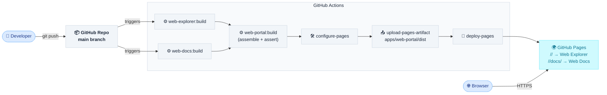

# System Overview

## Purpose

ADLC Discovery Tool is a static documentation site delivering an AI-first SDLC adoption programme. The site hosts discovery materials, workshop outputs, and design decisions, and is open-sourced via GitHub Pages.

## Containers

| Container             | Responsibility                                                                                                                                         | Stack                                 |
| --------------------- | ------------------------------------------------------------------------------------------------------------------------------------------------------ | ------------------------------------- |
| Web Explorer          | Promotional single-page app                                                                                                                            | React 19 · Vite · Tailwind 4 · Motion |
| Web Docs              | Static documentation site rendered from Markdown via VitePress                                                                                         | VitePress 1.x · Vite                  |
| Web Portal            | Build-time composition of Web Explorer's and Web Docs's static builds into one deployable artifact tree — no application source, no runtime of its own | Nx (`nx:run-commands`) · TypeScript   |
| Discuss               | Client-side comments widget on doc pages, backed by GitHub Discussions — no infra of our own                                                           | giscus (external)                     |
| Harness Bootstrap E2E | Test harness validating the `harness-bootstrap` skill — deterministic unit/integration coverage plus live agent E2E runs                               | Vitest · Nx · TypeScript              |

Harness Bootstrap E2E is dev/CI tooling, not a runtime participant in the browser-facing request flow below — it tests the `harness-bootstrap` skill against disposable fixture workspaces and has no presence in the deployed site. Its deterministic layers run inside `ci.yml`; its agent E2E layer runs only from a developer's own environment. See `Containers/Harness Bootstrap E2E.md`.

## System diagram

_Comments runtime flow (giscus/GitHub Discussions) is shown in `Containers/Discuss.md`._

## Design principles

- Region is deployment configuration — never hardcoded in source or documentation
- Content is static — no server-side rendering, no database, no runtime compute we operate (excludes third-party client-side widgets that call external services directly from the browser, e.g. giscus)
- Carve-out: `docs/.og/docs-operational-graph.sqlite` is a build-time-produced, read-only SQLite file queried in-browser via `sql.js` (WASM) — a first-party query engine over first-party static data, not server-side compute we operate

## Tooling

Binding workspace decisions that apply across all containers.

| Tool        | Version        | Pinned by                                 |
| ----------- | -------------- | ----------------------------------------- |
| Node.js     | 24             | `.nvmrc`                                  |
| Yarn        | 4.x            | `packageManager` in root `package.json`   |
| NX          | 23.x           | root `package.json` devDependencies       |
| Module mode | ESM            | `"type": "module"` in root `package.json` |
| ESLint      | v9 flat config | `eslint.config.js` at workspace root      |

TypeScript base: `tsconfig.base.json` — `module: ES2022`, `moduleResolution: bundler`. Each container extends this base and overrides for its own emit target.
