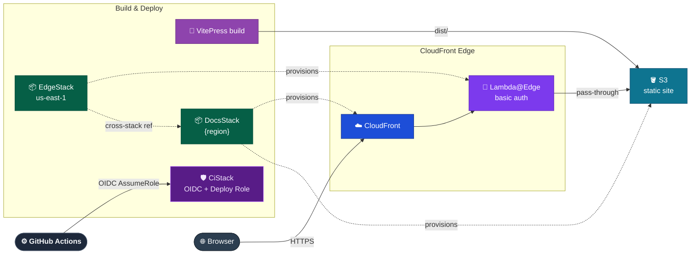

# System Overview

## Purpose

ADLC Discovery Tool is a password-protected static documentation site delivering an AI-first SDLC adoption programme. The site hosts discovery materials, workshop outputs, and design decisions produced during the DataArt × DataArt engagement.

## Containers

| Container             | Responsibility                                                                                                              | Stack                    |
| --------------------- | --------------------------------------------------------------------------------------------------------------------------- | ------------------------ |
| Web                   | Static documentation site rendered from Markdown via VitePress                                                              | VitePress 1.x · Vite     |
| Auth                  | Lambda@Edge handler enforcing basic auth password gate on every CloudFront request                                          | Node.js · TypeScript     |
| Infrastructure        | CloudFront distribution, S3 origin, Lambda@Edge association, IAM roles; GitHub OIDC provider and CI deploy role (`CiStack`) | AWS CDK · TypeScript     |
| Discuss               | Client-side comments widget on doc pages, backed by GitHub Discussions — no infra of our own                                | giscus (external)        |
| Harness Bootstrap E2E | Test harness validating the `harness-bootstrap` skill — deterministic unit/integration coverage plus live agent E2E runs    | Vitest · Nx · TypeScript |

Harness Bootstrap E2E is dev/CI tooling, not a runtime participant in the browser-facing request flow below — it tests the `harness-bootstrap` skill against disposable fixture workspaces and has no presence in the deployed site. Its deterministic layers run inside `ci.yml`; its agent E2E layer runs only from a developer's own environment. See `Containers/Harness Bootstrap E2E.md`.

## System diagram

_Response path (401 challenge and cached asset delivery) is shown in `Containers/Auth.md`. Comments runtime flow (giscus/GitHub Discussions) is shown in `Containers/Discuss.md`._

## Design principles

- All infrastructure is code (AWS CDK) — nothing provisioned manually
- Region is deployment configuration — never hardcoded in source or documentation
- Content is static — no server-side rendering, no database, no runtime compute we operate beyond edge auth (excludes third-party client-side widgets that call external services directly from the browser, e.g. giscus)

## Tooling

Binding workspace decisions that apply across all containers.

| Tool        | Version        | Pinned by                                 |
| ----------- | -------------- | ----------------------------------------- |
| Node.js     | 24             | `.nvmrc`                                  |
| Yarn        | 4.x            | `packageManager` in root `package.json`   |
| NX          | 23.x           | root `package.json` devDependencies       |
| Module mode | ESM            | `"type": "module"` in root `package.json` |
| ESLint      | v9 flat config | `eslint.config.js` at workspace root      |

TypeScript base: `tsconfig.base.json` — `module: ES2022`, `moduleResolution: bundler`. Each container extends this base and overrides for its own emit target.
