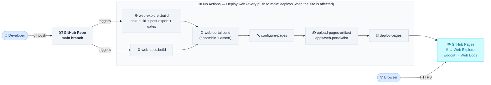

# System Overview

## Purpose

ADLC Discovery Tool is a static documentation site delivering an AI-first SDLC adoption programme. The site hosts discovery materials, workshop outputs, and design decisions, and is open-sourced via GitHub Pages.

## Containers

| Container                  | Responsibility                                                                                                                                                                                                                                                                                    | Stack                                                                                           |
| -------------------------- | ------------------------------------------------------------------------------------------------------------------------------------------------------------------------------------------------------------------------------------------------------------------------------------------------- | ----------------------------------------------------------------------------------------------- |
| Web Explorer               | Promotional multi-route site, pre-rendered to one static page per route at build time                                                                                                                                                                                                             | Next.js 16 (App Router, static export) · React 19 · Tailwind 4 · Motion                         |
| Web Docs                   | Static documentation site rendered from Markdown via VitePress                                                                                                                                                                                                                                    | VitePress 1.x · Vite                                                                            |
| Web Portal                 | Build-time composition of Web Explorer's and Web Docs's static builds into one deployable artifact tree — no application source, no runtime of its own                                                                                                                                            | Nx (`nx:run-commands`) · TypeScript                                                             |
| Discuss                    | Client-side comments widget on doc pages, backed by GitHub Discussions — no infra of our own                                                                                                                                                                                                      | giscus (external)                                                                               |
| Implementation Harness E2E | Test harness validating the `implementation-harness` skill package and the repo's release tooling — deterministic unit/integration coverage plus live agent E2E runs                                                                                                                              | Vitest · Nx · TypeScript                                                                        |
| Log Hub                    | Dev tooling: opt-in, repo-managed local Log Hub server (Docker Compose) plus a local-scope Claude Code hook that uploads session telemetry; no presence in the deployed site                                                                                                                      | Docker Compose · TypeScript scripts run via `tsx` · Nx (`nx:run-commands`) · Claude Code plugin |
| Harness Release Pipeline   | CI tooling and the repo's only release lane: each PR stamps the harness version (`yarn harness:version`, checked by `version-gate`); on merge `deploy-harness.yml` builds and attests it, and after approval in the `release` environment tags and publishes it to its five distribution channels | GitHub Actions · Nx Release                                                                     |

Implementation Harness E2E is dev/CI tooling, not a runtime participant in the browser-facing request flow below — it tests the `implementation-harness` skill (source `skills/implementation-harness/`) against disposable fixture workspaces and has no presence in the deployed site. Its deterministic layers run inside the PR workflows `ci-web.yml` and `ci-harness.yml`; its agent E2E layer runs only from a developer's own environment. See `Containers/Implementation Harness E2E.md`.

Log Hub is dev tooling, not a runtime participant in the browser-facing request flow below — it runs only on a contributor's own machine, is opt-in, and never runs in CI runtime or the GitHub Pages build. It is not registered in `apps/web-portal`'s composed deploy tree. See `Containers/Log Hub.md`.

## System diagram

_Not shown here: the comments runtime flow (`Containers/Discuss.md`); the dev-tooling telemetry flow (`Containers/Log Hub.md`); and the harness release lane — CI tooling, not a request-flow participant: `deploy-harness.yml` builds on push to `main`, separately from this Pages deploy, and after a reviewer approves ships the npm package, the Release ZIP and the tag the marketplace and `gh skill` pin, while skills.sh installs from the default branch (`Containers/Harness Release Pipeline.md`)._

## Design principles

- Region is deployment configuration — never hardcoded in source or documentation
- Content is pre-rendered to static files at build time — no request-time rendering, no database, no runtime compute we operate (excludes third-party client-side widgets that call external services directly from the browser, e.g. giscus; also excludes opt-in, contributor-machine-only dev tooling with no deployed-site presence, e.g. Implementation Harness E2E, Log Hub)
- Carve-out: `docs/.og/docs-operational-graph.sqlite` is a build-time-produced, read-only SQLite file queried in-browser via `sql.js` (WASM) — a first-party query engine over first-party static data, not server-side compute we operate

## Tooling

Binding workspace decisions that apply across all containers.

| Tool        | Version        | Pinned by                                 |
| ----------- | -------------- | ----------------------------------------- |
| Node.js     | 24             | `.nvmrc`                                  |
| Yarn        | 4.x            | `packageManager` in root `package.json`   |
| NX          | 23.x           | root `package.json` devDependencies       |
| Module mode | ESM            | `"type": "module"` in root `package.json` |
| ESLint      | v9 flat config | `eslint.config.js` at workspace root      |

TypeScript base: `tsconfig.base.json` — `module: ES2022`, `moduleResolution: bundler`. Each container extends this base and overrides for its own emit target.
