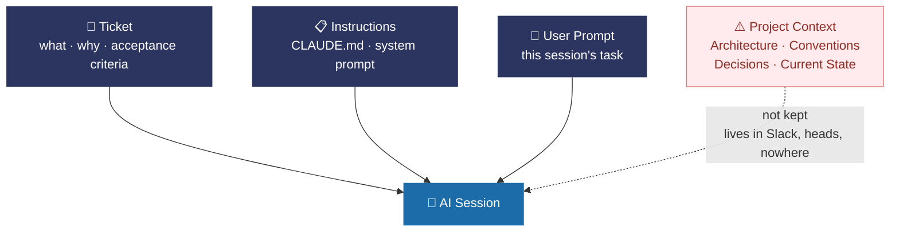

# Software Development Lifecycle

The why behind DataArt's platform: the industry-wide story, and what ADLC — the engagement telling this story — does about it.

---

## 1. The Wheel Works

> AI is already on every spoke. The question is whether it is doing so productively — or just fast.


The SDLC is 40 years old and it works. Analysis → Design → Implementation → QA → Deployment →
Maintenance. The names change — Waterfall, Agile, SAFe, Shape Up — but the wheel stays the same.
Every serious engineering team runs some version of it. AI tools are already present on every spoke.
The question is not _whether_ AI is touching the wheel — it is **whether it is doing so
productively, or just fast**.

Most teams have adopted AI at the tool level: autocomplete, code generation, chat. Output is faster.
Quality is inconsistent. The wheel still turns, but it wobbles — because the AI has no idea what
project it is working on, what decisions have already been made, or what the team conventions are.
It executes fast and directionless.

---

For the concrete tool landscape, see [Tools Across the Six SDLC Stages](<../Harness/01 Explore/04 SDLC Tool Coverage.md>): stage-specific features, assessed capability depth, and explicit gaps.

## 2. But Something Is Wrong

> These problems do not disappear with AI. They get faster.


The SDLC has well-known friction points that exist on every project, with or without AI.
Requirements drift mid-cycle. Knowledge degrades at every handoff — from business to design, design
to dev, dev to QA. Estimates are made earliest, when the team knows least. Testing is a gate at the
end rather than a signal throughout. Critical decisions accumulate in the heads of a few people, and
when they leave, the project loses its institutional memory.

These problems do not disappear with AI. They get faster. An AI assistant acting on stale
requirements, incomplete handoff notes, or contradicted conventions produces plausible output that
is quietly wrong in ways that only surface later — under deadline pressure, in production, or when a
new team inherits the codebase.

---

## 3. What It Actually Looks Like

> Context does not disappear. It moves — into the prompt. Or into a mistake.



Three things feed every AI session. The **ticket** carries intent — what to build and why.
**Instructions** carry how the team works — when they exist and are current. The **user prompt**
carries what the developer needs right now. In most teams, none of the three carry reliable
project-specific signal. Tickets have requirements but not conventions. Instructions are generic or
absent. The user prompt is ad-hoc by definition.

Project context — architecture decisions, accepted tradeoffs, current conventions, delivery state —
is not kept in any of them. It lives in Slack threads, in heads, and in whoever has been on the
project long enough to remember.

The developer has two options.

**Without context — the short prompt:**

```
Add auth to the checkout flow
```

The AI produces something plausible. Wrong cookie strategy. Contradicts ADR-04. Does not know the
session service exists. Passes review if nobody checks.

**With context — the long prompt:**

```
Add auth to the checkout flow.

We use JWT with httpOnly cookies, refresh token rotation every 15 min.
No 3rd party providers — see ADR-04.
Session service at /api/v2/session (src/services/session.ts).
Follow the AuthContext pattern from the user profile feature.
TypeScript strict mode. Error handling: see src/middleware/auth.ts.
Checkout flow is in src/features/checkout — do not touch the payment module.
```

The AI produces correct output. But the burden is entirely on the human — every session, every
developer, every new hire. It resets with every conversation. It degrades at every handoff. When the
person who wrote that prompt leaves, the knowledge leaves with them.

---

## 4. The Root Cause: Context

> Project Context is the most unstable layer in the stack — and the most valuable for AI. It is the
> one that is not kept.


Every project sits inside a stack of context layers. Business Context — product vision, OKRs,
regulatory requirements — is owned and governed by the organisation. Technical Context —
architecture standards, ARB governance, security patterns — is negotiated and maintained. These
layers exist. They are documented. They are maintained.

What is routinely missing is **Project Context**: the live, current, non-contradictory record of
what was decided, what was built, and how this project works. It changes every sprint, lives in
Slack threads, and resets with every new AI session. It is the most volatile layer in the stack —
and the most valuable for AI-assisted development. Without it, the AI has no project-specific signal
and falls back to generic patterns. An AI without Project Context is a navigator handed only the
country map. It knows the destination. It will drive confidently — and miss the turn.

---

## 5. Where Teams Get Stuck

> - Code AI is a faster keyboard.
> - Workflow AI is a faster assembly line.
> - Neither changes what the AI knows about your project.

There are three tiers of AI adoption.


- **Code AI** writes functions on demand — no project context, same output on every codebase.
- **Workflow AI** executes a predefined task end to end — no memory between sessions, direction
  resets every time. Most teams are somewhere on this ladder, moving fast but not accumulating
  anything. Each session is an isolated event. Each new team member — human or AI — starts from
  zero.
- **Assisted AI**: encoding how _this team_ thinks, making that encoding persistent, and improving
  it over time. This is not about a smarter model. It is about giving the model the right
  project-specific signal — architecture decisions, conventions, current state — so it behaves like
  a team member who was properly onboarded, not a contractor who just arrived.

---

For concrete options, see [Competitors and Related Tools](<../Harness/01 Explore/01 Competitors and Related Tools.md#three-tiers-of-adoption>): how delivery methodologies, specification tools, and composable skills relate to these tiers. The tiers describe adoption practices, not fixed product rankings; several tools support persistent context when a team maintains it.

## 6. The Fix: The Harness

> Code is a derivative. Documents are the product.


The harness does not replace the SDLC. It wires **structured, non-contradictory, scoped context**
into each phase. The core principle is simple: **code is a derivative. Documents are the product.**
Every lifecycle phase has a defined output — not code alone, but a document that captures what was
decided and what was built. The AI writes both, as part of the same workflow.

The mechanism is a three-link chain. The `/design` lifecycle takes a ticket and produces an approved
HLD — the authoritative statement of how the system must be built. The `/dev` lifecycle implements
against the HLD and writes the LLD — the record of what was actually built. `/where-we-are` diffs
the two at any point. The gap is delivery debt, made visible on demand rather than discovered in a
crisis. Because HLD and LLD always reflect current state, the AI can reconstruct the full picture of
the project in any session, on any stack, for any team member.
