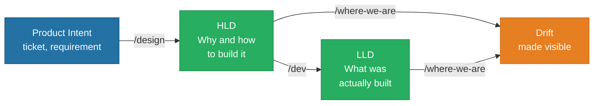
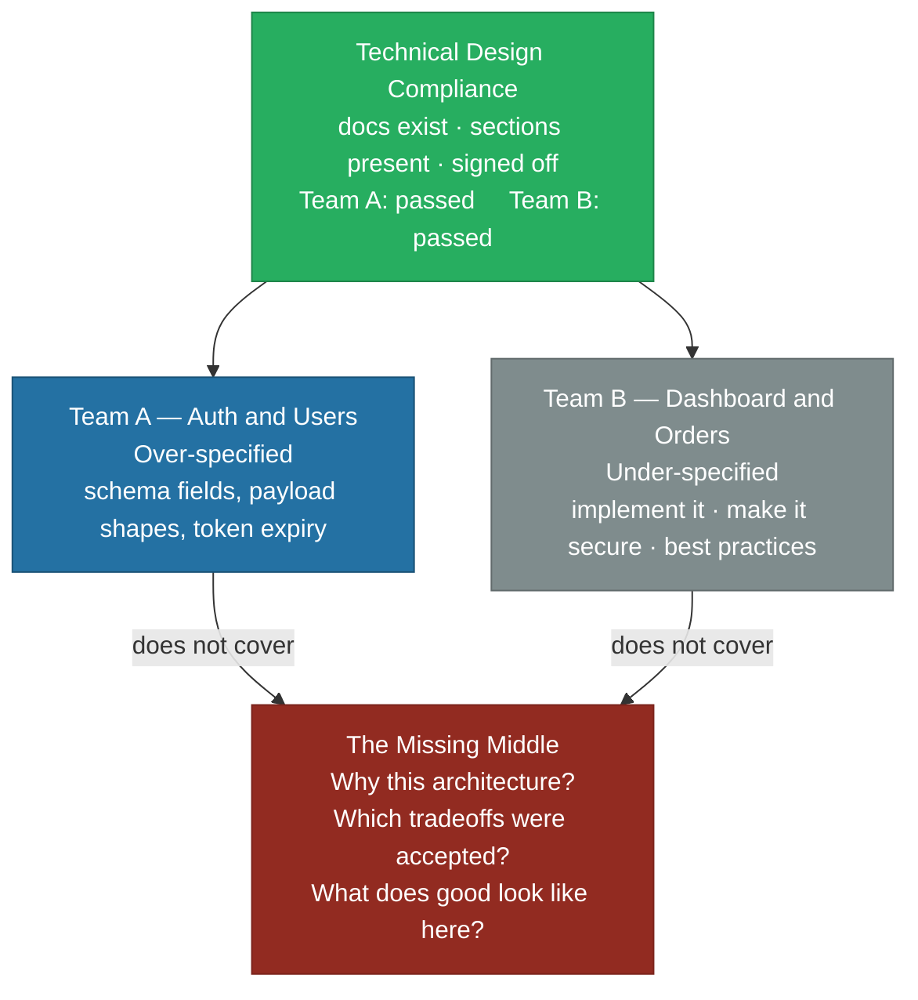
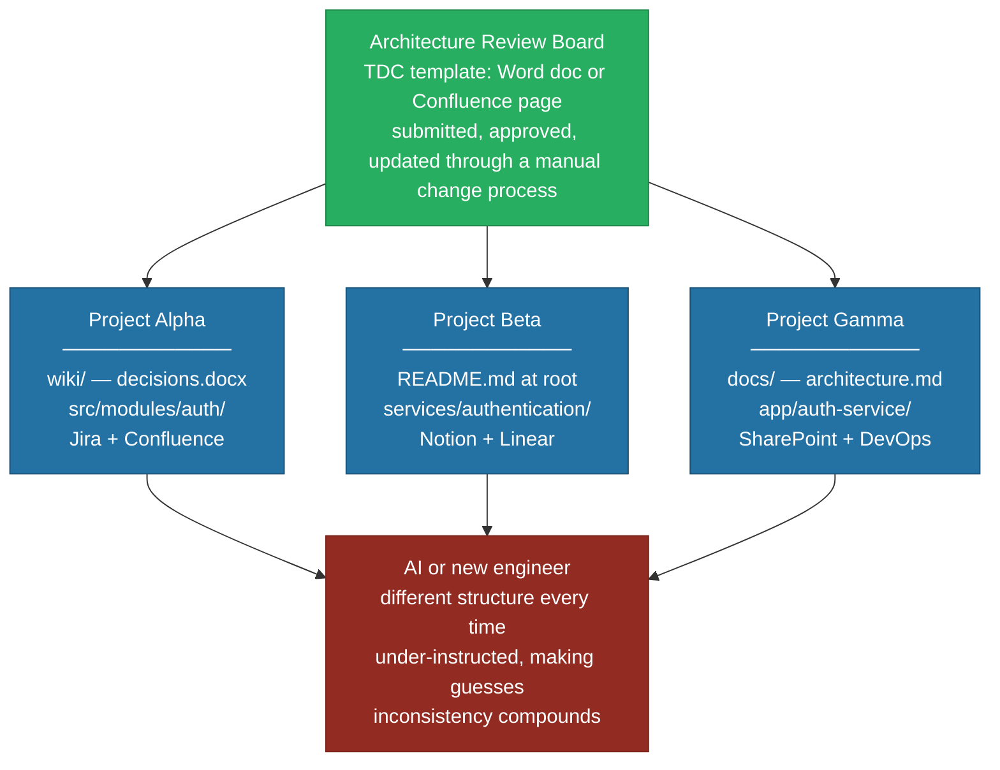
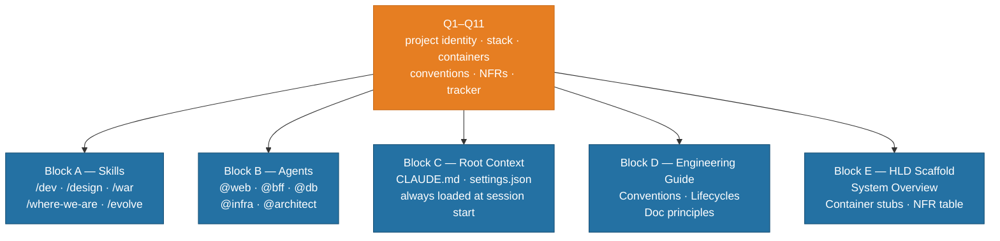
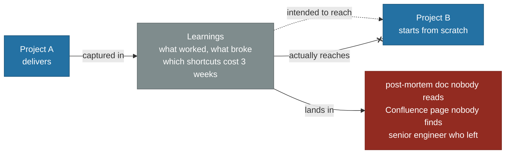
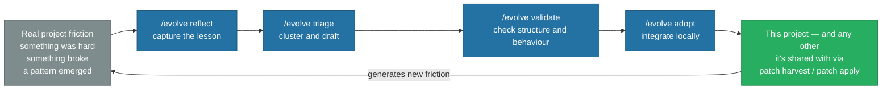
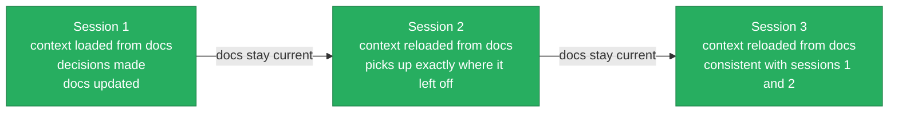

# The Challenges — Diagnoses and Answers

Think about onboarding a new engineer. You would give them:

- the system architecture — how the product is designed and why
- the team conventions — how things are done here, not just anywhere
- the current state — what has been built, what has diverged, what is still pending
- a scoped task — one ticket, not the whole backlog

Without that onboarding, a senior engineer will still produce output — fast, confident, and inconsistent. They will contradict decisions already made, miss conventions already established, and lose thread between sessions.

**An AI assistant has exactly the same problem.** Every session starts from zero. It has no memory of your architecture decisions, no awareness of your conventions, and no connection to your documentation. Execution is fast. Direction is absent.

The fix is the same as with a new colleague: structured onboarding, maintained context, and a shared source of truth that stays current as the project evolves. Ten specific challenges follow. Most live at the project level, where the harness closes the gap directly — making the right context a first-class output of the work itself, not more process. A few live one layer up, at the Business or Technical/Integration Context that sits above any single project — those need wiring the [Context Topology](/The%20Story/02%20Context%20Landscape.md) itself, not just running the harness once. One more — [The Mental Model Shift](./04%20The%20Mental%20Model%20Shift.md) — isn't a context-wiring problem at all; it's about whether the people running the harness have adopted the mindset it requires, so it gets its own page.

---

## The Drift

> **Decisions live in Slack. Documentation describes a system that no longer exists.**

This is not a new problem. It exists on every project, with or without AI.

The gap between all three compounds over time. Decisions made six months ago are invisible. The documentation describes a system that no longer exists. Implementation becomes the only source of truth — by accident, not by design. A human engineer at least carries some of that history in memory. An AI starts from zero — and if the context it receives is stale, partial, or contradictory, its output will be too.

**How to address this — the harness (Project Context):** the drift happens because documentation is treated as an afterthought, written once and abandoned. The harness makes docs a required output of every phase, not a separate task.

> Docs as a Lifecycle Output — not a separate task.

| Phase           | What ships                                                           |
| --------------- | -------------------------------------------------------------------- |
| `/design`       | Approved solution published to HLD — decisions, tradeoffs, rules     |
| `/dev`          | Implementation documented in LLD — what was built, deviations logged |
| `/where-we-are` | HLD vs LLD diff — delivery debt made visible at any point            |

Decisions, implementation, and documentation stay in sync because the workflow enforces it — not because teams remember to update the wiki.

---

## The Uneven Depth

> **Over-documented where it doesn't matter. Silent where it does.**

Meet the customer portal. Two teams. Both have docs in Confluence. Both passed Technical Design Compliance.

| Area               | Team A wrote                            | Team B wrote              | AI produces                                                       |
| ------------------ | --------------------------------------- | ------------------------- | ----------------------------------------------------------------- |
| **Auth**           | JWT payload fields, token expiry: 3600s | "implement secure auth"   | Invents the session strategy — contradicts undocumented decisions |
| **Error handling** | HTTP status codes per endpoint          | "handle errors properly"  | Applies generic patterns — misses any project convention          |
| **Performance**    | _(not documented)_                      | _(not documented)_        | Assumes generic targets — actual SLAs exist nowhere               |
| **Dashboard data** | _(not in scope for Team A)_             | "show relevant user info" | Invents the data model — inconsistent with Team A's schema        |

The problem is not that teams write too much or too little. It is that **TDC checked whether docs exist — not whether they are useful.** The middle layer — why decisions were made, what tradeoffs were accepted, what good looks like on this project — is absent from both teams. A human engineer fills that gap from experience and asking colleagues. **An AI fills it with generic patterns** — plausible, consistent with itself, and quietly wrong in ways that only surface later.

**How to address this — the harness (Project Context):** the missing middle is exactly what the HLD is designed to hold. The harness enforces a three-layer structure where each layer has a specific purpose and a specific level of abstraction.

> The Right Layer at the Right Level

| Layer                 | What it holds                                              | What it does NOT hold                           |
| --------------------- | ---------------------------------------------------------- | ----------------------------------------------- |
| **HLD**               | Why this architecture. Which tradeoffs. Rules and KPIs.    | Field names, payload shapes, enum values        |
| **LLD**               | What was actually built. Deviations from HLD.              | Intentions, aspirations, generic best practices |
| **Engineering Guide** | How this team works. Conventions specific to this project. | Generic "best practices"                        |

The `/design` lifecycle forces the rationale to be written and approved **before** a line of code is written. The middle layer is no longer optional — it is the gate.

---

## Inconsistent Topology

> **No two projects speak the same language. Every contributor navigates by guesswork.**

Every team, every project, every engagement starts from scratch — different folder structures, different naming conventions, different doc formats, different definition of "done." In regulated industries, architecture must pass an **Architecture Review Board** via a Technical Design Compliance document — real work: security posture, cost estimates, alignment with company standards. But the ARB operates at the **company level**. It does not produce a project-level skeleton. Once approved, every project is still on its own.

| Project A                              | Project B                            | Project C                               |
| -------------------------------------- | ------------------------------------ | --------------------------------------- |
| `wiki/` — Word docs, Jira + Confluence | `README.md` at root, Notion + Linear | `docs/` — Markdown, SharePoint + DevOps |

The ARB is not the problem. The gap is one level below it — at the project level, there is no shared skeleton. Every new engineer, every SA scoping a project, every team inheriting a legacy codebase pays the cost of that missing skeleton. There is no portable foundation — only starting over.

**How to address this — the harness (Project Context):** the harness-bootstrap generates a consistent project-level skeleton in a single session, from Q1–Q11 answers about the specific project.

> Bootstrap Once, Own Forever

Every project starts from the same skeleton — consistent structure, consistent conventions, consistent place for every type of artifact. The AI always knows where things are. Not replacing company governance — complementing it one layer down.

---

## No Feedback Loop

> **Hard-won patterns die with the project. The next team starts from zero.**

Hard-won lessons stay in post-mortems, retrospectives, and the memories of people who were there. The next project inherits the same starting point — and often the same mistakes.

The cost is invisible because the next project never knows what it missed.

**How to address this — the harness (Project Context):** hard-won patterns are captured, validated, and adopted back into the project's harness through a dedicated lifecycle, not left in a post-mortem nobody reads.

> The Evolve Lifecycle

The harness is a living platform. Every project improves it locally through Evolve; cross-project sharing is a separate, bootstrap-level `patch harvest` / `patch apply` step. Every lesson compounds.

---

## Session Amnesia

> **Good context at 9am. Gone by tomorrow.**

Even when an AI is given good context at the start of a session, it does not persist. The next session starts from zero. Mid-session, context degrades as the conversation grows. There is no memory of decisions made last Tuesday, no awareness of the convention established three sprints ago.

A team that runs AI without structured context management is re-onboarding a new colleague every morning.

**How to address this — the harness (Project Context):** not by giving the AI memory, but by making the context structured enough to reload instantly at the start of any session.

> Structured, Reloadable Context

| What gets loaded | What it contains                                                          |
| ---------------- | ------------------------------------------------------------------------- |
| `CLAUDE.md`      | Project identity, stack, containers, guarded commands — always in context |
| HLD              | Current architectural decisions — authoritative, always up to date        |
| LLD              | Current system state — what was actually built                            |
| Scoped agents    | `@web`, `@bff`, `@infra` — each sees only its container, no noise         |

The difference: sessions are no longer isolated events. They are a continuous thread — because the docs are the memory.

---

## The Legacy Wall

> **Most of the codebase predates AI tooling entirely — and it shows.**

A mature engineering estate rarely looks like one coherent system. It's usually a long-lived core platform wrapped in layers of custom integrations, in-house tooling built to plug specific gaps over the years, and connective work joining CRM, third-party services, and internal data pipelines. None of that context is written down anywhere an AI tool can read it — it lives in the judgment of the engineers who built it. An AI working against that estate produces code that looks right at first glance and takes real effort to unwind, because the tradeoffs behind the existing system were never externalized.

**How to address this — the harness (Project Context):** bootstrap the harness onto the project as it stands today, not a greenfield assumption — the first pass writes LLD to match what's actually built, including what only ever lived in engineers' heads. From there, the same fix as Drift and Uneven Depth keeps HLD and LLD aligned going forward. What's true for this estate is captured live as discovery workshops run, not assumed generically here.

---

## The Fragmentation

> **Divergence that looks manageable inside one team compounds into an estate-wide problem.**

Teams pick up AI tools independently, and each choice makes sense on its own: a different assistant here, a different convention there. Multiply that across enough teams and the estate stops having one shape at all.

**How to address this — wiring Context Topology (Technical · Integration Context), not the harness alone:** this is Inconsistent Topology at estate scale, one layer up at the [Technical and Integration Context](/The%20Story/02%20Context%20Landscape.md) most teams assume is already shared. One project's harness gives that project a consistent skeleton — it doesn't keep every team's skeleton the same. Closing the gap means wiring that same skeleton across the estate, team by team: one team adopting it is a preference, every team adopting it is a standard.

---

## The Governance Gap

> **Security policy predates agentic AI — silent on what it can read, generate, or send.**

Depending on the organisation, those questions carry their own regulatory, customer-data, or intellectual-property dimensions — specifics that a generic enterprise AI policy, written for no industry in particular, simply doesn't cover.

| Governance question                  | Generic enterprise AI policy | What actually needs answering                                                   |
| ------------------------------------ | ---------------------------- | ------------------------------------------------------------------------------- |
| What can AI read?                    | "Sensitive data" (undefined) | Customer/PII data, pre-release or confidential material, partner contract terms |
| What can AI generate?                | Not addressed                | Output that could be mistaken for an approved, reviewed deliverable             |
| Where do prompts and outputs end up? | Not addressed                | Third-party model providers, logged where legal/compliance needs visibility     |

**How to address this — wiring Context Topology (Business Context), not the harness alone:** governance is owned at the [Business Context](/The%20Story/02%20Context%20Landscape.md) layer, above any single project — the harness can't generate a policy any more than it can set company goals. What it contributes: scoped agents (`@web`, `@auth`, `@infra`) restrict what an AI session reads and writes, and NFR docs plus guarded commands make sensitive operations explicit — legible enough to plug into a policy once one exists. The organisation's actual regulatory and IP obligations are diagnosed as part of that discovery, not assumed generically here.

---

## The Attribution Gap

> **Nobody can tell finance which teams get real value from AI spend, or which workloads just burn budget.**

Engineers are using AI tools across a growing number of workloads, and spend is climbing with them. The attribution to go with it doesn't exist yet.

| Finance's question                                | Current answer |
| ------------------------------------------------- | -------------- |
| Which teams get proportional value from AI spend? | Unknown        |
| Which workloads justify their usage?              | Unknown        |
| Which usage patterns burn budget without output?  | Unknown        |

**How to address this — session observability and dashboards:** the fix is instrumentation — session-level usage dashboards like DataArt's own [Artisyn Log Hub](https://artisyn-log-hub.labs.dataart.com/), or [LinearB](https://linearb.io/), rolled up by team, workload, and outcome. The harness gives that instrumentation something coherent to group by: scoped phases with defined outputs (`/design`, `/dev`, `/where-we-are`), so usage attributes to a phase or ticket, not one undifferentiated total. The actual baseline is diagnosed as part of that discovery, not assumed generically here.

---

## Vendor Lock-In

> **Whatever a team is running today will not be what they're running in eighteen months.**

Organisations that invest in a tool-agnostic context foundation now don't have to start over every time a new tool takes the lead. Organisations that build their whole workflow around today's specific tool do.

**How to address this — the harness (Project Context):** this is the harness's founding constraint: root context, conventions, and lifecycles live as portable Markdown, mapped to each AI tool's primitives (see [AI Coding Tool Compatibility](/Engineering%20Guide/04%20AI%20Coding%20Tool%20Compatibility.md)) rather than hard-coded into one vendor's format. Swapping tools later means re-wiring an adapter layer, not rebuilding the foundation.

---

## The Common Answer

Every challenge has the same fix at its core:

> **Make the right context a first-class output of the work — not a by-product that gets skipped under pressure.**

The harness does not add documentation overhead. It restructures the work so that documentation is what the work produces. The code is the derivative.
